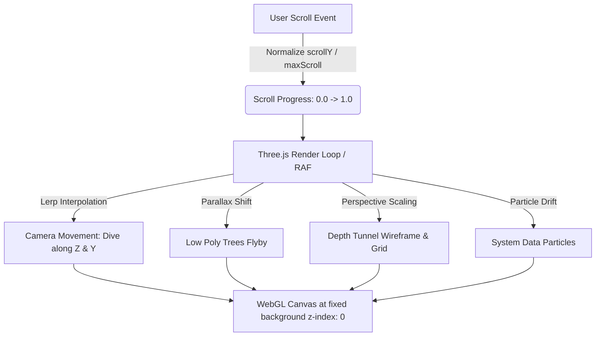

# Kế Hoạch Thiết Kế: 3D System Depth Background (Low Poly Forest & Cyber Tunnel)

## 1. Phân Tích Bài Toán (Problem Analysis)

### 1.1 Mục tiêu thiết kế
- Tích hợp không gian 3D tương tác phong cách **"The Mindverse" / "Engineered Curiosity"** từ bản mẫu vào trang chủ [src/pages/index.astro](file:///Users/macbookair/Downloads/huynh_minh_tri/tri-portfolio/src/pages/index.astro).
- **Rừng cây Low Poly (Low Poly Tech Forest)**: Xuất hiện các cụm cây lớn nhỏ dưới nền, đặt lệch về hai biên (trái/phải) để không che khuất chữ và nội dung portfolio.
- **Đường viền tạo độ sâu (Depth Frame / Perspective Tunnel)**: Tạo khung phối cảnh kỹ thuật số đa tầng hướng tâm, tạo cảm giác cổng không gian dẫn vào chiều sâu hệ thống.
- **Hiệu ứng cuộn chuột (Scroll-driven Descent)**: Khi người dùng kéo trang xuống (từ Hero qua Education, Experience, Projects đến Contact), camera 3D và không gian sẽ tiến dần vào chiều sâu (Z-axis dive), tạo cảm giác như đang thâm nhập sâu vào tầng lõi kiến trúc của hệ thống phần mềm.

### 1.2 Hiện trạng kiến trúc hiện tại
- Trang [index.astro](file:///Users/macbookair/Downloads/huynh_minh_tri/tri-portfolio/src/pages/index.astro) đang sử dụng layout [BaseLayout.astro](file:///Users/macbookair/Downloads/huynh_minh_tri/tri-portfolio/src/layouts/BaseLayout.astro).
- Trong `BaseLayout.astro` hiện có lớp nền phẳng `.ambient-layer` vẽ bằng CSS gradients (cành cây tĩnh mờ ảo).
- Dự án chạy Astro 7 + Vite, chưa có thư viện `three` trong `package.json`.
- Cần tối ưu hiệu năng tuyệt đối để WebGL 3D chạy 60fps mượt mà trên nền, không làm giật lag quá trình cuộn trang và không chặn các sự kiện chuột (click, select) của nội dung chính.

---

## 2. Giải Pháp Đề Xuất (Proposed Solution)



### Bước 1: Thêm thư viện Three.js
- Cài đặt `three` và `@types/three` qua npm (hoặc dynamic import) để đảm bảo tương thích hoàn toàn với Vite/Astro build pipeline.

### Bước 2: Thiết kế các thành phần 3D (Procedural Low Poly Scene)
1. **Low Poly Trees (Cây lớn nhỏ phong cách Low Poly)**:
   - Dựng bằng các khối cơ bản không tốn dung lượng model:
     - Thân cây: `CylinderGeometry(radiusTop, radiusBottom, height, 5-6 radialSegments)`.
     - Tán lá cây thông: 2–3 tầng `ConeGeometry(radius, height, 5 radialSegments)` xếp so le góc xoay.
     - Cây tinh thể (Crystal Tree): Tán cây dùng khối đa diện `IcosahedronGeometry(radius, 0)`.
   - Vật liệu: `MeshStandardMaterial` với `flatShading: true`, màu xanh lục bảo (`#0f4c3a`), xanh ngọc mint (`#2fb88a`) và xanh dương điểm xuyết (`#3b82f6`).
   - Bố cục: Tạo khoảng 8–12 cây lớn nhỏ rải dọc 2 bên lề trái/phải theo chiều sâu từ Z = 10 đến Z = -40.
2. **Đường viền tạo độ sâu (Depth Frame & Perspective Tunnel)**:
   - Khung viền HUD công nghệ đa tầng Z: Một chuỗi các khung viền chữ nhật mỏng (`LineSegments` hoặc `EdgesGeometry`) thu nhỏ dần về phía sau tạo thành hành lang không gian sâu (Depth Portal).
   - Lưới trắc địa công nghệ (`GridHelper`) trải dài ở đáy mặt đất với độ trong suốt tinh tế.
3. **Các hạt dữ liệu hệ thống (System Particles)**:
   - 800 hạt ánh sáng bay lơ lửng trong không gian tạo cảm giác bụi ánh sáng công nghệ trôi dạt khi di chuyển.

### Bước 3: Cơ chế Cuộn Chuột & Camera Dive (Scroll Interpolation)
- Đặt camera tại `camera.position.set(0, 3, 16)`.
- Đo lường tiến độ cuộn trang: `progress = window.scrollY / (documentHeight - windowHeight)`.
- Dùng công thức nội suy Lerp (`currentPos += (targetPos - currentPos) * 0.06`):
  - Khi cuộn từ 0% -> 100%:
    - `camera.position.z` tiến từ `16` xuống `-15` (đi sâu qua các hàng cây và xuyên qua các khung viền độ sâu).
    - `camera.position.y` thay đổi nhẹ theo góc nhìn tự nhiên.
    - Màu sương mù `FogExp2` dần dày lên tạo cảm giác đi vào vùng lõi hệ thống bí ẩn.

### Bước 4: Tích hợp vào Astro Component
- Đóng gói toàn bộ logic vào component sạch sẽ: `src/components/home/SystemDepthBackground.astro`.
- Nhúng vào `src/pages/index.astro` hoặc `BaseLayout.astro`.
- Thiết lập CSS:
  ```css
  #system-depth-canvas {
    position: fixed;
    inset: 0;
    z-index: 0;
    pointer-events: none;
  }
  ```

---

## 3. Rủi Ro & Giải Pháp Khắc Phục (Risks & Edge-cases)

| Rủi ro tiềm ẩn | Mức độ | Biện pháp xử lý |
| :--- | :--- | :--- |
| **Tốn pin / GPU trên thiết bị di động** | Trung bình | Tự động hạ `pixelRatio` về tối đa 1.5, giảm số lượng hạt trên màn hình nhỏ (< 768px), pause render loop khi tab không active (`document.hidden`). |
| **Che khuất chữ và giảm độ tương phản** | Cao | Giữ vật thể 3D chủ yếu ở 2 biên (trái/phải), sương mù nền tối màu `#050b09` đồng bộ với theme hiện tại, độ sáng ánh sáng vừa phải. |
| **Giật khung hình (Jank) khi scroll nhanh** | Thấp | Dùng `passive: true` cho scroll listener, tách rời logic cập nhật `targetProgress` và cập nhật vị trí camera trong `requestAnimationFrame` với hệ số Lerp mượt mà. |
| **Người dùng bật chế độ giảm chuyển động (`prefers-reduced-motion`)** | Thấp | Kiểm tra media query `(prefers-reduced-motion: reduce)`: nếu bật, giữ camera ở vị trí tĩnh thanh lịch và chỉ tạo hiệu ứng ánh sáng nhẹ. |
| **Chặn tương tác chuột vào card/button** | Cao | Bắt buộc gán `pointer-events: none` cho canvas 3D để người dùng click, bôi đen text, tương tác với các component của Astro hoàn toàn tự nhiên. |

---

## 4. Các Bước Thực Hiện Chi Tiết (Khi chuyển sang /code)

1. Cài đặt dependency: `npm i three @types/three`.
2. Tạo component [src/components/home/SystemDepthBackground.astro](file:///Users/macbookair/Downloads/huynh_minh_tri/tri-portfolio/src/components/home/SystemDepthBackground.astro).
3. Viết module sinh cây Low Poly (`createLowPolyTree`) và đường viền phối cảnh chiều sâu.
4. Tích hợp thanh cuộn với camera controller.
5. Cập nhật [src/pages/index.astro](file:///Users/macbookair/Downloads/huynh_minh_tri/tri-portfolio/src/pages/index.astro) để kích hoạt component.
6. Chạy dev server và kiểm tra trực quan trên trình duyệt.
