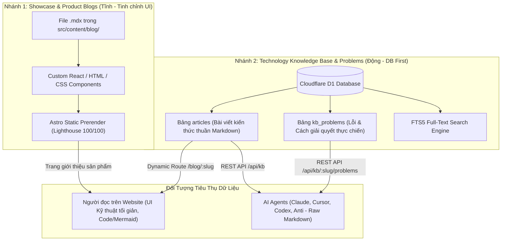
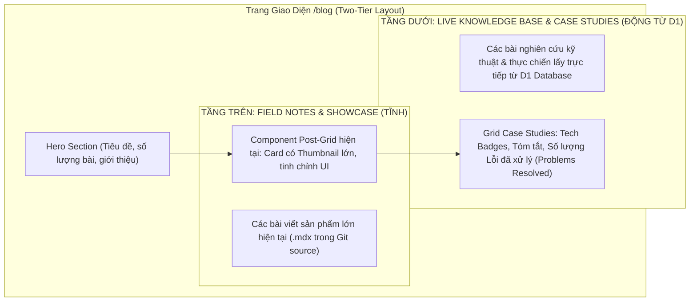
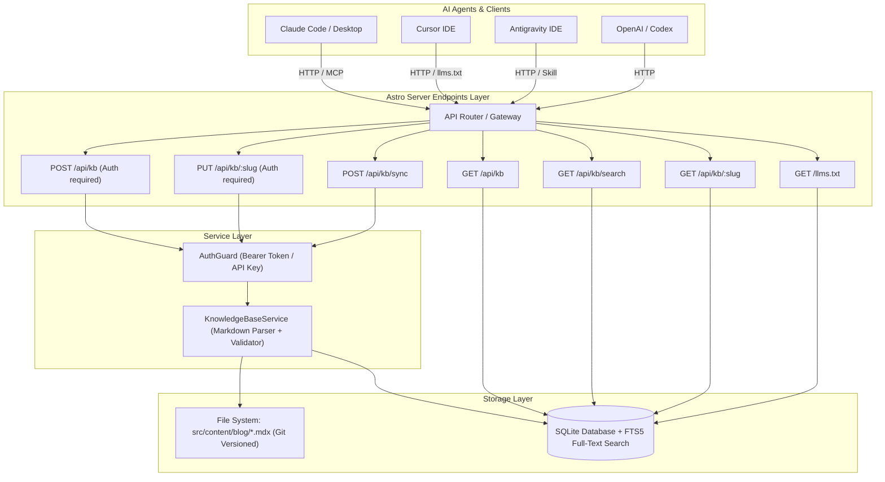
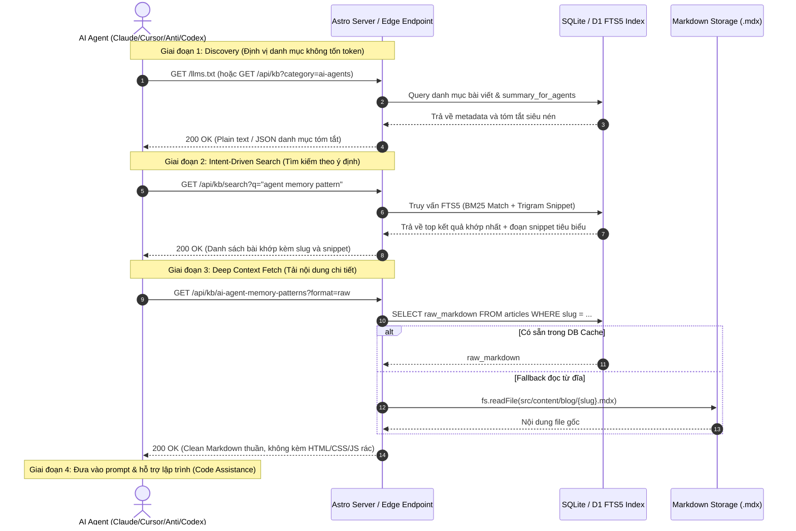
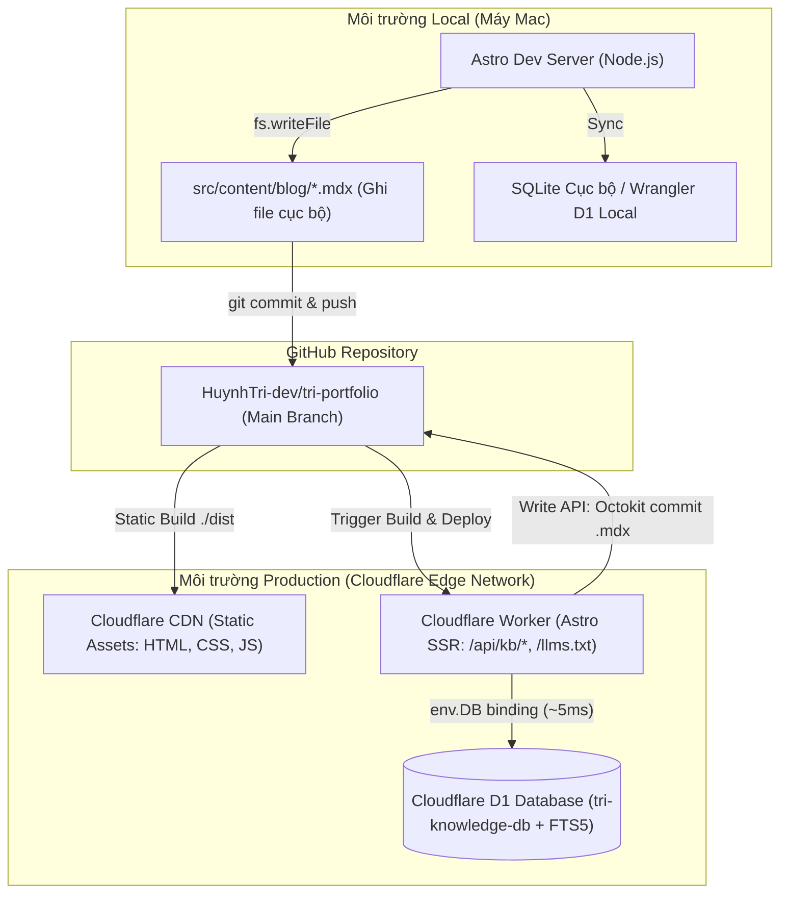
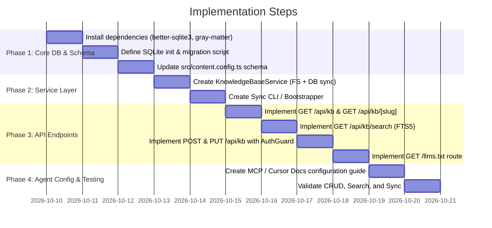

# Architecture & Design: Knowledge Base Database & Agent API

**File**: `docs/knowledge_base_architecture.md`  
**Description**: Architectural blueprint and implementation plan for transforming `src/content/blog` into a synchronized Knowledge Base with database indexing, CRUD APIs, and AI Agent query endpoints for Claude, Codex, Antigravity, and Cursor.  
**Author**: Antigravity Pair Programmer  
**Date**: 2026-10-10  

---

## 1. Executive Summary & Dual-Pillar Content Architecture

Định hình lại toàn bộ hệ thống Content thành **2 nhánh nội dung hoàn toàn độc lập và chuyên biệt**:



### 1.1 Chi Tiết 2 Nhánh Nội Dung

1. **Nhánh 1: Bài viết Giới thiệu Sản phẩm & Showcase (Product / Portfolio Blog)**:
   * **Định dạng**: File `.mdx` nằm trong [src/content/blog](file:///Users/macbookair/Downloads/huynh_minh_tri/tri-portfolio/src/content/blog).
   * **Đặc tính**: Chứa các component giao diện React phức tạp (ví dụ: `<ProjectDossier />`, thẻ HTML tùy chỉnh, hiệu ứng animation mượt mà) để tạo ấn tượng cho khách xem portfolio.
   * **Cơ chế**: Build tĩnh bằng Astro Content Collections truyền thống. Khi có case study dự án mới thì mới commit Git và deploy.

2. **Nhánh 2: Bài viết Kiến thức Công nghệ & Ghi nhận Lỗi (Knowledge Base & Problems Engine)**:
   * **Định dạng**: Markdown thuần (`.md` hoặc Markdown chuẩn có code blocks và sơ đồ Mermaid).
   * **Lưu trữ**: **Tập trung 100% trong Cloudflare D1 Database**.
   * **Mục tiêu cốt lõi**:
     * **Phục vụ truy vấn (Query) của AI Agent**: FTS5 index tìm kiếm tức thì theo từ khóa / mã lỗi, trả về Raw Markdown sạch tiết kiệm tối đa token.
     * **Hiển thị cho con người đọc trên web**: Trang web có dynamic route đọc từ D1, render ra layout công nghệ chỉn chu (typography, syntax highlight, KaTeX, Mermaid) mà **không cần rebuild lại frontend mỗi khi thêm bài**.
     * **API thêm/sửa động**: Cho phép gọi API (`POST /api/kb` và `POST /api/kb/:slug/problems` kèm secret key) để lưu trữ kiến thức và cập nhật bài giải lỗi ngay trong quá trình code thực tế.

### 1.2 Thiết Kế Giao Diện Blog 2 Tầng (Two-Tier UI Layout on `/blog`)

Trên giao diện trang danh sách Blog ([src/pages/blog/index.astro](file:///Users/macbookair/Downloads/huynh_minh_tri/tri-portfolio/src/pages/blog/index.astro)), trang web sẽ được bố trí thành **2 tầng rõ ràng**:



#### Chi tiết hiển thị của từng tầng:

1. **Tầng Trên (Top Section) — Showcase & Field Notes**:
   * Sử dụng component card hiện tại ([src/pages/blog/index.astro](file:///Users/macbookair/Downloads/huynh_minh_tri/tri-portfolio/src/pages/blog/index.astro)).
   * Hiển thị các bài viết sản phẩm/showcase lớn (như *Building OmniMer Health*, *Finance Analysis*).
   * Giữ nguyên giao diện card có thumbnail ảnh lớn, ngày xuất bản và hiệu ứng hover tinh chỉnh.

2. **Tầng Dưới (Bottom Section) — Live Knowledge Base & Case Studies (Từ D1)**:
   * **Nguồn dữ liệu**: SSR đọc trực tiếp từ Cloudflare D1 (bảng `articles` và `kb_problems`).
   * **Giao diện Card chuyên nghiệp**: Thiết kế theo phong cách Engineering Dossier / Research Card:
     * Badge danh mục công nghệ (`Architecture`, `AI Agents`, `Database`).
     * Tiêu đề bài nghiên cứu + ngày cập nhật gần nhất.
     * Tóm tắt kiến trúc cô đọng.
     * **Problem Counter Badge**: Hiển thị số lượng lỗi thực tế đã được giải quyết gắn với bài này (ví dụ: `⚠️ 2 issues resolved & documented`).
   * **Giao diện Chi tiết Bài viết (`/blog/:slug`)**:
     * Đọc nội dung Markdown từ D1 và render HTML cực đẹp: Hỗ trợ syntax highlighting cho code blocks, sơ đồ thuật toán Mermaid, công thức KaTeX.
     * **Mục "Troubleshooting & Problem Solutions" ở cuối bài**: Hiển thị danh sách các bài học lỗi gặp phải (`problem.md`) kèm nguyên nhân và code sửa lỗi đã kiểm chứng — cực kỳ trực quan để **bạn ôn tập lại kiến thức thực chiến và người khác cùng học hỏi**!

---

## 2. System Architecture & Component Design



### 2.1 Phân Định Vai Trò Lưu Trữ: D1 vs R2 vs Git (Storage Architecture & Decoupling)

Một câu hỏi cốt lõi: **Nên lưu Markdown trên Git, D1 hay R2? Và mỗi lần thêm/sửa bài có cần build lại frontend không?**

* **1. Cloudflare D1 — Nơi Lưu Trữ Trực Tiếp Nội Dung Markdown (`raw_markdown`)**:
  * Mỗi bài viết Markdown trung bình chỉ từ **2 KB - 50 KB**. Cột `TEXT` trong SQLite/D1 hỗ trợ lên đến hàng chục MB một cách dễ dàng và truy xuất trong **<10ms**.
  * **Tại sao không dùng R2 cho file Markdown?**:
    * R2 là Object Storage (tương tự AWS S3), thiết kế cho file nhị phân lớn (ảnh, video, zip). Nếu lưu Markdown trên R2: Tốc độ đọc chậm hơn D1 (30-60ms so với 5-10ms của D1), tốn thêm 1 lượt gọi mạng (network hop), và quan trọng nhất: **FTS5 trong D1 không thể index tìm kiếm toàn văn trực tiếp nếu text nằm trên R2**.
    * Do đó, **D1 lưu trực tiếp toàn bộ nội dung Markdown** (`raw_markdown` và `raw_content`).
  * **Vai trò của R2**: Chỉ dùng R2 khi bài viết có đính kèm **hình ảnh, file ảnh chụp lỗi, diagram PNG/SVG lớn**.

* **2. Loại Bỏ Hoàn Toàn Nhu Cầu "Phải Deploy Lại Frontend Mỗi Lần Update"**:
  * Khi chuyển bài viết và problems sang lưu trữ trên D1:
    * Cả trang hiển thị cho người đọc ([src/pages/blog/[slug].astro](file:///Users/macbookair/Downloads/huynh_minh_tri/tri-portfolio/src/pages/blog/[slug].astro)) và API của Agent ([src/pages/api/kb/](file:///Users/macbookair/Downloads/huynh_minh_tri/tri-portfolio/src/pages/api/kb/)) đều đọc **trực tiếp từ D1 tại runtime** (Edge Worker SSR).
    * Khi bạn hoặc Agent gọi API tạo mới (`POST /api/kb`) hoặc sửa bài (`PUT /api/kb/:slug`):
      * D1 cập nhật trong **10ms**.
      * F5 trang blog hoặc Agent gọi API là **thấy ngay nội dung mới tức thì**!
      * **100% KHÔNG CẦN CHẠY BUILD, KHÔNG CẦN DEPLOY LẠI FRONTEND!**

* **3. Vai trò của thư mục Git ([src/content/blog](file:///Users/macbookair/Downloads/huynh_minh_tri/tri-portfolio/src/content/blog))**:
  * Đóng vai trò là **Seed Data khởi đầu** và **Bản Backup an toàn trong Git**.
  * Cung cấp lệnh CLI: `npm run kb:backup` để tải toàn bộ bài viết từ D1 về thành các file `.mdx` trên máy tính và commit vào Git khi bạn muốn lưu trữ snapshot lịch sử.

### 2.2 Database Schema (SQLite + FTS5)

```sql
-- Main articles metadata and content table
CREATE TABLE IF NOT EXISTS articles (
    id TEXT PRIMARY KEY,               -- e.g. 'building-omnimer-health'
    slug TEXT UNIQUE NOT NULL,
    title TEXT NOT NULL,
    description TEXT,
    pub_date TEXT NOT NULL,
    updated_date TEXT,
    thumbnail TEXT,
    thumbnail_alt TEXT,
    hashtags TEXT NOT NULL,            -- JSON array: ["Architecture", "Knowledge-Base"]
    seo_keywords TEXT,                 -- JSON array
    draft INTEGER DEFAULT 0,
    is_knowledge_base INTEGER DEFAULT 0, -- 1 if tagged as knowledge base
    kb_category TEXT,                  -- 'architecture', 'best-practices', 'ai-agents', 'research'
    target_agents TEXT,                -- JSON array: ["claude", "cursor", "codex", "anti"]
    summary_for_agents TEXT,           -- High-density summary for LLM context compression
    raw_markdown TEXT NOT NULL,        -- Full Markdown body without frontmatter
    raw_content TEXT NOT NULL,         -- Complete file including YAML frontmatter
    file_path TEXT NOT NULL,           -- Relative path: 'src/content/blog/post.mdx'
    created_at DATETIME DEFAULT CURRENT_TIMESTAMP,
    updated_at DATETIME DEFAULT CURRENT_TIMESTAMP
);

-- Full-Text Search Index (FTS5) for ultra-fast Agent queries
CREATE VIRTUAL TABLE IF NOT EXISTS articles_fts USING fts5(
    slug UNINDEXED,
    title,
    description,
    hashtags,
    kb_category,
    summary_for_agents,
    raw_markdown,
    content='articles',
    content_rowid='rowid'
);

-- Sub-knowledge / Troubleshooting Table (Problem & Solution attached to parent article)
CREATE TABLE IF NOT EXISTS kb_problems (
    id TEXT PRIMARY KEY,                 -- e.g. 'astro-d1-fts5-tokenizer-error'
    parent_slug TEXT NOT NULL,           -- Foreign key linking to parent article slug
    title TEXT NOT NULL,
    error_code TEXT,                     -- e.g. 'SQLITE_ERROR', 'ERR_MODULE_NOT_FOUND'
    error_snippet TEXT,                  -- Trích đoạn thông báo lỗi chính xác
    environment TEXT,                    -- 'Node 22, macOS, Wrangler 3.x'
    root_cause TEXT NOT NULL,            -- Phân tích nguyên nhân gốc rễ
    solution_markdown TEXT NOT NULL,     -- Chi tiết cách khắc phục & code fix
    tags TEXT NOT NULL,                  -- JSON array: ["d1", "sqlite", "fts5"]
    file_path TEXT NOT NULL,             -- 'src/content/problems/{parent_slug}/{id}.md'
    created_at DATETIME DEFAULT CURRENT_TIMESTAMP,
    updated_at DATETIME DEFAULT CURRENT_TIMESTAMP,
    FOREIGN KEY(parent_slug) REFERENCES articles(slug) ON DELETE CASCADE
);

-- FTS5 Index for Problems & Error Solutions
CREATE VIRTUAL TABLE IF NOT EXISTS kb_problems_fts USING fts5(
    id UNINDEXED,
    parent_slug UNINDEXED,
    title,
    error_code,
    error_snippet,
    root_cause,
    solution_markdown,
    tags,
    content='kb_problems',
    content_rowid='rowid'
);
```

### 2.3 Extended Content Frontmatter Schemas
In [src/content.config.ts](file:///Users/macbookair/Downloads/huynh_minh_tri/tri-portfolio/src/content.config.ts), extend the `blog` collection schema and define a dedicated `problems` collection:

```ts
// 1. Parent Knowledge Base Collection
const blog = defineCollection({
  loader: glob({ base: "./src/content/blog", pattern: "**/*.{md,mdx}" }),
  schema: z.object({
    title: z.string(),
    description: z.string(),
    pubDate: z.coerce.date(),
    updatedDate: z.coerce.date().optional(),
    thumbnail: z.string().default("/images/blog/default.png"),
    thumbnailAlt: z.string().default("Post thumbnail"),
    hashtags: z.array(z.string()).min(1),
    draft: z.boolean().default(false),
    seoKeywords: z.array(z.string()).optional(),
    isKnowledgeBase: z.boolean().default(false),
    kbCategory: z.enum([
      "architecture",
      "research",
      "guidelines",
      "devops",
      "ai-agents",
      "general"
    ]).optional(),
    targetAgents: z.array(z.enum(["claude", "cursor", "codex", "anti", "general"])).optional(),
    summaryForAgents: z.string().optional(),
  }),
});

// 2. Child Troubleshooting & Problem Resolution Collection
const problems = defineCollection({
  loader: glob({ base: "./src/content/problems", pattern: "**/*.{md,mdx}" }),
  schema: z.object({
    title: z.string(),
    parentSlug: z.string(), // Phải trùng với slug của bài viết cha trong blog
    errorCode: z.string().optional(),
    errorSnippet: z.string().optional(),
    environment: z.string().optional(),
    tags: z.array(z.string()).default([]),
    date: z.coerce.date(),
  }),
});

export const collections = { projects, blog, problems };
```

---

## 3. API Endpoints Specification

All endpoints are built as Astro Server Endpoints under `src/pages/api/kb/`:

### 3.1 `GET /api/kb`
- **Purpose**: List articles with optional filtering.
- **Query Params**:
  - `is_kb=true`: Filter only knowledge base articles.
  - `category=architecture`: Filter by knowledge category.
  - `tag=react`: Filter by hashtag.
  - `agent=claude`: Filter articles targeted for specific AI agents.
  - `limit=20`, `offset=0`
- **Response**: JSON array of article metadata + brief agent summary.

### 3.2 `GET /api/kb/[slug]`
- **Purpose**: Fetch single knowledge item for agent consumption.
- **Query Params / Headers**:
  - `Accept: text/markdown` or `?format=raw`: Returns raw Markdown body (saves tokens for agents).
  - Default: Returns JSON with metadata, frontmatter, and raw markdown.

### 3.3 `GET /api/kb/search?q=<query>`
- **Purpose**: Full-text search using SQLite FTS5.
- **Returns**: Rank-ordered list of matching snippets, headings, and relevance scores.

### 3.4 `POST /api/kb` (Create Article)
- **Auth**: `Authorization: Bearer <KB_API_KEY>`
- **Request Body**:
  ```json
  {
    "slug": "ai-agent-memory-patterns",
    "title": "Design Patterns for AI Agent Memory & RAG",
    "description": "Comprehensive guide on agentic memory patterns.",
    "isKnowledgeBase": true,
    "kbCategory": "ai-agents",
    "hashtags": ["AI", "Architecture", "Knowledge-Base"],
    "targetAgents": ["claude", "cursor", "anti", "codex"],
    "summaryForAgents": "Covers short-term, working memory, and persistent RAG vector stores.",
    "content": "## Architectural Overview\n\nAgent memory is divided into..."
  }
  ```
- **Action**:
  1. Validates schema using Zod.
  2. Generates YAML frontmatter + Markdown body.
  3. Writes file `src/content/blog/{slug}.mdx`.
  4. Inserts into SQLite `articles` and `articles_fts`.
- **Response**: `201 Created` with saved metadata.

### 3.5 `PUT /api/kb/[slug]` (Update Article)
- **Auth**: `Authorization: Bearer <KB_API_KEY>`
- **Action**: Updates file on disk and updates SQLite index.
- **Response**: `200 OK`.

### 3.6 `POST /api/kb/sync` (Re-index)
- **Auth**: `Authorization: Bearer <KB_API_KEY>`
- **Action**: Iterates over all `.mdx` files in `src/content/blog/` and `src/content/problems/`, parses frontmatters via `gray-matter`, and rebuilds SQLite table & FTS indexes.

### 3.7 `POST /api/kb/:parentSlug/problems` (Tạo lỗi & cách xử lý gán vào Knowledge cha)
- **Purpose**: Cho phép Agent hoặc lập trình viên ghi lại lỗi gặp phải trong quá trình thực hành kèm nguyên nhân và cách xử lý đã kiểm chứng.
- **Auth**: `Authorization: Bearer <KB_API_KEY>` (Bảo vệ bảo mật, chống spam hoặc ghi đè tùy tiện).
- **Request Body**:
  ```json
  {
    "slug": "d1-fts5-tokenizer-unicode61-error",
    "title": "Lỗi D1 FTS5 tokenizer không hỗ trợ remove_diacritics trên Wrangler",
    "errorCode": "SQLITE_ERROR",
    "errorSnippet": "no such tokenizer: unicode61 with remove_diacritics",
    "environment": "macOS Sonoma, Node 22, Wrangler 3.x",
    "rootCause": "Bản SQLite nhúng của Wrangler local runtime chưa compile cờ tokenizer mở rộng...",
    "solution": "Chuyển tokenizer sang 'unicode61' cơ bản hoặc sử dụng tokenizer 'trigram'...",
    "tags": ["d1", "fts5", "sqlite", "wrangler"],
    "content": "## Triệu chứng lỗi\n\nKhi chạy query FTS5...\n\n## Cách khắc phục từng bước\n\n1. Sửa schema...\n2. Chạy lại migration..."
  }
  ```
- **Xử lý**:
  1. Kiểm tra xác thực Token (`KB_API_KEY`).
  2. Kiểm tra `parentSlug` có tồn tại trong bảng `articles` không.
  3. Tạo file Markdown: `src/content/problems/{parentSlug}/{slug}.md` kèm YAML frontmatter chuẩn.
  4. Ghi trực tiếp vào bảng `kb_problems` và cập nhật chỉ mục tìm kiếm `kb_problems_fts`.
  5. Nếu chạy trên Production, tự động commit file `.md` lên repo GitHub.
- **Response**: `201 Created`.

### 3.8 `GET /api/kb/:parentSlug/problems` (Tra cứu lỗi & cách xử lý theo bài cha)
- **Purpose**: Cho phép AI Agent tra cứu toàn bộ danh sách lỗi đã biết (Known Issues & Fixes) của bài viết cha.
- **Response**: JSON danh sách các lỗi, nguyên nhân, code fix và link raw markdown.

### 3.9 Universal Discovery: `GET /llms.txt` and `GET /llms-full.txt`
- Standard machine-readable specification used by Cursor, Anthropic, and OpenAI.
- Exposes title, description, problems catalog, and direct link to raw markdown for every Knowledge Base item.

### 3.10 AI Agent Retrieval & Troubleshooting Workflow (Luồng Tra Cứu & Tự Sửa Lỗi Của Agent)

Mô hình tra cứu tri thức kỹ thuật của AI Agent (Claude, Cursor, Antigravity, Codex) được thiết kế theo quy trình **3 giai đoạn (Discovery -> Search -> Deep Retrieval)** nhằm tối ưu hóa 100% dung lượng cửa sổ ngữ cảnh (Context Window) và chi phí token:



#### Chi tiết các bước vận hành:
1. **Giai đoạn 1 — Discovery (Định vị tri thức)**:
   * Agent **không tải toàn bộ nội dung** ngay từ đầu để tránh làm tràn Context Window.
   * Agent gọi `/llms.txt` hoặc `GET /api/kb?is_kb=true`. Phản hồi chỉ chứa tiêu đề, hashtag và trường `summaryForAgents` (tóm tắt mật độ thông tin cao, ~50-100 token/bài).
2. **Giai đoạn 2 — Intent-Driven Search (Truy vấn ngữ cảnh theo task)**:
   * Khi Agent nhận một bài toán code cụ thể từ người dùng (ví dụ: *"thiết kế memory pattern cho agent"*), Agent gọi `GET /api/kb/search?q=memory+pattern`.
   * Endpoint sử dụng SQLite FTS5 với thuật toán xếp hạng `bm25` để lọc ra đúng 2-3 bài viết nghiên cứu liên quan nhất, trả kèm `snippet` để Agent xác định bài viết cần nạp.
3. **Giai đoạn 3 — Deep Context Fetch (Nạp Markdown sạch)**:
   * Agent gọi `GET /api/kb/:slug?format=raw` (hoặc header `Accept: text/markdown`).
   * Endpoint bóc tách bỏ hoàn toàn các thẻ HTML, wrapper UI hoặc component React dư thừa, chỉ trả về nội dung Markdown kỹ thuật thuần túy (Code block, sơ đồ Mermaid, Best practices, API specs).
   * Tiết kiệm **80-90% lượng token** so với việc Agent phải cào và phân tích HTML từ trang web thông thường.
4. **Kiến Trúc Một Nguồn Thống Nhất (Single Unified API Source)**:
   * **Tất cả các Agent (Cursor, Claude, Antigravity, Codex) đều trỏ về 1 Nguồn Duy Nhất**:
     `https://trihuynh.omnimer.io.vn`
   * **Lợi ích vượt trội**:
     * **Không phụ thuộc Localhost**: Không cần bật `npm run dev` trên máy thì Agent mới đọc được data. Bạn có thể mở bất kỳ dự án nào, bất kỳ máy tính nào, Antigravity và Cursor đều tự động kéo được tri thức nghiên cứu từ Knowledge Base về.
     * **Độ trễ tiệm cận Local**: Nhờ Cloudflare Edge Worker và D1 toàn cầu, tốc độ phản hồi chỉ từ 10 - 25ms.
     * **Đồng nhất 100% hợp đồng giao tiếp (Contract)**:
       - **Discovery**: `GET https://trihuynh.omnimer.io.vn/llms.txt`
       - **Tìm kiếm**: `GET https://trihuynh.omnimer.io.vn/api/kb/search?q=...`
       - **Đọc nội dung thuần**: `GET https://trihuynh.omnimer.io.vn/api/kb/:slug?format=raw`
       - **Tra danh mục JSON**: `GET https://trihuynh.omnimer.io.vn/api/kb?category=...`
   * **Cách kết nối chuẩn hóa của các Agent**:
     * **Cursor**: Trỏ Docs index tới `https://trihuynh.omnimer.io.vn/llms.txt`.
     * **Antigravity**: Tích hợp trực tiếp tool/skill gọi `https://trihuynh.omnimer.io.vn/api/kb/search`.
     * **Claude (Code / Desktop)**: Cấu hình MCP Tool hoặc gọi REST tới `https://trihuynh.omnimer.io.vn/api/kb`.
     * **OpenAI Codex / ChatGPT**: Nhúng OpenAPI specification từ `https://trihuynh.omnimer.io.vn/api/openapi.json`.

5. **Vòng Lặp Tự Học & Xử Lý Lỗi (Agent Troubleshooting & Knowledge Learning Loop)**:
   * **Khi Agent code và gặp lỗi trong thực tế**:
     1. **Bước 1 (Tra cứu lỗi đã biết)**: Agent gọi `GET /api/kb/:parentSlug/problems` hoặc `GET /api/kb/search?q="<nội dung lỗi>"`. Nếu trong DB đã có bài giải (`problem.md`), Agent đọc ngay `solution_markdown` và tự sửa lỗi trong vài giây mà không cần con người can thiệp.
     2. **Bước 2 (Ghi nhận cách giải quyết mới)**: Khi gặp một bug mới và đã debug/fix thành công, Agent (hoặc dev) gửi request:
        ```http
        POST /api/kb/astro-cloudflare-d1-setup/problems
        Authorization: Bearer <KB_API_KEY>
        ```
     3. **Bước 3 (Đồng bộ hóa tức thì)**: Hệ thống sinh file Markdown `src/content/problems/astro-cloudflare-d1-setup/<slug>.md`, ghi vào D1 và kích hoạt FTS5 index.
     4. **Kết quả**: Knowledge Base ngày càng thông minh hơn sau mỗi lần fix bug thực chiến, phục vụ trọn đời cho các tác vụ code trong tương lai.

---

## 4. Deployment Strategy & Cloudflare Infrastructure (Chiến Lược Deploy)

Hệ thống được deploy lên **Cloudflare Workers & D1** theo mô hình **Astro Hybrid (Static + Edge SSR)**:



### 4.1 Cơ Chế Cấu Hình Triển Khai (Configuration Setup)

1. **Astro Hybrid Mode ([astro.config.mjs](file:///Users/macbookair/Downloads/huynh_minh_tri/tri-portfolio/astro.config.mjs))**:
   * Cài đặt adapter: `@astrojs/cloudflare`
   * Toàn bộ website portfolio, trang chủ, bài viết blog thông thường giữ nguyên chế độ **Static Prerender (`output: 'static'` hoặc hybrid)** để đảm bảo tốc độ tải trang 100/100 Lighthouse và 0 đồng chi phí server.
   * Riêng các API route ([src/pages/api/kb/](file:///Users/macbookair/Downloads/huynh_minh_tri/tri-portfolio/src/pages/api/kb/)) khai báo `export const prerender = false;` để chạy động (SSR) trên Cloudflare Worker.

2. **Cấu hình Binding Database ([wrangler.jsonc](file:///Users/macbookair/Downloads/huynh_minh_tri/tri-portfolio/wrangler.jsonc))**:
   ```jsonc
   {
     "$schema": "./node_modules/wrangler/config-schema.json",
     "name": "tri-portfolio",
     "compatibility_date": "2026-07-29",
     "assets": {
       "directory": "./dist",
       "not_found_handling": "404-page"
     },
     "d1_databases": [
       {
         "binding": "DB",
         "database_name": "tri-knowledge-db",
         "database_id": "<ID_KHI_TẠO_D1>"
       }
     ]
   }
   ```

3. **Tạo Cơ sở dữ liệu D1 & Chạy Migration**:
   * Lệnh tạo DB trên Cloudflare:
     ```bash
     npx wrangler d1 create tri-knowledge-db
     ```
   * Lệnh chạy file khởi tạo schema & FTS5 index:
     ```bash
     npx wrangler d1 execute tri-knowledge-db --remote --file=./scripts/schema.sql
     ```

### 4.2 Xử lý bài toán Ghi File Markdown trên Production Edge
Trên Cloudflare Worker (Edge Network), môi trường không có ổ cứng cục bộ (`fs.writeFile` không khả dụng). Do đó luồng ghi/cập nhật Markdown được giải quyết triệt để như sau:
* **Khi gọi API Write/Update trên Production (`POST /api/kb`)**:
  1. Ghi và cập nhật trực tiếp vào **Cloudflare D1** ngay lập tức để AI Agent có thể đọc được ngay bài viết mới trong vòng 5ms.
  2. Đồng thời Worker gọi **GitHub REST API** (sử dụng `GITHUB_TOKEN` cấu hình trong Cloudflare Secrets) để commit tạo/sửa file `.mdx` trực tiếp vào repo `HuynhTri-dev/tri-portfolio/src/content/blog/{slug}.mdx`.
  3. Git luôn giữ trọn vẹn toàn bộ file Markdown làm Single Source of Truth!
* **Khi ở máy Local Development**:
  * API tận dụng `node:fs/promises` để ghi trực tiếp file `.mdx` vào ổ cứng máy tính ngay lập tức.

### 4.3 Quy trình 1-Click Deploy
* Chạy lệnh quen thuộc trong [package.json](file:///Users/macbookair/Downloads/huynh_minh_tri/tri-portfolio/package.json):
  ```bash
  npm run deploy
  ```
  *(Lệnh này tự động chạy `astro build` tạo static bundle cho CDN và worker bundle kết nối D1, sau đó `wrangler deploy` đẩy toàn bộ lên Cloudflare edge toàn cầu)*.

---

## 5. Step-by-Step Implementation Roadmap



### Detailed Execution Steps:
1. **Step 1: Install Dependencies & Setup Environment**
   - Add `better-sqlite3` (or LibSQL) and `gray-matter` for parsing frontmatter in server endpoints.
   - Setup `.env` with `KB_API_KEY="<secret_key>"` and `DB_PATH="./data/knowledge.db"`.
2. **Step 2: Database Initialization & Sync Service**
   - Create `src/lib/db/client.ts` to manage SQLite connection with connection pooling and WAL mode (`journal_mode = WAL` for maximum read concurrency).
   - Create `src/lib/db/schema.ts` defining tables and FTS5 search.
   - Create `src/lib/services/knowledge.service.ts`:
     - `syncAllFilesToDatabase()`: Scans `src/content/blog`, parses with `gray-matter`, upserts to SQLite.
     - `createOrUpdateArticle(slug, frontmatter, markdown)`: Atomic file write + DB upsert.
     - `queryArticles(filters)` and `searchArticles(query)`.
3. **Step 3: Update Astro Config & Endpoints**
   - Ensure Astro configuration supports server output for `/api/*` endpoints (hybrid mode or server endpoints).
   - Implement:
     - `src/pages/api/kb/index.ts` (GET all, POST new)
     - `src/pages/api/kb/[slug].ts` (GET single, PUT update)
     - `src/pages/api/kb/search.ts` (GET search)
     - `src/pages/api/kb/sync.ts` (POST re-index)
     - `src/pages/llms.txt.ts` (Universal agent catalog)
4. **Step 4: AI Agent Connection Profiles**
   - **Cursor**: Configure `.cursorrules` or Cursor Docs: `http://localhost:4321/llms.txt` or `http://localhost:4321/api/kb`.
   - **Claude Desktop / Code**: Provide a lightweight MCP configuration or direct REST curl instructions.
   - **Antigravity / Codex**: Direct REST tool or dynamic context fetcher.

---

## 6. Risk Analysis & Mitigation Strategies

| Risk | Impact | Probability | Mitigation Strategy |
| :--- | :--- | :--- | :--- |
| **1. Cloudflare Static vs Runtime Write** | High | High | When deployed as static assets on Cloudflare CDN, server-side Node `fs.writeFile` is not available at edge. **Mitigation**: Support dual runtime: In local development & Node SSR, write to disk directly; for cloud deployment, writes can either integrate with GitHub API (create commit/PR to `src/content/blog`) or Cloudflare D1 + R2. In local dev, everything writes directly to disk instantly. |
| **2. Unauthorized API Access** | Critical | Medium | Protect all `POST`, `PUT`, and `sync` endpoints with `Authorization: Bearer <KB_API_KEY>`. Read endpoints (`GET /api/kb`, `GET /llms.txt`) remain open for agents to read freely. |
| **3. File & DB Desynchronization** | Medium | Low | Never treat DB as the primary storage. Markdown files in `src/content/blog/*.mdx` are the ultimate source of truth. The `sync` routine can rebuild the entire DB in <100ms. |
| **4. Slug Collisions & Malformed Frontmatter** | Medium | Medium | Validate all input with `zod` before disk write. Sanitize slugs (kebab-case, alphanumeric only). Atomic write via temporary file replacement or gray-matter serialization. |
| **5. Astro Hot Reload / Content Cache** | Low | Low | Astro Content Collections automatically detect new `.mdx` files in `src/content/blog` và reload the dev server index seamlessly. |

---

## 7. Readiness for Execution

This document concludes the **Brainstorming & Architecture Analysis** phase.  
To proceed to implementation, please issue the `/code` command.
