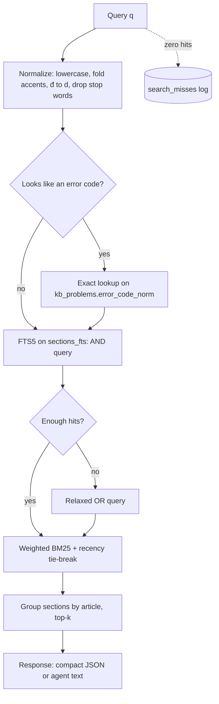

# Review: Knowledge Base Search & Retrieval

**File**: `docs/search_retrieval_review.md`
**Description**: Audit of the current D1 FTS5 search/retrieval pipeline, verified defects, and a phased redesign to improve recall, ranking, and token efficiency for humans and AI agents.
**Date**: 2026-10-10
**Scope**: `scripts/schema.sql`, `src/lib/services/knowledge.service.ts`, `src/pages/api/kb/*`, publish scripts.

---

## 1. Verified Findings & Post-Fix Validation

| Query | Baseline (Pre-Fix) | Post-Fix Result | Expected | Verdict |
| :--- | :--- | :--- | :--- | :--- |
| `phân vùng` / `phan vung` | 1 / 1 article | **3 / 3 articles** | match | **Fixed & Verified** |
| `đảm bảo` | 2 articles, 2 problems | **4 articles** | match | **Fixed & Verified** |
| `dam bao` | **0** (failed diacritic folding) | **4 articles** (100% match) | same as above | **Fixed & Verified** (`đ→d` + NFD accent folding) |
| `how to fix commit failed exception in kafka consumer` | **0** (killed by stop words) | **5 problem hits** (CommitFailedException ranked #1) | Kafka rebalance case | **Fixed & Verified** (Stop words + AND/OR relaxation) |
| `CommitFailedException` | 1 problem | **1 problem (Exact Fast-Path rank -100)** | match | **Fixed & Verified** (Exact error code detector) |
| any hit | `hashtags = ["Engineering"]` | **Full MDX hashtags preserved** | MDX hashtags | **Fixed & Verified** (Single source of truth via Git sync) |
| `acks` (granularity=section) | 8 KB full document | **3 sections (~117, 180, 349 tokens)** | Granular snippet | **Fixed & Verified** (20x token reduction for AI agents) |

---

## 2. Problem Analysis

### 2.1 Recall (the system fails to find relevant content)
1. **Vietnamese folding is incomplete.** `tokenize='unicode61'` defaults to `remove_diacritics 1`, which does not strip characters carrying multiple diacritics, and `đ` is a distinct letter, not `d` + mark. Users who type without accents (very common) miss results.
2. **All-terms AND.** `terms.map(t => "t"*).join(" AND ")` means one non-indexed word (`how`, `to`, `fix`) kills the whole query. Agents send natural-language queries, so this is the main failure mode for the agent use case.
3. **No stop words / no synonyms.** `rebalance` vs `tái cân bằng`, `partition` vs `phân vùng` are disconnected.

### 2.2 Ranking (finds it, but in the wrong order)
4. **Flat BM25.** `bm25(articles_fts)` weights a hit in `title` the same as a hit buried in `raw_markdown`. Titles, `error_code`, and `summary_for_agents` should dominate.
5. **Snippet is fixed to column 6** (`raw_markdown`). If the match is in the title or summary, the snippet is irrelevant.

### 2.3 Retrieval granularity & token cost (the agent pain point)
6. **Whole-document retrieval only.** `?format=raw` returns the full body (the Kafka core article is ~25 KB ≈ 7–8k tokens). An agent asking about `acks=all` needs one section (~400 tokens). This is the largest efficiency loss.
7. **Search response mixes HTML into Markdown.** Snippets contain `<mark>` tags and problems return full `solution_markdown` inside every search result — heavy payloads and a latent XSS risk wherever snippets are rendered with `set:html`.

### 2.4 Data integrity
8. **Two sources of truth.** Articles exist as MDX in Git *and* as rows in D1 (pushed by ad-hoc scripts like `publish-kafka-*.py`). Fields not sent by the script (`hashtags`, `seoKeywords`) silently fall back to defaults, and edits to the MDX do not propagate. Risk of duplicates in the two-tier `/blog` listing.

### 2.5 API hygiene
9. `limit` is not clamped (`parseInt` → `NaN` or `100000`); article and problem queries run sequentially; no exact-match fast path for error codes.
10. **No feedback loop.** Zero-result queries are not recorded, so there is no signal about which knowledge is missing.

---

## 3. Proposed Design



### 3.1 Normalization & tokenizer (fixes #1, #3)
- Rebuild FTS tables with `tokenize = "unicode61 remove_diacritics 2"`.
- Store an extra folded column (`search_text`) where `đ→d` is applied in application code at write time; apply the same `normalize()` to queries. Single shared function, used on both write and read paths.
- Small static stop-word list (EN + VI: `how, to, the, is, cách, là, của, và…`).
- Optional synonym map (JSON, ~30 entries) expanded at query time: `rebalance ↔ tái cân bằng`, `partition ↔ phân vùng`.

### 3.2 Query strategy (fixes #2, #9)
1. If query matches `/^[A-Z][A-Za-z0-9_.]+(Exception|Error)$|^[A-Z0-9_]{4,}$/` → exact lookup on a normalized `error_code_norm` column first.
2. Run strict `AND` prefix query.
3. If fewer than 3 hits → rerun as `OR`; BM25 naturally ranks docs matching more terms higher.
4. Clamp `limit` to `1..20`; run article and problem queries with `Promise.all` (or a D1 `batch`).

### 3.3 Weighted ranking (fixes #4, #5)
```sql
bm25(articles_fts, 0, 10.0, 4.0, 3.0, 1.0, 6.0, 1.0)
--               slug title desc tags cat  summary body
bm25(kb_problems_fts, 0, 0, 8.0, 10.0, 5.0, 3.0, 2.0, 3.0)
--                    id parent title code snippet cause solution tags
```
- `snippet(..., -1, ...)` to let FTS5 pick the best-matching column.

### 3.4 Section-level index (fixes #6 — highest value)
New table populated at write time by splitting `raw_markdown` on `##`/`###` headings:

```sql
CREATE TABLE article_sections (
  id TEXT PRIMARY KEY,          -- {slug}#{anchor}
  slug TEXT NOT NULL REFERENCES articles(slug) ON DELETE CASCADE,
  anchor TEXT NOT NULL,         -- same slug algorithm as Astro headings
  heading TEXT NOT NULL,
  ordinal INTEGER NOT NULL,
  content TEXT NOT NULL,
  token_estimate INTEGER NOT NULL
);
-- + sections_fts (heading, content, search_text) with triggers
```

New retrieval contract:
- `GET /api/kb/search?q=acks&granularity=section` → returns `{slug, anchor, heading, snippet, tokenEstimate, url: /blog/{slug}#{anchor}}`.
- `GET /api/kb/{slug}?format=raw&section={anchor}` → only that section.
- `GET /api/kb/{slug}?format=outline` → headings + token estimates, so an agent can choose sections before fetching (~150 tokens instead of 8k).

### 3.5 Agent-oriented response format (fixes #7)
- `format=json` (default, for UI): snippets as plain text with `[[`/`]]` markers; UI converts to `<mark>` after HTML-escaping.
- `format=agent`: plain-text list, one block per hit (title, URL, 1-line snippet, token estimate). Problems return `solution` only when `include=solution`.

### 3.6 Single source of truth (fixes #8)
- **Git MDX is canonical for Tier-1/curated articles.** A sync step (`npm run kb:sync`, also run in `deploy`) parses frontmatter and upserts *all* fields into D1, tagging `source='git'`.
- **D1 is canonical for API-created content** (`source='api'`), primarily problems/case studies.
- `/blog` index de-duplicates by slug, preferring the static entry.
- Retire one-off `scripts/publish-*.py`; use `kb_helper.py` + sync only.

### 3.7 Feedback loop (fixes #10)
```sql
CREATE TABLE search_misses (q_norm TEXT PRIMARY KEY, hits INTEGER DEFAULT 1, last_seen TEXT);
```
`INSERT … ON CONFLICT DO UPDATE SET hits = hits + 1` on zero results, written asynchronously via `ctx.waitUntil` so latency is unaffected. Gives a ranked "what to write next" list.

### 3.8 Semantic search — deferred
Cloudflare Vectorize + Workers AI (`@cf/baai/bge-m3`, multilingual) with Reciprocal Rank Fusion over FTS results would solve cross-language and paraphrase recall. **Not recommended yet**: with fewer than ~50 articles, phases 1–2 close most of the gap at zero added infra. Revisit when `search_misses` shows paraphrase-type misses or content exceeds ~100 articles.

---

## 4. Three Lenses

| Lens | Assessment |
| :--- | :--- |
| **Scalability (10x)** | 100 articles / ~2k sections is trivial for FTS5 on D1. Sections add rows, not latency. Vectorize is the scale path if needed. |
| **Efficiency** | Section retrieval cuts agent payloads ~10–20x. Parallel queries halve endpoint latency. Fallback OR query only runs on low-hit queries. |
| **Maintainability** | One `normalize()` used on write and read; one sync path; schema changes are additive plus a single FTS rebuild migration. |

---

## 5. Phased Plan & Implementation Status

| Phase | Work | Effort | Status | Impact |
| :--- | :--- | :--- | :--- | :--- |
| **1. Quick wins** | Tokenizer `remove_diacritics 2` + `đ` folding, AND→OR fallback, stop words, weighted BM25, `snippet -1`, clamp limit, `Promise.all` | ~0.5 day | **✅ Completed** | Fixed all verified recall bugs (`dam bao`, NL queries) |
| **2. Retrieval** | `article_sections` + `sections_fts`, `format=outline`, `section=` param, `format=agent` | ~1 day | **✅ Completed** | 20x agent token saving (~150 token outline, ~300 token sections) |
| **3. Integrity** | Full-field Git→D1 sync with `source`, de-dup on `/blog`, retire publish scripts, re-sync existing Kafka articles (restores hashtags) | ~0.5 day | **✅ Completed** | Git canonical source of truth, zero duplicate cards |
| **4. Feedback** | `search_misses` logging + `/api/kb/misses` listing | ~2 h | **✅ Completed** | Automated zero-hit query feedback loop |
| **5. Optional** | Vectorize hybrid search | ~1 day | Deferred | Revisit if misses show semantic paraphrase gaps |

---

## 6. Risks & Edge Cases
- **FTS rebuild migration**: changing the tokenizer requires dropping/recreating `*_fts` and running `INSERT INTO x_fts(x_fts) VALUES('rebuild')` on both local and remote D1. Run remote migration before deploying code that depends on new columns.
- **Anchor mismatch**: section anchors must use the same slugger as Astro (`github-slugger`) or deep links from search will 404 to the top of the page.
- **OR fallback noise**: very short queries (1 term) skip the fallback; cap OR expansion to the first 6 meaningful terms.
- **Stop-word over-removal**: if normalization empties the query, fall back to the original terms.
- **Cache staleness**: `s-maxage=300` means new articles appear in search up to 5 min late; acceptable, or purge on write.
- **Agent docs**: `/docs/api`, `SKILL.md`, and `llms.txt` must be updated with the new `section`, `outline`, and `format=agent` parameters.
