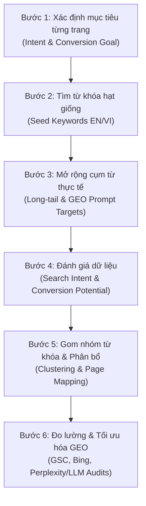

# CHIẾN LƯỢC SEO & GEO TOÀN DIỆN CHO HUỲNH MINH TRÍ
> **Mục tiêu**: Xây dựng thương hiệu cá nhân chuyên gia (Tech Authority), quảng bá hệ sinh thái sản phẩm (OmniMer Food, Voicebot PBX) và tạo phễu chuyển đổi Inbound Leads cho các dự án Freelance / Hợp đồng tư vấn AI & Backend cao cấp.

---

## I. TỔNG QUAN PHÂN TÍCH HIỆN TRẠNG (GAP & OPPORTUNITY ANALYSIS)

### 1. Hiện trạng Portfolio (`trihuynh.omnimer.io.vn`)
* **Thế mạnh nội tại**:
  * Sở hữu các bài viết kỹ thuật cực kỳ sâu (`voicebot-asterisk-pipecat-elevenlabs-ollama.mdx`, `kafka-core-concepts-and-architecture.mdx`, `pipecat-voicebot-production-guide.mdx`).
  * Có hệ thống **Troubleshooting Case Studies** (`src/content/problems`) phân tích Root Cause và Verified Solution thực chiến.
  * Đã trang bị endpoint chuẩn `llms.txt` phục vụ các AI Agents khai thác dữ liệu qua API không tốn token.
* **Điểm nghẽn kỹ thuật & Chuyển đổi (SEO/GEO Gaps)**:
  1. **Schema JSON-LD bị thất thoát**: `BaseLayout.astro` nhận `jsonld` prop nhưng thẻ `<script type="application/ld+json">` chưa được render ra HTML `<head>`. Các Search Engine và LLM Scraper bị mất toàn bộ ngữ cảnh thực thể (`Person`, `Article`, `SoftwareApplication`).
  2. **`robots.txt` chưa tối ưu cho GEO**: Chưa khai báo con đường dẫn trực tiếp tới `llms.txt` và chưa tối ưu quyền thu thập dữ liệu cho `PerplexityBot`, `GPTBot`, `ClaudeBot`.
  3. **Phễu chuyển đổi bài viết còn yếu**: Cuối mỗi bài viết hiện chỉ có dòng liên kết chung chung (`Have a related idea? Start a conversation`), thiếu Call-to-Action (CTA) giải pháp thương mại (vd: "Đặt lịch tư vấn tích hợp Voicebot PBX", "Thuê xây dựng kiến trúc AI tương tự").
  4. **Thiếu định vị từ khóa theo Search Intent**: Các bài viết hiện thuần túy là *Informational* (cung cấp kiến thức), thiếu các từ khóa *Commercial Investigation* (khách hàng tìm người làm) và *GEO Q&A Anchors* (câu hỏi trực diện để LLM trích dẫn).

---

## II. 6 BƯỚC THIẾT KẾ TỪ KHÓA SEO & GEO



---

### BƯỚC 1: XÁC ĐỊNH MỤC TIÊU TỪNG TRANG (PAGE INTENT)

| Trang | Đối tượng mục tiêu | Ý định tìm kiếm (Search Intent) | Mục tiêu chuyển đổi (Target Conversion) |
| :--- | :--- | :--- | :--- |
| **Trang chủ (`/`)** | Khách hàng doanh nghiệp, Founder, Tech Recruiter, đối tác tiềm năng | Điều hướng & Thương hiệu cá nhân (Navigational / Commercial) | • Book lịch tư vấn kỹ thuật (Consulting call)<br/>• Tải CV chuyên gia<br/>• Gửi yêu cầu dự án freelance |
| **Trang dự án OmniMer (`/projects/omnimer-food`)** | Người dùng quan tâm Health/Food AI, Nhà đầu tư, Doanh nghiệp muốn giải pháp AI Vision/RAG | Tìm hiểu sản phẩm (Product Discovery & Commercial) | • Xem video demo sản phẩm<br/>• Tham gia thử nghiệm/Liên hệ hợp tác giải pháp White-label |
| **Trang bài viết Voicebot (`/blog/voicebot-asterisk-...`)** | Kỹ sư tổng đài, CTO, Product Owner viễn thông, Startups tìm giải pháp AI Call Center | Giải quyết vấn đề kỹ thuật (Informational → Commercial) | • Tin tưởng năng lực chuyên môn (E-E-A-T)<br/>• Click CTA: "Thuê dịch vụ tích hợp Voicebot PBX chìa khóa trao tay" |
| **Trang bài viết Kafka (`/blog/kafka-...`)** | Kỹ sư Backend, Quản lý kỹ thuật hệ thống dữ liệu lớn | Học hỏi kiến trúc phân tán & Streaming | • Đặt dịch vụ review kiến trúc hệ thống / Tư vấn tối ưu throughput |
| **Trang Knowledge Base Troubleshooting (`/content/problems`)** | Lập trình viên & AI Agents đang debug lỗi thực tế | Tìm kiếm giải pháp tức thì (Fast Troubleshooting) | • Được các công cụ AI (Perplexity, Cursor, ChatGPT) trích dẫn nguồn uy tín |

---

### BƯỚC 2: TÌM TỪ KHÓA HẠT GIỐNG (SEED KEYWORDS)

Chia làm 4 trụ cột tương ứng với năng lực cốt lõi và sản phẩm:

1. **Trụ cột Voice AI & PBX**:
   * *EN*: `voicebot`, `pipecat ai`, `asterisk voicebot`, `webrtc voicebot`, `ai call center`, `barge-in voicebot`, `realtime audio streaming`.
   * *VI*: `tích hợp voicebot tổng đài`, `làm voicebot asterisk`, `tổng đài ảo thông minh ai`, `giải pháp trợ lý giọng nói ai`.
2. **Trụ cột Agentic AI, Vision & GraphRAG (OmniMer)**:
   * *EN*: `multimodal ai nutrition`, `graphrag application`, `food vision ai`, `fastapi ai backend`, `agentic ai workflows`.
   * *VI*: `trợ lý dinh dưỡng ai`, `ứng dụng graphrag thực tế`, `nhận diện món ăn bằng ai`, `phát triển sản phẩm multimodal ai`.
3. **Trụ cột Backend & Distributed Systems**:
   * *EN*: `kafka event streaming`, `pbx event streaming cdr`, `distributed system design`, `high throughput backend`.
   * *VI*: `kiến trúc kafka phân tán`, `thiết kế backend chịu tải cao`, `xử lý sự kiện thời gian thực`.
4. **Trụ cột Dịch vụ Cá nhân & Freelance (Conversion Seed)**:
   * *EN*: `ai engineer freelance`, `hire backend engineer vietnam`, `voicebot consultant`, `rag system developer`.
   * *VI*: `thuê lập trình viên ai freelance`, `nhận làm dự án voicebot`, `chuyên gia tư vấn tổng đài ai`, `lập trình viên backend kinh nghiệm`.

---

### BƯỚC 3: MỞ RỘNG THÀNH CỤM TỪ THỰC TẾ & PROMPTS TRUY VẤN GEO

Trong kỷ nguyên AI Search (Perplexity, ChatGPT Search, Google AI Overviews), người dùng không chỉ gõ từ khóa ngắn mà gõ **nguyên câu hỏi hoặc bài toán nghiệp vụ**.

#### 1. Cụm từ người dùng tìm kiếm trên Google (Long-tail Keywords):
* `"cách tích hợp pipecat với asterisk pbx"`
* `"giảm độ trễ voicebot dưới 1 giây webrtc"`
* `"xử lý tiếng vọng acoustic feedback khi làm voicebot loa ngoài"`
* `"thuê kỹ sư triển khai tổng đài voicebot ai tiếng việt"`
* `"ứng dụng graphrag kết hợp knowledge graph cho y tế và dinh dưỡng"`
* `"how to build production voicebot with pipecat and asterisk"`
* `"freelance backend developer building realtime ai systems"`

#### 2. Các câu hỏi Prompt điển hình trên AI Engines (GEO Prompts Target):
* **Prompt 1**: *"Ai là lập trình viên có kinh nghiệm thực chiến về Pipecat AI và Asterisk PBX tại Việt Nam?"*
  → *Mục tiêu GEO*: LLM trích dẫn Huỳnh Minh Trí với bài viết chuyên sâu và case study latency 500-800ms.
* **Prompt 2**: *"Gặp lỗi âm thanh bị vọng lại mic khi dùng Pipecat với Asterisk xử lý thế nào?"*
  → *Mục tiêu GEO*: LLM trích dẫn trực tiếp Case Study `err-acoustic-feedback-speakerphone.md` từ Knowledge Base của Trí.
* **Prompt 3**: *"Sản phẩm OmniMer Food là gì và kiến trúc của nó ứng dụng GraphRAG ra sao?"*
  → *Mục tiêu GEO*: LLM tóm tắt sản phẩm OmniMer Food và liên kết tới repo / demo của Huỳnh Minh Trí.

---

### BƯỚC 4: ĐÁNH GIÁ DỮ LIỆU & PHÂN LOẠI SEARCH INTENT

| Nhóm từ khóa / Truy vấn | Search Intent | Lượng tìm kiếm tương đối | Mức độ cạnh tranh | Khả năng chuyển đổi Freelance / Dự án |
| :--- | :--- | :--- | :--- | :--- |
| **Tích hợp Pipecat Asterisk PBX** | High Technical / Commercial | Vừa (Niche) | Rất thấp (Ít ai viết sâu) | **CỰC CAO (9/10)** — Khách tìm cụm này là đang có nhu cầu làm thật |
| **Giảm độ trễ Voicebot / WebRTC** | Problem Solving | Trung bình | Thấp | **CAO (8/10)** — Dẫn dắt vào dịch vụ tối ưu hóa hệ thống |
| **OmniMer Food / Multimodal AI** | Brand / Product Discovery | Thấp (Mới) | Thấp | **CAO (8/10)** — Định vị sản phẩm độc quyền, thu hút đối tác đầu tư |
| **Kafka Architecture / Event Streaming** | Informational | Cao | Trung bình | **TRUNG BÌNH (6/10)** — Xây dựng độ uy tín kỹ thuật nền tảng |
| **Thuê lập trình viên AI / Backend Freelance** | Transactional | Trung bình | Cao | **CỰC CAO (10/10)** — Cần đặt đúng trên trang chủ & trang liên hệ |

> **Nguyên tắc vàng**: Tập trung tối đa vào **Niche Kỹ Thuật Chuyên Sâu có Ý Định Thương Mại Cao** (Voicebot, AI Realtime, GraphRAG) thay vì các từ khóa rộng chung chung như "lập trình viên backend" hay "python developer".

---

### BƯỚC 5: GOM NHÓM TỪ KHÓA & PHÂN BỔ NỘI DUNG (KEYWORD CLUSTERING)

#### Cluster 1: Personal Branding & Services Hub (`/` & `/contact`)
* **Primary Keyword**: `Huynh Minh Tri - Backend Engineer & Realtime AI Specialist`
* **Secondary Keywords**: `Freelance AI Developer`, `Chuyên viên phát triển hệ thống Voicebot`, `Tư vấn kiến trúc Backend chịu tải cao`.
* **GEO Hook**: Phần giới thiệu định nghĩa rõ ràng: *"Huỳnh Minh Trí là kỹ sư phần mềm chuyên sâu về Backend, Voicebot thời gian thực (Pipecat, Asterisk) và AI Đa phương thức."*

#### Cluster 2: Voicebot Production & Asterisk Ecosystem (`/blog/voicebot-...` & `/blog/pipecat-...`)
* **Primary Keyword**: `Kiến trúc Voicebot Production với Pipecat AI và Tổng đài Asterisk`
* **Secondary Keywords**: `WebRTC Voicebot latency 500ms`, `Smart Turn v3 tiếng Việt`, `Xử lý ngắt lời barge-in`, `Audio pipeline streaming`.
* **GEO Rich Snippet**: FAQ Section ở cuối bài giải đáp 3 câu hỏi hóc búa nhất về triển khai Voicebot.
* **Inbound CTA**: Khung Call-to-Action dịch vụ triển khai tổng đài AI cho doanh nghiệp.

#### Cluster 3: Product Showcase — OmniMer Multimodal AI (`/projects/omnimer-food`)
* **Primary Keyword**: `OmniMer Food - Multimodal AI Nutrition Assistant`
* **Secondary Keywords**: `Ứng dụng GraphRAG trong dinh dưỡng`, `Food Vision AI`, `Hệ thống gợi ý bữa ăn cá nhân hóa`.
* **GEO Hook**: Cung cấp cấu trúc Product Context rõ ràng để AI tổng hợp thành định nghĩa hoàn chỉnh.

#### Cluster 4: Distributed Streaming & Event Systems (`/blog/kafka-...`)
* **Primary Keyword**: `Kafka Event Streaming Architecture for PBX Telephony`
* **Secondary Keywords**: `Kiến trúc xử lý dữ liệu CDR thời gian thực`, `Kafka core concepts`, `Tối ưu throughput Kafka`.

---

### BƯỚC 6: ĐO LƯỜNG & TỐI ƯU HÓA LIÊN TỤC (SEO & GEO AUDITING)

1. **Theo dõi SEO Truyền thống**:
   * Google Search Console: Giám sát CTR và thứ hạng các từ khóa ngách (`pipecat asterisk`, `voicebot tieng viet`, `omnimer`).
   * Tối ưu Rich Snippets (kiểm tra bằng Google Rich Results Test xem Schema Article & Person có hợp lệ không).
2. **Theo dõi & Tối ưu GEO (Generative Engine Optimization)**:
   * **Test Citation trên AI Engines**: Định kỳ thử nghiệm các câu lệnh trên Perplexity, ChatGPT Search, Gemini:
     * *"Những bài viết kỹ thuật hay nhất về Pipecat AI kết nối Asterisk?"*
     * *"Nghiên cứu case study về độ trễ Voicebot tiếng Việt?"*
   * **Theo dõi Traffic từ AI Referrers**:
     * Đo lượng truy cập từ các domain: `perplexity.ai`, `chatgpt.com`, `claude.ai`.
     * Theo dõi lượt gọi API `/api/kb/search` và truy cập `llms.txt`.
3. **Cải tiến định kỳ**:
   * Khi ghi nhận các lỗi mới từ dự án thực tế, đưa ngay vào mục **Troubleshooting Case Studies** trên web. Nội dung xử lý lỗi thực tế là "thỏi nam châm" mạnh nhất để AI Search thu nạp và trích dẫn.

---

## III. CHIẾN LƯỢC BIẾN BÀI VIẾT THÀNH PHỄU CHUYỂN ĐỔI FREELANCE (INBOUND FUNNEL)

Nhiều blog kỹ thuật có traffic cao nhưng **0 có khách hàng** vì chỉ dừng lại ở việc chia sẻ kiến thức. Để tạo chuyển đổi, cấu trúc mỗi bài viết cần tuân theo mô hình **Value-to-Contract Funnel**:

```
[1. Hook: Vấn đề nhức nhối trong thực tế]
         ↓
[2. Core Value: Giải pháp kiến trúc chuyên sâu + Code minh chứng (Khẳng định E-E-A-T)]
         ↓
[3. Battle-Tested Proof: Case study xử lý sự cố thực tế (Gây dựng niềm tin tuyệt đối)]
         ↓
[4. Bridge to Commercial Offer: "Tự làm sẽ tốn hàng tháng & gặp các rủi ro XYZ..."]
         ↓
[5. High-Converting CTA Box: Đặt lịch tư vấn kỹ thuật / Thuê làm PoC trong 2 tuần]
```

### Thiết kế Widget "Freelance & Consulting Conversion Box" tại cuối bài:
* **Tiêu đề**: *"Cần triển khai hệ thống Voicebot / AI Backend tương tự cho sản phẩm của bạn?"*
* **Nội dung**: *"Tôi nhận tư vấn kiến trúc, tối ưu độ trễ và trực tiếp triển khai giải pháp chìa khóa trao tay (Turnkey PoC / Production) cho doanh nghiệp và startups."*
* **Các gói dịch vụ cụ thể**:
  1. **1-on-1 Architecture Advisory** (Tư vấn kiến trúc, chọn tech stack, review pipeline).
  2. **Production Voicebot / AI PoC** (Xây dựng bản chạy thử nghiệm hoàn chỉnh trong 2 - 4 tuần).
  3. **Custom Backend & Data Streaming** (Xây dựng hệ thống chịu tải với Node.js, FastAPI, Kafka).
* **Button hành động**: `[Book lịch trao đổi 30 phút]` và `[Gửi yêu cầu dự án qua Telegram / Email / Zalo]`.

---

## IV. CÁC HẠNG MỤC KỸ THUẬT CẦN THỰC THI (CODE IMPLEMENTATION ROADMAP)

Khi người dùng gửi lệnh `/code`, các bước kỹ thuật sẽ được triển khai chính xác:

1. **Sửa lỗi Schema JSON-LD trong `src/layouts/BaseLayout.astro`**:
   * Render trực tiếp thẻ `<script type="application/ld+json" set:html={JSON.stringify(jsonld)} />` vào `<head>`.
2. **Bổ sung Schema chuyên sâu**:
   * `Person` schema trên trang chủ với `sameAs`, `hasOccupation`, `knowsAbout`.
   * `TechArticle` / `HowTo` schema trên các bài blog với thuộc tính `author`, `publisher`, `headline`.
   * `SoftwareApplication` schema cho sản phẩm OmniMer Food.
3. **Cập nhật `public/robots.txt` chuẩn GEO**:
   * Cho phép các bot AI thu thập (`User-agent: GPTBot`, `PerplexityBot`, `ClaudeBot`, `Google-Extended`).
   * Khai báo link `llms.txt`: `Allow: /llms.txt`.
4. **Xây dựng Component `ArticleConsultingCta.astro`**:
   * Nhúng tự động vào chân các bài viết blog/knowledge base để kích hoạt chuyển đổi.
5. **Thêm phần FAQ / Direct Answer chuẩn GEO vào các bài viết trọng điểm**:
   * Tăng khả năng xuất hiện trong Perplexity Quick Answers và Google Featured Snippets.
