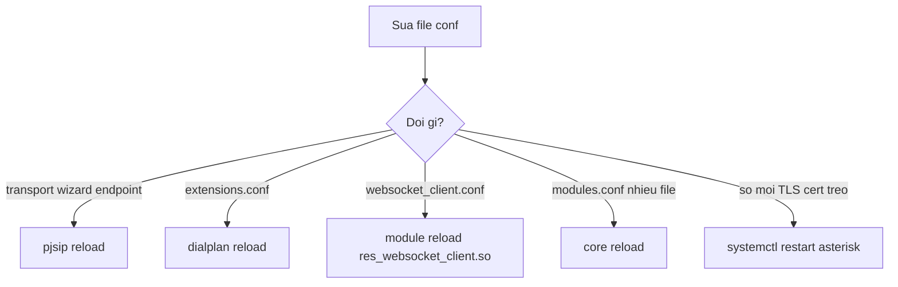

# Cài đặt Asterisk 22, thư mục và lệnh reload

Lab VM `lab-leon-12-10-2026`, binary `/usr/sbin/asterisk`, build **22.11.0** (2026-10-12), service systemd **active**, chạy user `asterisk` (không để daemon root). Đọc nền tảng ở `asterisk-nen-tang-voip-sip-kien-truc`.

## 1. Build từ source

Script lab `install_asterisk.sh` (chạy trên VM qua SSH):

1. Tải `asterisk-22-current.tar.gz` và verify MD5.
2. `./contrib/scripts/install_prereq install` (SSL, ncurses, và dependency build).
3. `./configure --with-jansson-bundled`
4. `make -j$(nproc) && make install && make samples && make config`
5. Tạo user `asterisk`, `chown` thư mục runtime.

Source tree sau cài thường nằm ở `/usr/local/src/asterisk-build/asterisk-22.*`. Dùng lại thư mục này khi `menuselect` bật module mới. Không cấu hình lại từ đầu nếu chỉ thiếu một `.so`.

Tài liệu gốc: Installing Asterisk From Source trên docs.asterisk.org.

## 2. menuselect khi thiếu module

Trước `make install`, trong thư mục source:

```bash
make menuselect
menuselect/menuselect --list-options menuselect.makeopts
```

Voicebot và WebRTC cần:

| Nhóm menuselect | Module |
|-----------------|--------|
| Channel Drivers | `chan_websocket` |
| Resource Modules | `res_websocket_client`, `res_http_websocket` |

Sau khi đổi: `make && make install`, rồi `systemctl restart asterisk`. `pjsip reload` không nạp `.so` mới.

```bash
asterisk -rx "module show like websocket"
```

Lab 22.11 build mặc định đã có 4 module `like websocket` Running: `chan_websocket`, `res_websocket_client`, `res_http_websocket`, `res_pjsip_transport_websocket`. Module cuối là SIP-over-WSS, không phải leg media của Pipecat.

## 3. systemd và CLI

`make config` tạo unit. Process đọc user từ `asterisk.conf`.

```bash
systemctl enable --now asterisk
systemctl status asterisk
journalctl -u asterisk -f
asterisk -V
asterisk -rvvv
asterisk -rx "core show version"
```

`-rvvv` gắn console và tăng verbose. `-rx` chạy một lệnh rồi thoát. Trong console: `core set verbose 5`.

## 4. Thư mục

| Đường dẫn | Nội dung |
|-----------|----------|
| `/etc/asterisk/` | File `.conf` |
| `/var/lib/asterisk/` | AstDB, sounds, AGI, static HTTP |
| `/var/lib/asterisk/sounds/custom/` | WAV IVR, lab `chao-mung-ban-tri.wav` |
| `/var/log/asterisk/` | `messages`, verbose |
| `/var/spool/asterisk/` | Monitor, voicemail |
| `/var/spool/asterisk/monitor/voicebot/` | MixMonitor cuộc 9999 |
| `/usr/lib/asterisk/modules/` | `*.so` |
| `/usr/sbin/asterisk` | Binary |

AstDB (`database put/get`) là key-value nội bộ, khác voicemail ODBC/SQL.

## 5. File cấu hình lab

| File | Vai trò lab |
|------|-------------|
| `pjsip.conf` | `[transport-udp]` |
| `pjsip_wizard.conf` | `[extension-template](!)` |
| `pjsip_wizard_extensions.conf` | 10001, 10002, password tách khỏi template |
| `extensions.conf` | `[from-internal]`: 999, `_1XXXX`, 9999 |
| `rtp.conf` | 10000–20000, `strictrtp=yes`, ICE on |
| `modules.conf` | `load` / `noload` |
| `logger.conf` | Mức log |
| `asterisk.conf` | User, path, `maxcalls` |
| `websocket_client.conf` | Section `[pipecat]` |
| `http.conf` | HTTP server cho WSS và ARI |
| `ari.conf` | User/app Stasis khi dùng ARI |
| `manager.conf` | AMI |
| `cel.conf` | Lab đang **Disabled** |
| `cdr.conf` | Lab **Enabled** |

`#include` tách secret và snippet lab khỏi sample gốc. Wizard include `pjsip_wizard_extensions.conf`. Append block lab cuối file, giữ comment mẫu Asterisk ở đầu. Trước khi thêm transport, grep để không nhân đôi section:

```bash
grep '^\[transport-udp\]' /etc/asterisk/pjsip.conf
grep '^\[extension-template\]' /etc/asterisk/pjsip_wizard.conf
```

Sau khi sửa:

```bash
chown asterisk:asterisk /etc/asterisk/pjsip*.conf /etc/asterisk/extensions.conf
chown asterisk:asterisk /etc/asterisk/websocket_client.conf
chown asterisk:asterisk /var/lib/asterisk/sounds/custom/*.wav
```

## 6. Reload đúng subsystem



| Lệnh | Khi nào |
|------|---------|
| `pjsip reload` | Transport, wizard, endpoint, auth, aor |
| `dialplan reload` | `extensions.conf` |
| `module reload res_websocket_client.so` | `websocket_client.conf` |
| `core reload` | Nhiều file hoặc `modules.conf` |
| `systemctl restart asterisk` | Module `.so` mới, đổi TLS cert, process treo |

`allow_reload=yes` trên transport mới cho phép `pjsip reload` áp transport mà không restart. Sai cú pháp: `pjsip show endpoints` rỗng hoặc log `/var/log/asterisk/messages` báo lỗi parse. Không restart cả PBX chỉ để thêm extension nếu wizard syntax đúng.

## 7. make samples không phải cấu hình production

`make samples` sinh password yếu và context mở. Lab **append** block riêng, không xóa demo nếu không cần, và không coi sample là baseline an toàn. AMI/ARI sample không được bind ra Internet. Chi tiết harden: `asterisk-van-hanh-debug-bao-mat`.

## 8. Kiểm tra sau cài hoặc sau reboot

```bash
asterisk -rx "core show version"
asterisk -rx "core show settings"
asterisk -rx "module show like wizard"
asterisk -rx "module show like websocket"
asterisk -rx "pjsip show transport transport-udp"
asterisk -rx "rtp show settings"
systemctl is-active asterisk
```

Kỳ vọng wizard: `res_pjsip_config_wizard.so` Running. Nếu endpoint không xuất hiện dù file wizard có nội dung, module bị `noload` hoặc syntax wizard lỗi — file tồn tại không có nghĩa object đã được sinh.

## 9. Firewall hai tầng

VM Vultr có firewall group, thường chỉ IP admin **/32**. Đổi mạng thì SSH timeout dù `power: running`. Trên VM, UFW có thể chỉ mở SSH.

Mở tối thiểu cho softphone:

```bash
ufw allow 5060/udp
ufw allow 5060/tcp
ufw allow 10000:20000/udp
ufw status
```

Không mở AMI **5038** và không publish Pipecat **10003** ra Internet. Pipecat chỉ listen `127.0.0.1`.
