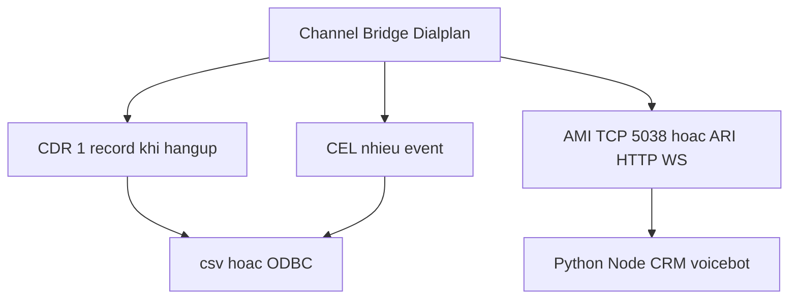

# CDR, CEL, AMI và ARI

Asterisk kể cuộc gọi ra ngoài bằng bản ghi tóm tắt (CDR), sự kiện vòng đời (CEL), hoặc API thời gian thực (AMI, ARI). Kafka lab `mblife.pbx.cdr.v1` cần `linkedid`, không chỉ một dòng CDR. Kiến trúc channel: `asterisk-nen-tang-voip-sip-kien-truc`.

## 1. Ba lớp



| Cơ chế | Dữ liệu | Dùng khi |
|--------|---------|----------|
| CDR | Một bản ghi cuối cuộc: src, dst, billsec, disposition | Billing, báo cáo ngày |
| CEL | CHAN_START, ANSWER, BRIDGE_ENTER, HANGUP, LINKEDID_END | Nhiều leg, transfer, ghép Kafka |
| AMI | Event + action TCP | Originate, giám sát đời cũ |
| ARI | REST + WebSocket trên channel đã vào Stasis | App điều khiển cuộc gọi |
| AGI | stdin/stdout từng bước dialplan | Script cũ, FreePBX, billing |

CDR không đủ cho “từng nhịp” trong cuộc gọi. CEL không điều khiển được channel. ARI không chạy nếu dialplan không gọi `Stasis()`.

```bash
asterisk -rx "cdr show status"
asterisk -rx "cel show status"
asterisk -rx "module show like cdr"
asterisk -rx "module show like cel"
asterisk -rx "module show like manager"
asterisk -rx "module show like ari"
asterisk -rx "module show like stasis"
asterisk -rx "manager show connected"
asterisk -rx "manager show users"
```

## 2. Trạng thái lab đã đo

| Thành phần | Trạng thái VM |
|------------|----------------|
| CDR | **Enabled**. Backend csv và adaptive ODBC. `Log unanswered calls: No` |
| CEL | **Disabled**. Bật `cel.conf` trước khi gom event |
| AMI | `manager` + `res_manager_*` load. Port **5038**. Không expose Internet |
| ARI | `res_ari*` **12** module Running |
| Stasis | `res_stasis*` **9** + `app_stasis` Running. Chưa có app đặt tên riêng |
| Producer Kafka | Mô phỏng. Chưa phải daemon AMI/CEL production |

`core show channels` là runtime, không thay CDR.

## 3. CDR

Một record khi kênh kết thúc: `src`, `dst`, `start`, `answer`, `end`, `billsec`, `disposition` (ANSWERED, NO ANSWER, BUSY, FAILED).

```ini
[general]
enable=yes
```

Backend: `cdr_csv`, `cdr_odbc`, hoặc custom. Vì unanswered đang không log, cuộc đổ chuông rồi cúp có thể không có dòng CDR. Đổi policy trong `cdr.conf` nếu báo cáo cần cả cuộc nhỡ.

`billsec` chỉ tính từ answer đến hangup. Cuộc không answer có duration nhưng billsec 0 nếu vẫn được ghi.

## 4. CEL và linkedid

| Event | Nghĩa |
|-------|-------|
| `CHAN_START` | Kênh được tạo |
| `ANSWER` | Answer |
| `BRIDGE_ENTER` / `BRIDGE_EXIT` | Vào hoặc ra bridge |
| `HANGUP` | Leg kết thúc |
| `LINKEDID_END` | Hết chuỗi liên kết của cả cuộc |

`${UNIQUEID}` thuộc một leg. `linkedid` / `${CHANNEL(linkedid)}` gom caller, callee, transfer, leg WebSocket. Topic lab dùng `linkedid` làm key idempotent.

Pipeline đích:

```text
Asterisk CEL hoặc AMI
  → daemon Python (reconnect, backpressure)
  → Redpanda mblife.pbx.cdr.v1 key=linkedid
  → consumer
  → SQLite
```

| Field message | Nguồn |
|---------------|-------|
| linkedid | CEL hoặc `CHANNEL(linkedid)` |
| uniqueid | `${UNIQUEID}` từng leg |
| src, dst, start, answer, end, billsec, disposition | CDR |
| direction | Context: `from-pstn` là inbound, `from-internal` là internal hoặc outbound |

Chưa bật CEL thì không có event để gom. CDR csv một mình mất transfer và mất leg WebSocket riêng.

Voicebot truyền `linkedid` sang Pipecat bằng tham số `v(linkedid=...)` trên `Dial(WebSocket/...)` để log bot khớp CDR. Hướng này không thay daemon CEL.

## 5. AMI

TCP 5038, user trong `manager.conf`. Bind `127.0.0.1` hoặc VPN. TLS nếu ra khỏi localhost.

```ini
[labuser]
secret = STRONG
read = system,call,log,verbose,command,agent,user,config,dtmf,reporting,cdr,dialplan
write = system,call,log,verbose,command,agent,user,config,dtmf,reporting,cdr,dialplan
```

Client `Action: Login`, nhận `Newchannel`, `DialBegin`, `BridgeEnter`, `Hangup`. `Originate` tạo cuộc từ server (click-to-call). Quyền write rộng bằng một shell trên PBX. Không copy block read/write đầy đủ ra production nếu app chỉ cần `call,reporting`.

CLI tương đương originate:

```bash
asterisk -rx "channel originate PJSIP/10001 application Playback demo-congrats"
```

## 6. ARI và điểm vào Stasis

ARI không nhìn mọi cuộc gọi. Dialplan phải đưa channel vào app:

```ini
exten => _X.,1,Stasis(myapp)
```

App khai báo trong `ari.conf`, subscribe WebSocket, gọi REST `/channels`, `/bridges`, `/play`, `/record`. Module: `app_stasis`, `res_stasis`, `res_ari`, `res_http_websocket`. HTTP server trong `http.conf` phải bật.

So với AMI: ARI mô hình hóa channel và bridge. AMI là event/action mức thấp hơn, không cần `Stasis()`, và nguy hiểm hơn nếu quyền write mở.

Luồng app tối thiểu và so sánh với `chan_websocket` nằm ở `asterisk-nang-cao-stasis-ha-voicebot`. Voicebot lab **không** dùng ARI.

## 7. AGI

`AGI(agi://host/script)` — script đọc/ghi từng bước, dialplan vẫn nắm priority. Module `res_agi`. Phù hợp tra cước hoặc IVR cũ. App thoại realtime mới nên ARI hoặc WebSocket channel, không mở AGI cho STT.

## 8. Chọn cơ chế

| Nhu cầu | Chọn |
|---------|------|
| Báo cáo cuối ngày | CDR → CSV/DB. Cân nhắc bật log unanswered |
| Timeline, transfer, nhiều leg, Kafka | CEL, key `linkedid`. Bật `cel.conf` trước |
| Giám sát và originate đơn giản | AMI, bind localhost |
| IVR động, CRM điều khiển cuộc gọi | ARI + `Stasis(app)` |
| Bot Pipecat lab | `Dial(WebSocket/...)`, không Stasis |
| Script từng bước trong dialplan | AGI hoặc `Gosub` |

`func_odbc` tra DB ngay trong dialplan khi đã có ODBC. CDR adaptive ODBC của lab không đồng nghĩa dialplan đã query được DB.
