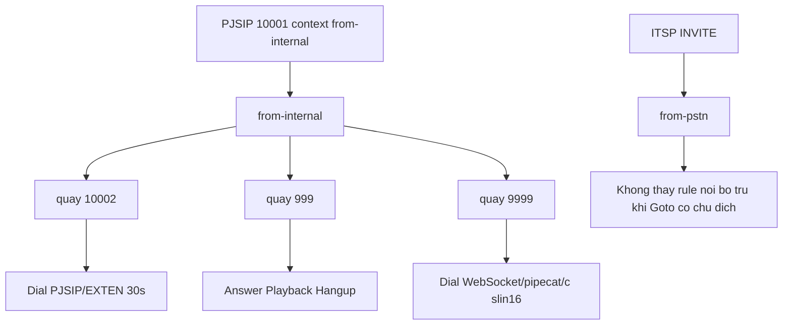
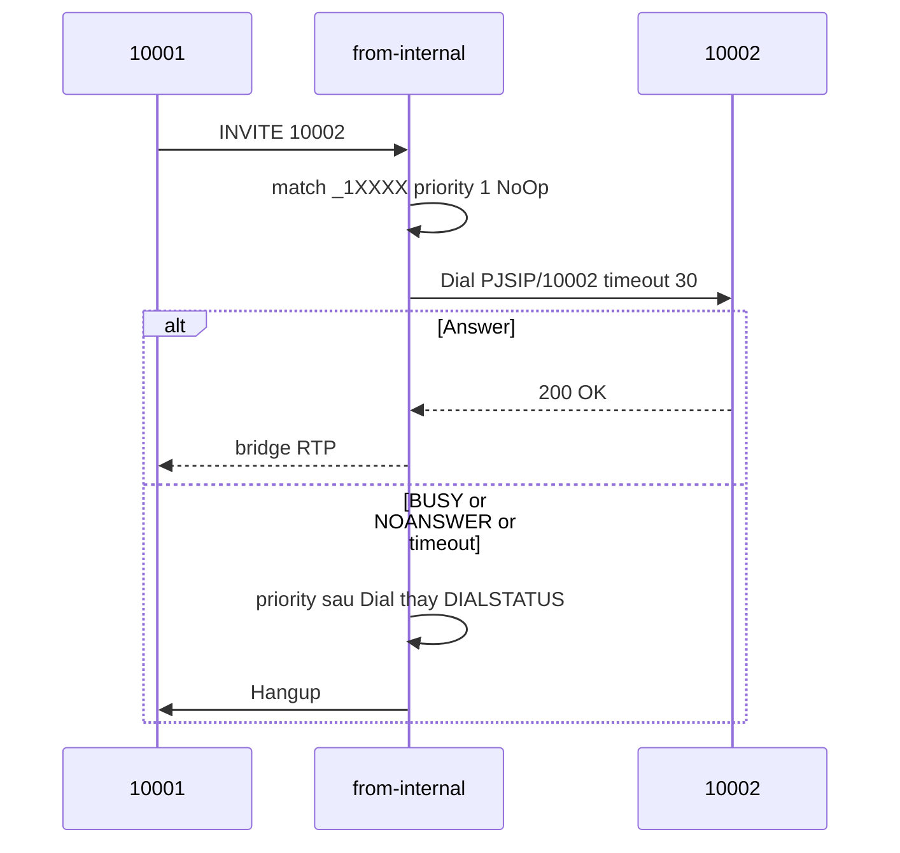

# Dialplan, IVR, queue, voicemail và conference

Dialplan chạy **sau** khi đã có channel. PJSIP chỉ đưa cuộc gọi vào context của endpoint. Engine đọc `extensions.conf` là `pbx_config`. Bài PJSIP: `asterisk-pjsip-wizard-transport-nat`.

## 1. Context cách ly quyền

Endpoint `context=from-internal` khiến mọi cuộc **do user đó quay** chỉ match trong `[from-internal]`. INVITE từ trunk phải vào `from-pstn`. Cùng một số có thể nghĩa khác nhau ở context khác. Không đặt pattern gọi PSTN quốc tế trong context mà peer không tin cậy được phép vào.



## 2. Module dialplan

| Module | Việc |
|--------|------|
| `pbx_config` | Đọc `extensions.conf` |
| `app_dial` | `Dial()`, tạo leg, bridge khi answer |
| `app_playback` | `Playback`, và cả `Background` / `WaitExten` |
| `app_read` | `Read` |
| `app_stack` | `Gosub`, `Return` |
| `app_queue` | `Queue` |
| `app_voicemail` | `VoiceMail`, `VoiceMailMain` |
| `app_confbridge` | `ConfBridge` |
| `app_mixmonitor` | `MixMonitor` |
| `res_musiconhold` | Nhạc chờ |

`Background()` nằm trong `app_playback`. Không có module tên `background`. Nếu app báo not registered, module Not Running.

## 3. Dialplan lab from-internal

Extension cụ thể thắng pattern khi cùng match. `999` không khớp `_1XXXX` nên không xung đột. `9999` cũng là exact match, không bị `_1XXXX` nuốt.

```ini
[from-internal]
exten => 999,1,NoOp(Greeting: Chao mung ban tri)
 same => n,Answer()
 same => n,Wait(1)
 same => n,Playback(custom/chao-mung-ban-tri)
 same => n,Hangup()

exten => _1XXXX,1,NoOp(Internal to ${EXTEN})
 same => n,Dial(PJSIP/${EXTEN},30)
 same => n,Hangup()
```

| Bước 999 | Vì sao |
|----------|--------|
| `NoOp` | Mốc log, không đổi media |
| `Answer()` | Bắt buộc trước `Playback` khi kênh còn ringing |
| `Wait(1)` | Tránh cắt đầu file |
| `Playback` | Phát hết một lần, không ăn DTMF giữa chừng |
| File | `/var/lib/asterisk/sounds/custom/chao-mung-ban-tri.wav`. Gọi **không** kèm `.wav` |

| Pattern | Khớp |
|---------|------|
| `_1XXXX` | Đúng 5 ký tự, bắt đầu 1 |
| `_X.` | Một hoặc nhiều chữ số |
| `_9NXX` | 9 + 3 số (N = 2–9) |
| `_0XXXXXXXXX` | Kiểu số ngoài, dùng với trunk |

`same => n` là priority kế tiếp của cùng extension. Có thể viết `exten => 999,2,Answer()` tường minh. Sau khi `Dial` answer rồi cúp, priority sau `Dial` vẫn chạy (thường `Hangup`). `DIALSTATUS` lúc đó mới có giá trị.

```bash
asterisk -rx "dialplan reload"
asterisk -rx "dialplan show from-internal"
asterisk -rx "dialplan show from-internal@999"
asterisk -rx "dialplan show from-internal@10002"
```

`dialplan show context@exten` in chuỗi priority sẽ chạy. Dùng trước khi test phone.

## 4. Biến và rẽ nhánh

| Biến | Nội dung |
|------|----------|
| `${EXTEN}` | Số đích đang match |
| `${CALLERID(num)}` | Số người gọi |
| `${DIALSTATUS}` | ANSWER, BUSY, NOANSWER, CHANUNAVAIL, CONGESTION, CANCEL |
| `${CHANNEL}` | Tên kênh hiện tại |
| `${UNIQUEID}` | ID của **một leg** |
| `${CHANNEL(linkedid)}` | ID cả cuộc gọi, kể cả nhiều leg. Key Kafka lab |

`Set(MYVAR=value)` sống cùng channel, mất khi hangup trừ khi đẩy sang CDR/CEL.

```ini
exten => _1XXXX,1,Dial(PJSIP/${EXTEN},30)
 same => n,GotoIf($["${DIALSTATUS}" = "BUSY"]?busy,1)
 same => n,Hangup()

exten => busy,1,Playback(busy)
 same => n,Hangup()
```

`Goto(context,exten,priority)` nhảy context. `Gosub` + `Return` là subroutine. `Macro` đã deprecated, dùng `Gosub`.

`#include extensions-custom.conf` để không sửa nhầm sample.

### Dial options

```ini
Dial(PJSIP/10002,30,m)
Dial(PJSIP/10002,30,r)
Dial(PJSIP/10001&PJSIP/10002)
```

Tham số thứ hai là timeout giây. `m` cần Music on Hold. `r` là ringback. `&` đổ chuông đồng thời. Option `b` của `MixMonitor` (không phải của Dial) nghĩa là chỉ ghi khi đã bridge.

## 5. IVR có phím

Lab 999 là Playback một file. IVR thật = prompt + chờ phím + nhánh.

```ini
exten => 800,1,Answer()
 same => n,Background(welcome)
 same => n,WaitExten(5)

exten => 1,1,Goto(sales,1)
exten => 2,1,Goto(support,1)

exten => i,1,Playback(invalid)
 same => n,Goto(800,1)

exten => t,1,Hangup()
```

| App | Hành vi |
|-----|---------|
| `Playback` | Phát hết, không bắt phím giữa file |
| `Background` | Phát và nghe DTMF |
| `WaitExten(5)` | Chờ extension trong context, timeout 5 giây |
| `i` | Phím không khớp |
| `t` | Hết giờ |

WAV telephony: 8000 Hz, mono, 16-bit PCM. Bỏ đuôi file khi gọi Playback.

```bash
ffmpeg -i input.mp3 -ar 8000 -ac 1 -acodec pcm_s16le \
  /var/lib/asterisk/sounds/custom/chao-mung-ban-tri.wav
chown asterisk:asterisk /var/lib/asterisk/sounds/custom/*.wav
```

999 im lặng: thiếu Answer, sai sample rate, sai đường `custom/`, hoặc quyền file không thuộc user `asterisk`.

## 6. Queue

`queues.conf`:

```ini
[support]
strategy = ringall
timeout = 15
member => PJSIP/10001
member => PJSIP/10002
```

| strategy | Hành vi |
|----------|---------|
| `ringall` | Đổ mọi member rảnh |
| `rrmemory` | Round-robin nhớ agent cuối |
| `leastrecent` | Agent lâu chưa nhận nhất |

```ini
exten => 600,1,Answer()
 same => n,Queue(support,t,,,300)
 same => n,Voicemail(600@default,u)
 same => n,Hangup()
```

`Queue` trả về khi agent answer hoặc thất bại. Luôn có fallback. MoH khi chờ lấy từ `musiconhold.conf` qua `res_musiconhold`.

```bash
asterisk -rx "queue show support"
```

Lab đã load `app_queue` nhưng dialplan chưa khai hàng đợi.

## 7. Voicemail

Mailbox dạng `extension@context`, thường `@default`, file `voicemail.conf`. Thư nằm `/var/spool/asterisk/voicemail/`. MWI qua `res_pjsip_mwi`.

```ini
exten => *97,1,VoiceMailMain(${CALLERID(num)}@default)
exten => _1XXXX,n,Voicemail(${EXTEN}@default,u)
```

| Flag | Greeting |
|------|----------|
| `u` | Unavailable |
| `b` | Busy |

Gosub tái sử dụng: Dial 30 giây, `NOANSWER` thì Voicemail. Lab chưa gắn voicemail vào `_1XXXX`.

## 8. ConfBridge và ghi âm

`MeetMe` cũ, không dùng. Nhiều người = một bridge nhiều kênh RTP trong cùng instance Asterisk.

```ini
exten => 700,1,Answer()
 same => n,ConfBridge(700)
 same => n,Hangup()
```

`confbridge.conf` giữ PIN, số người, quyền moderator.

```ini
same => n,MixMonitor(${UNIQUEID}.wav)
```

`MixMonitor` trộn hai chiều một file. `Monitor` tách leg, legacy. File mặc định `/var/spool/asterisk/monitor/`. User `asterisk` phải ghi được. Voicebot 9999 dùng option `b` và thư mục `monitor/voicebot` — chi tiết ở `asterisk-nang-cao-stasis-ha-voicebot`.

## 9. Luồng cuộc gọi nội bộ đã gắn dialplan


