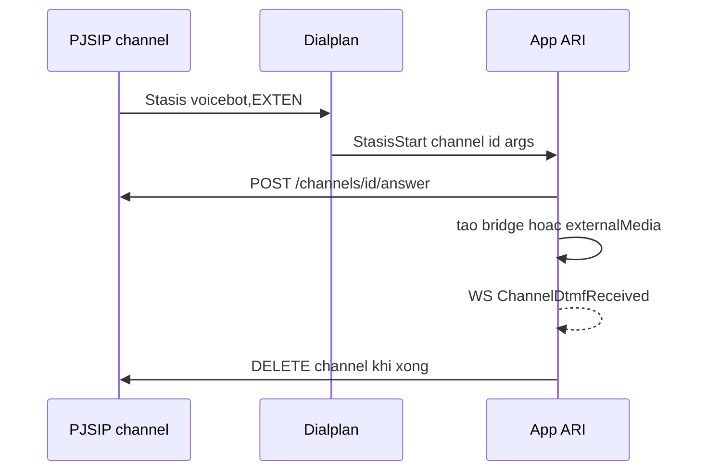
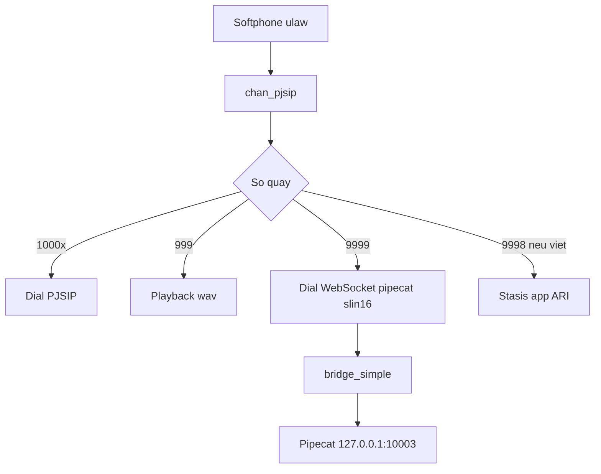
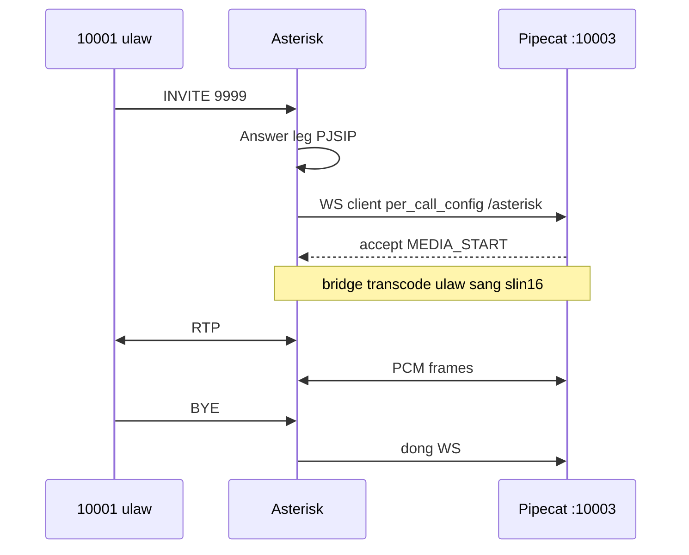
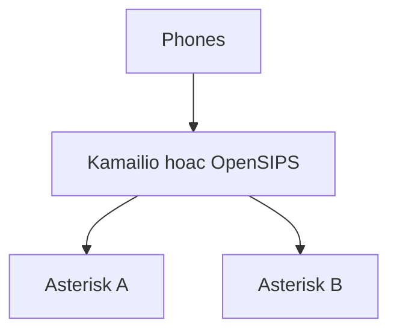

# Stasis, HA và voicebot PBX trên Asterisk 22

Phần nâng cao cho lab MBLife: Stasis/ARI đã load nhưng chưa có app, HA là thiết kế chứ chưa dựng, voicebot **9999** đi `chan_websocket` tới Pipecat. Pipeline AI (echo gate, VAD, ElevenLabs, Ollama) nằm ở bài đã publish `voicebot-asterisk-pipecat-elevenlabs-ollama`. Bài này là hợp đồng PBX.

Tiền đề: `asterisk-nen-tang-voip-sip-kien-truc`, `asterisk-cdr-cel-ami-ari`, `asterisk-webrtc-tls-srtp`.

## 1. Snapshot module đã verify

Host `lab-leon-12-10-2026`, Asterisk **22.11.0**, `PUBLIC_IP` `45.76.147.0`.

| Chủ đề | Running | Ghi chú |
|--------|---------|---------|
| PJSIP | 51 module | `chan_pjsip`, registrar, nat, session, `res_pjsip_transport_websocket` |
| Wizard | `res_pjsip_config_wizard` | Endpoint 10001 gắn nguồn wizard |
| RTP | `res_rtp_asterisk`, `res_srtp`, `res_pjsip_sdp_rtp` | 10000–20000, strictrtp=yes, ICE on, STUN off |
| Queue / VM / Conf | `app_queue`, `app_voicemail`, `app_confbridge` | Có module, dialplan lab chưa dùng |
| IVR | `app_playback`, `app_read` | `Background` nằm trong `app_playback` |
| CDR | Enabled, csv + adaptive ODBC | Không log unanswered |
| CEL | Disabled | Bật trước pipeline Kafka thật |
| AMI | manager trên 5038 | Không public |
| ARI | 12 module | Sẵn sàng, chưa gắn app |
| Stasis | 9 module + `app_stasis` | Sẵn sàng, chưa `Stasis(tên-app)` |
| WebSocket | 4 module | UDP vẫn là SIP user. Pipecat dùng `res_websocket_client` |

Transport đã verify: bind `0.0.0.0:5060`, cả hai `external_*` = `45.76.147.0`, `local_net=127.0.0.0/8`.

Dialplan `from-internal`: `999` Playback, `_1XXXX` Dial 30 giây, `9999` WebSocket (đã merge trên VM voicebot, `c(slin16)`, URI cổng **10003**).

## 2. Stasis nhường quyền điều khiển

Dialplan cổ điển chạy hết priority trong `extensions.conf`. Stasis dừng dialplan và giao channel cho app ngoài qua ARI.



```ini
exten => 9998,1,Answer()
 same => n,Stasis(voicebot,${EXTEN})
```

Tên `voicebot` phải khớp user/app trong `ari.conf`. HTTP server bật. App giữ vòng lặp: `StasisStart` → answer → bridge / play / `externalMedia` → xóa channel.

| Module | Vai trò |
|--------|---------|
| `app_stasis` | Ứng dụng dialplan `Stasis()` |
| `res_stasis` và `res_stasis_*` | Answer, playback, recording, snoop trong Stasis |
| `res_ari` và `res_ari_*` | REST và sự kiện |
| `http` + `res_http_websocket` | Transport ARI và WSS |

Use case hợp ARI: menu từ DB, screen-pop CRM trên `StasisStart` kèm `linkedid`, conference tùy biến, bot tự viết bridge. Không hợp khi Pipecat đã có serializer Asterisk: thêm ARI là thêm event loop không cần.

## 3. Chọn đường cho voicebot

| | Dialplan thuần | Stasis + ARI | WebSocket channel lab |
|---|----------------|--------------|------------------------|
| Dialplan | Playback, Queue | `Stasis(app)` | `Answer` rồi `Dial(WebSocket/pipecat/c(slin16))` |
| App | Không | REST + WS event | Pipecat listen |
| Media | File hoặc bridge SIP | App phải bridge hoặc externalMedia | `chan_websocket` nối trong Dial |
| Độ phức tạp | Thấp | Cao | Trung bình |
| Lab | 999, nội bộ | Chưa dùng | **9999** |

AudioSocket (`AudioSocket(host:port)`) không có transport Pipecat chính thức. Chỉ xét khi không dùng được WebSocket.

Cả ba đường đều không thay PJSIP. User vẫn REGISTER. Chỉ leg bot đổi.



## 4. Hợp đồng 9999

Asterisk là **WebSocket client**. `connection_type=per_call_config`: mỗi cuộc một TCP tới Pipecat. Pipecat listen, không dial ngược. Phù hợp firewall vì cổng bot không public.

Leg A: SIP/RTP ulaw hoặc alaw, 8 kHz. `Answer()` dừng ringback. `Dial` tạo leg B. Bridge transcode sang **slin16** (PCM 16-bit signed, 16 kHz, mono). Pipecat không tự decode RTP khi dùng `AsteriskFrameSerializer`.

Đổi `c(slin16)` thì phải đổi `PIPECAT_SAMPLE_RATE` cùng lúc. `slin` / `slin8` lệch sẽ im hai đầu.

```ini
exten => 9999,1,NoOp(=== Pipecat voicebot === caller ${CALLERID(num)})
 same => n,Set(BOT_CALLER=${CALLERID(num)})
 same => n,Answer()
 same => n,Dial(WebSocket/pipecat/c(slin16)v(caller=${URIENCODE(${BOT_CALLER})},linkedid=${URIENCODE(${CHANNEL(linkedid)})}))
 same => n,NoOp(Voicebot end DIALSTATUS=${DIALSTATUS})
 same => n,Hangup()
```

| Tham số Dial | Nghĩa |
|--------------|-------|
| `pipecat` | Tên section trong `websocket_client.conf` |
| `c(slin16)` | Codec trên leg WS |
| `v(caller,linkedid)` | Query sang app để khớp log và CDR |

```ini
[pipecat]
type = websocket_client
uri = ws://127.0.0.1:10003/asterisk
protocols = media
connection_type = per_call_config
connection_timeout = 5000
reconnect_interval = 1000
reconnect_attempts = 3
tls_enabled = no
```

Mẫu upstream hay ghi cổng **8765**. Lab là **10003**. Lệch cổng = CONGESTION ngay. Pipecat máy khác: đổi IP private, firewall chỉ từ Asterisk, production dùng `wss://` và `tls_enabled=yes`.

Reload:

```bash
asterisk -rx "module reload res_websocket_client.so"
asterisk -rx "dialplan reload"
asterisk -rx "dialplan show from-internal@9999"
```

`Dial(WebSocket/INCOMING/...)` là chiều ngược: app nối vào HTTP Asterisk. Lab không dùng. Đừng đổi sang INCOMING để “cho chắc”.

DID sau này, chỉ số đã kiểm soát:

```ini
[from-pstn]
exten => 02812349999,1,Goto(from-internal,9999,1)
```

Không `Goto` mọi `_X.` vào bot.

### Ghi âm hai chiều

```ini
same => n,Set(VOICEBOT_REC_DIR=/var/spool/asterisk/monitor/voicebot)
same => n,System(mkdir -p ${VOICEBOT_REC_DIR} && chown asterisk:asterisk ${VOICEBOT_REC_DIR})
same => n,Answer()
same => n,Set(MIXMON_FILE=${VOICEBOT_REC_DIR}/voicebot-${STRFTIME(${EPOCH},,%Y%m%d-%H%M%S)}-${BOT_CALLER}-${CHANNEL(linkedid)})
same => n,MixMonitor(${MIXMON_FILE}.wav,b,/opt/pipecat-voicebot/scripts/mixmonitor_post.sh ^{MIXMONITOR_FILENAME})
```

Option `b` chỉ ghi sau bridge, bỏ đoạn im trước khi bot nối. Pipecat không ghi WAV riêng. Tên file chứa `linkedid` để khớp query WS.

### 999 và 9999

| | 999 | 9999 |
|---|-----|------|
| Loại | IVR tĩnh một chiều | Bot hai chiều |
| Media | Playback WAV 8 kHz | WS slin16 |
| Phụ thuộc | File `sounds/custom` | Process Pipecat + API key |
| Khi app chết | Im hoặc cắt file | CONGESTION, beep, cúp |

## 5. Luồng một cuộc 9999



Thứ tự vận hành: Pipecat active trước, rồi mới gọi. `curl -s http://127.0.0.1:10003/health` phải sống. `ss -lntp | grep 10003`.

| Triệu chứng | Nguyên nhân gốc đã gặp trên lab |
|-------------|-------------------------------|
| Beep rồi cúp, `DIALSTATUS=CONGESTION` | `pipecat-voicebot` inactive hoặc URI sai cổng |
| Không REGISTER | UFW hoặc Vultr chặn 5060/RTP |
| Im hai đầu | Lệch slin16 và sample rate, hoặc thiếu key `.env` |
| Bot không nói sau LLM | `optimize_streaming_latency` với `eleven_v4_turbo` gây HTTP 400 |
| Lặp câu trên loa ngoài | STT nghe TTS. Xử lý bằng echo gate trong Pipecat, không phải sửa codec |
| Lượt 1 được, lượt 2 im | `AlwaysUserMuteStrategy` kẹt. Đã bỏ ở bot |
| Không vào 9999 | Chưa `dialplan reload`, hoặc gọi sai context |

Chi tiết VAD (`VAD_STOP_SECS=0.22`), STT `scribe_v2`, TTS `eleven_v4_turbo`, model `gemma4:cloud`, và mute deadlock: lấy section từ slug `voicebot-asterisk-pipecat-elevenlabs-ollama`. Không nhân đôi pipeline Python ở đây.

Invariants agent cần khi sửa PBX, không sửa bot:

- URI `ws://127.0.0.1:10003/asterisk`, `protocols=media`, `per_call_config`.
- `c(slin16)` khớp 16000 Hz.
- `Answer()` trước `Dial(WebSocket/...)`.
- Không publish 10003.
- Không bật `webrtc=yes` trên extension UDP để “sửa” voicebot.

## 6. Originate và Local channel

Tạo cuộc từ server, không từ phone:

```bash
asterisk -rx "channel originate PJSIP/10001 application Playback demo-congrats"
```

AMI `Originate` cùng việc đó cho click-to-call. `Local/10001@from-internal` đi vào dialplan như thể user quay số, hữu ích khi originate cần context chứ không chỉ một application.

## 7. Scale

Một instance Asterisk giữ SIP và media trong bộ nhớ của nó. Không có cluster shared-state chính thức.



| Hướng | Nghĩa |
|-------|-------|
| Dọc | Thêm CPU/RAM. Trần là transcode, MixMonitor, conference |
| Ngang | Nhiều Asterisk, proxy chia theo DID hoặc site |
| Tách vai | Proxy chỉ signaling, Asterisk chỉ media |

Không ước lượng kênh từ datasheet. Lab 2 vCPU / 4 GB là vài cuộc cộng một bot, không phải hàng trăm CPS. Benchmark trên staging.

## 8. High availability

| Mô hình | Hành vi |
|---------|---------|
| Cold standby | Snapshot VM, failover IP thủ công |
| Warm spare | rsync `/etc/asterisk`, VIP keepalived. Phone phải REGISTER lại |
| Shared storage | Voicemail, ghi âm, CDR ODBC trên NFS hoặc DB chung |
| Stateless front | Kamailio và nhiều Asterisk. Cần stickiness hoặc re-INVITE |

REGISTER và RTP gắn instance đang xử lý. Failover làm cuộc đang nói bị đứt. Cuộc mới sống sau khi phone đăng ký lại. Không hứa cuộc gọi liên tục khi chuyển VIP.

SBC trước Asterisk khi ra Internet thật: ẩn topology, chuẩn codec, cắt toll fraud, terminate TLS. Lab không có SBC.

FreePBX/Issabel là GUI trên cùng engine Asterisk. Khác 3CX ở license. Ma trận 3CX nằm ở `asterisk-nen-tang-voip-sip-kien-truc`.

## 9. Checklist PBX trước khi gọi bot

- `chan_websocket` và `res_websocket_client` Running.
- `websocket_client.conf` URI cổng 10003, không 8765.
- `dialplan show from-internal@9999` thấy `Dial(WebSocket/pipecat/c(slin16)`.
- UFW và Vultr: 5060 và RTP 10000–20000. Không mở 10003, không mở 5038.
- `systemctl is-active pipecat-voicebot` và health local.
- Extension wizard `direct_media=no`, `allow=ulaw,alaw`, context `from-internal`.
- MixMonitor option `b` nếu cần file đối soát.
- CEL vẫn tắt: đừng kỳ vọng topic Kafka có event cho đến khi bật `cel.conf`.
