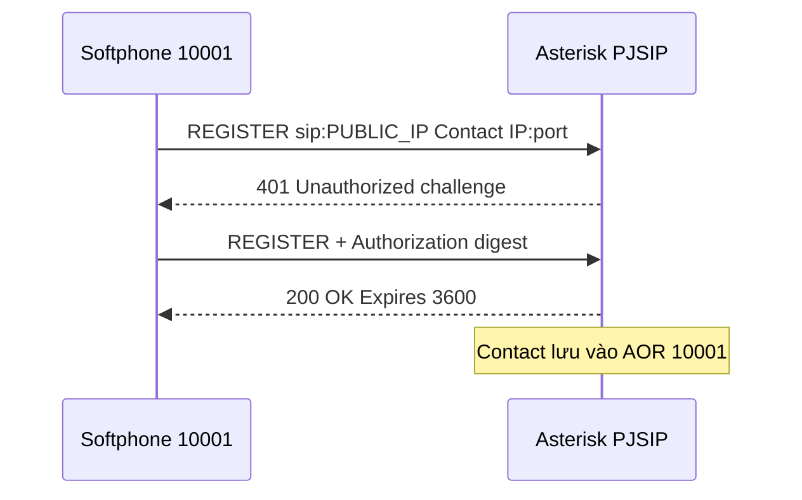
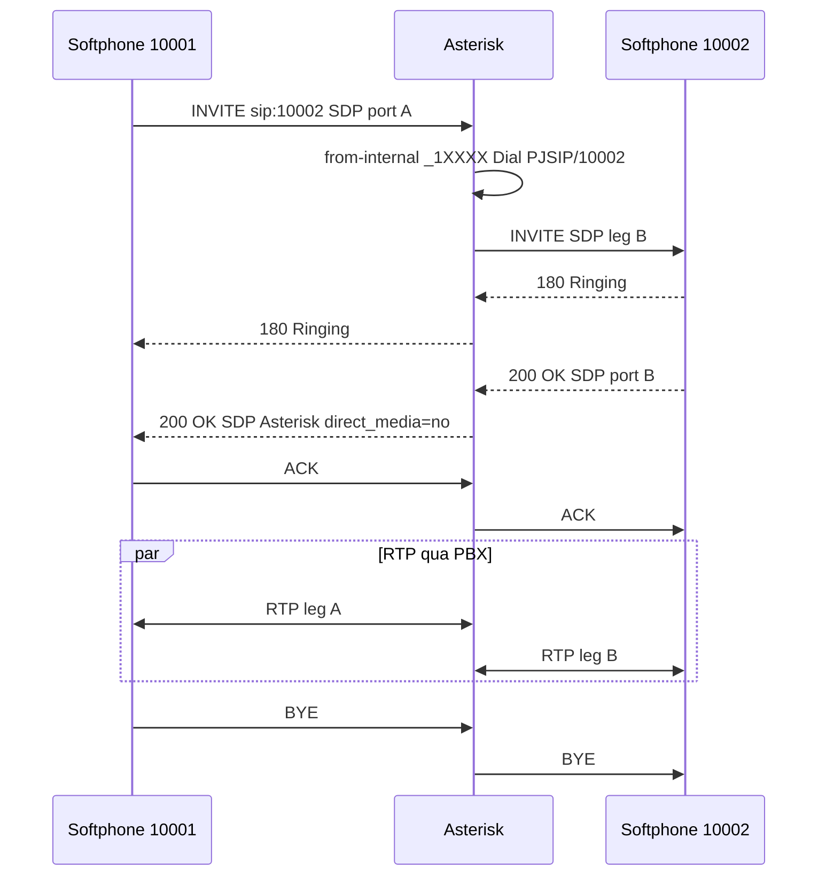
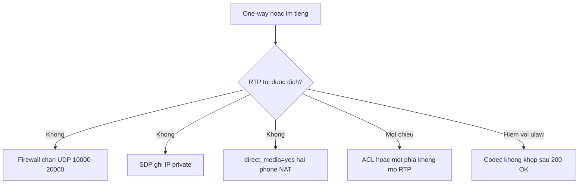

# Nền tảng VoIP, SIP và kiến trúc Asterisk 22

Bộ này dành cho agent vận hành PBX lab MBLife/Leon: Asterisk **22.11.0**, PJSIP (không `chan_sip`), `direct_media=no`, codec `ulaw,alaw`.

Series:

| Phần | Slug |
|------|------|
| 1. Nền tảng | `asterisk-nen-tang-voip-sip-kien-truc` |
| 2a. Cài đặt | `asterisk-cai-dat-thu-muc-cli` |
| 2b. PJSIP, wizard, NAT | `asterisk-pjsip-wizard-transport-nat` |
| 2c. Dialplan, IVR, queue | `asterisk-dialplan-ivr-queue-voicemail` |
| 2d. Trunk PSTN | `asterisk-trunk-pstn` |
| 2e. WebRTC | `asterisk-webrtc-tls-srtp` |
| 2f. CDR, CEL, AMI, ARI | `asterisk-cdr-cel-ami-ari` |
| 2g. Vận hành | `asterisk-van-hanh-debug-bao-mat` |
| 3. Stasis, HA, voicebot | `asterisk-nang-cao-stasis-ha-voicebot` |

Pipeline Pipecat đầy đủ (ElevenLabs, Ollama, echo gate) đã có ở `voicebot-asterisk-pipecat-elevenlabs-ollama`. Bài phần 3 chỉ giữ hợp đồng Asterisk ↔ bot.

## 1. Hai tầng VoIP: báo hiệu SIP và media RTP

Voice over IP tách cuộc gọi thành hai luồng độc lập. SIP thành công không có nghĩa RTP thành công.

| Tầng | Giao thức | Việc làm | Cổng lab |
|------|-----------|----------|----------|
| Báo hiệu | SIP | REGISTER, INVITE, 180, 200 OK, ACK, BYE, SDP | UDP/TCP **5060** |
| Media | RTP | Âm thanh thời gian thực | UDP **10000–20000** |

SDP trong INVITE và 200 OK mang địa chỉ IP, port RTP và danh sách codec (`c=IN IP4`, `m=audio`). RTP không đi chung cổng 5060.

Asterisk đóng vai **B2BUA** (Back-to-Back User Agent): hai chân SIP, hai bộ SDP. Lab đặt `direct_media=no` nên RTP đi qua PBX, không bắn thẳng giữa hai phone.

## 2. Thuật ngữ bắt buộc

| Thuật ngữ | Nghĩa trong lab |
|-----------|-----------------|
| UA | Softphone, IP phone, gateway |
| Extension | Số logic (`10001`) map tới endpoint PJSIP |
| Trunk | Kết nối ITSP/PSTN, khác extension nội bộ |
| DID | Số PSTN gán vào PBX |
| AOR | Sổ địa chỉ: Contact IP:port sau REGISTER |
| Context | Tập dialplan cách ly quyền (`from-internal` vs `from-pstn`) |
| URI | `sip:10002@203.0.113.1:5060` |

Asterisk 22 dùng **PJSIP** (`chan_pjsip`). `chan_sip` đã deprecated. Mọi cấu hình trong series này là PJSIP hoặc wizard sinh ra object PJSIP.

## 3. Luồng REGISTER

REGISTER và INVITE là hai phiên SIP độc lập. REGISTER chạy khi softphone bật hoặc trước khi hết hạn. Mỗi extension REGISTER riêng. Asterisk không REGISTER giữa 10001 và 10002.



| Bước | Ý nghĩa |
|------|---------|
| REGISTER | “Khi có cuộc gọi tới tôi, gửi tới Contact này.” |
| 401 | Digest auth (`inbound_auth` của wizard) |
| 200 OK | Contact nằm trong AOR. CLI: `pjsip show aor 10001` |
| Trước REGISTER | `pjsip show endpoint` thường **Unavailable** — chưa có chỗ gửi INVITE |

Lab: `PUBLIC_IP` = `45.76.147.0`, transport `transport-udp` bind `0.0.0.0:5060`.

## 4. Luồng INVITE nội bộ: 10001 gọi 10002

User 10001 quay 10002. INVITE vào context `from-internal`. Pattern `_1XXXX` chạy `Dial(PJSIP/${EXTEN},30)`. `Dial` tạo leg B tới contact của 10002. Chuông/ringback là signaling (`180 Ringing`), chưa cần RTP hai chiều. Tiếng nói chỉ có sau 200 OK khi SDP đã khớp và RTP chạy.



Điểm bất biến:

- Hai SDP: leg A (phone ↔ Asterisk) và leg B (Asterisk ↔ callee).
- `direct_media=no`: media relay qua PBX, phục vụ NAT, MixMonitor, queue, voicebot.
- Pattern lab: `_1XXXX` là 5 chữ số bắt đầu bằng 1 (10001–19999).

## 5. Codec

| Codec | Tên PJSIP | Băng thông | Ghi chú |
|-------|-----------|------------|---------|
| G.711 μ-law | `ulaw` | ~64 kbps | PCMU, nhiều trunk |
| G.711 A-law | `alaw` | ~64 kbps | PCMA, VN thường dùng |
| G.722 | `g722` | wideband | Cần cả hai đầu |
| Opus | `opus` | biến đổi | WebRTC |
| Signed linear 16 kHz | `slin16` | rộng | Leg WebSocket voicebot, không phải codec phone |

Lab endpoint: `disallow=all` rồi `allow=ulaw,alaw`. Transcoding (alaw ↔ opus, ulaw ↔ slin16) tốn CPU. VM lab **2 vCPU / 4 GB** chịu vài kênh G.711; không chịu nhiều conference hoặc transcode đồng thời. Voicebot 9999 transcode ulaw ↔ slin16 trên đúng một bridge — chấp nhận được cho lab.

## 6. One-way audio

Chuông vẫn nghe được vì SIP 180/183 đi cổng 5060. Im tiếng là RTP: cổng khác và IP trong SDP sai.



| # | Nguyên nhân | Cách xử lý lab |
|---|-------------|----------------|
| 1 | Firewall chỉ mở 5060 | Mở UDP 10000–20000 trên UFW và Vultr |
| 2 | `external_media_address` sai | Đặt bằng public IP phone nhìn thấy: `45.76.147.0` |
| 3 | `direct_media=yes` | Lab giữ `no` |
| 4 | Thiếu symmetric RTP | `rtp_symmetric=yes`, `force_rport=yes`, `rewrite_contact=yes` |
| 5 | SIP ALG / router sửa SIP | Tắt SIP ALG; thử 4G |
| 6 | IVR im | Thiếu `Answer()` trước `Playback`, hoặc thiếu file WAV |

```bash
asterisk -rx "core show channels"
asterisk -rx "rtp show stats"
asterisk -rvvv
rtp set debug on
pjsip set logger on
```

Trong log, `c=IN IP4` phải là IP reachable (public lab), và firewall cho UDP tới port trong `m=audio`.

## 7. Asterisk làm gì trong một process

Một process `asterisk`, nhiều module `.so` load lúc runtime. Ba vai: B2BUA, media switch, dialplan engine.

```text
         +------------------ Asterisk core ------------------+
         |  pbx_config + dialplan apps                       |
         |         |                          |              |
  SIP --> |  chan_pjsip  ----bridge----  chan_websocket   | --> Pipecat
         |         |                          |              |
         |    res_rtp_asterisk (RTP)                        |
         +--------------------------------------------------+
```

| Khái niệm | Nghĩa | Ví dụ lab |
|-----------|-------|-----------|
| Channel | Một leg | `PJSIP/10001-00000001` |
| Application | Lệnh dialplan | `Dial`, `Playback`, `Stasis`, `Queue`, `MixMonitor` |
| Bridge | Ghép media nhiều leg | `Dial()` khi callee answer; voicebot = PJSIP + WebSocket |

Khi `Dial(PJSIP/10002)` được answer và `direct_media=no`, bridge thường là **simple bridge** (RTP relay). CLI lúc đang gọi: `core show channels`, `bridge show all`.

## 8. Quy ước tên module

| Tiền tố | Vai trò | Ví dụ |
|---------|---------|--------|
| `chan_*` | Channel driver | `chan_pjsip`, `chan_websocket` |
| `app_*` | Ứng dụng dialplan | `app_dial`, `app_playback`, `app_stasis`, `app_queue` |
| `res_*` | Resource | `res_pjsip`, `res_rtp_asterisk`, `res_stasis`, `res_ari` |
| `func_*` | Hàm `${...}` | `func_cdr` |
| `bridge_*` | Kiểu bridge | `bridge_simple`, `bridge_native_rtp` |

Snapshot lab đã đếm: **51** module `like pjsip`, wizard Running, **9** Stasis, **12** ARI, **4** module `like websocket`. RTP `strictrtp=yes`, ICE on, STUN off. Chi tiết: bài `asterisk-nang-cao-stasis-ha-voicebot`.

## 9. Ba cách đưa cuộc gọi ra ứng dụng

| Cách | Dialplan | App ngoài | Lab dùng cho |
|------|----------|-----------|--------------|
| Dialplan thuần | `Playback`, `Queue`, `Goto` | Không | 999, `_1XXXX` |
| Stasis + ARI | `Stasis(myapp)` | HTTP/WS điều khiển channel/bridge | IVR động, chưa gắn app |
| WebSocket channel | `Dial(WebSocket/pipecat/c(slin16))` | Pipecat listen WS | **9999** |

Voicebot chọn WebSocket vì Pipecat có serializer sẵn. Không bắt buộc viết app ARI để bridge RTP. User vẫn REGISTER bằng PJSIP; chỉ leg bot là WebSocket.

```text
10001 --SIP/RTP ulaw--> Asterisk --bridge--> WebSocket --slin16--> Pipecat :10003
```

## 10. Cấu hình file và runtime

File INI trong `/etc/asterisk/*.conf` được đọc lúc load hoặc reload. Object PJSIP của một extension wizard:

```text
endpoint/10001 ---> auth/10001, aor/10001, transport-udp
```

Dialplan engine là `pbx_config`. Context cách ly quyền: endpoint `context=from-internal` chỉ thấy rule trong context đó. Trunk vào `from-pstn` không được gọi quốc tế trừ khi dialplan cố ý cho phép.

## 11. Asterisk so với 3CX

So sánh công bằng: Asterisk thuần + kỹ sư viết dialplan, đối với 3CX admin dùng GUI. Asterisk + FreePBX gần 3CX hơn nhưng vẫn khác license và ecosystem.

| Tiêu chí | Asterisk 22 tự build | 3CX |
|----------|----------------------|-----|
| License | GPL | Free tier + phí theo simultaneous calls |
| Admin | CLI và file | Web GUI, QR provisioning |
| Softphone | Bên thứ ba | Web client và app |
| IVR | Dialplan hoặc ARI | Kéo thả |
| Queue | `app_queue` | Module call center, wallboard |
| WebRTC | Thủ công (cert, ICE, DTLS) | Tích hợp |
| API | AMI, ARI, AGI | REST 3CX |
| CDR | CDR/CEL + DB tự nối | Report sẵn |
| Kafka | Tự do (CEL/AMI agent) | Webhook, không native Kafka |
| HA / multi-tenant | Tự thiết kế | Edition / hướng dẫn |
| Tùy biến | Rất cao | Trong khuôn GUI |

Chọn Asterisk khi cần CDR → Kafka, logic tùy chỉnh, kiểm soát VM, không phụ thuộc license theo số kênh đồng thời. Chọn 3CX khi cần triển khai nhanh, app mobile, meeting, connector CRM, và chấp nhận giới hạn tùy biến.

Giới hạn Asterisk: không có GUI/mobile turnkey, HA và SBC phải tự dựng, `make samples` không an toàn production, quy mô phụ thuộc CPU và kiến trúc media.

Lab đã có: cài 22 LTS, transport UDP + NAT, wizard 10001/10002, dialplan `from-internal` + 999 + 9999, tài liệu trunk và WebRTC. CDR bật (csv + adaptive ODBC). CEL tắt. Kafka producer lab là mô phỏng, chưa phải agent CEL production.

## 12. Bất biến lab để agent không đoán lại

```text
Softphone REGISTER → transport-udp:5060
Endpoint context   → from-internal
Gọi nội bộ         → _1XXXX → Dial(PJSIP/${EXTEN},30)
Gọi 999            → Playback(custom/chao-mung-ban-tri)
Gọi 9999           → Dial(WebSocket/pipecat/c(slin16)) → ws://127.0.0.1:10003/asterisk
PUBLIC_IP          → 45.76.147.0
RTP                → UDP 10000-20000, strictrtp=yes
direct_media       → no
```

Firewall Vultr thường whitelist **IP /32**. Đổi mạng (Wi-Fi/4G) làm SSH và SIP timeout dù VM đang chạy. Thêm rule TCP 22, TCP/UDP 5060, UDP 10000–20000 cho IP mới. UFW trên VM là tầng thứ hai: cloud mở mà UFW chặn vẫn không REGISTER được.
