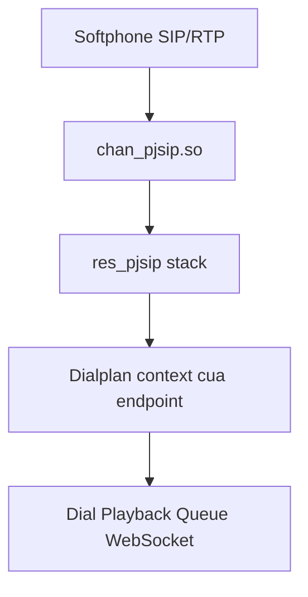
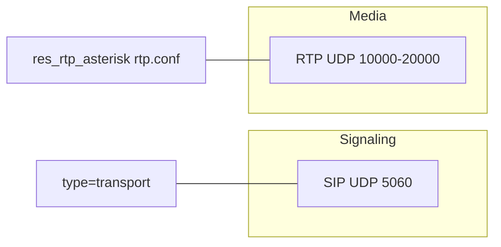
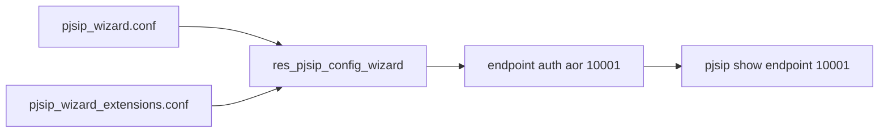

# PJSIP: object, wizard, transport và NAT

Asterisk **22.11.0**, stack PJSIP, không `chan_sip`. Một extension không phải một dòng config. Wizard chỉ sinh các object mà CLI vẫn inspect bằng `pjsip show`. Nền tảng SIP/RTP: `asterisk-nen-tang-voip-sip-kien-truc`.

## 1. Tầng module khi softphone gọi



| Module | Vai trò |
|--------|---------|
| `chan_pjsip` | Biến phiên SIP thành channel `PJSIP/10001-00000001` |
| `res_pjsip` | Đọc config, session, media |
| `res_pjsip_authenticator_digest` | Digest username/password |
| `res_pjsip_registrar` | Nhận REGISTER từ phone |
| `res_pjsip_outbound_registration` | PBX REGISTER ra ITSP |
| `res_pjsip_endpoint_identifier_ip` | Khớp INVITE theo IP nguồn (trunk IP-auth) |
| `res_pjsip_nat` | `rtp_symmetric`, `rewrite_contact` |
| `res_pjsip_config_wizard` | Đọc wizard, sinh endpoint/auth/aor |
| `res_rtp_asterisk` | RTP, đọc `rtp.conf` |
| `app_dial` | `Dial()` yêu cầu channel driver tạo leg mới |

Lab: `module show like pjsip` = **51** module. Sau `pjsip reload`, log liệt kê `res_pjsip*` được nạp lại.

## 2. Các type object

Cùng tên section (ví dụ `[10001]`) được khai báo nhiều lần với `type` khác nhau. Đó là đúng, không phải trùng lỗi.

| type | Hình dung | Việc làm |
|------|-----------|----------|
| `transport` | Cửa vào | Bind UDP/TCP/TLS/WSS |
| `endpoint` | Hồ sơ thuê bao | Codec, context, NAT, transport |
| `auth` | Chìa khóa | Digest user/password |
| `aor` | Sổ địa chỉ | Lưu Contact sau REGISTER |
| `identify` | Biển số | Match IP → endpoint trunk |
| `registration` | PBX đăng ký đi | Outbound REGISTER tới ITSP |

### REGISTER ghi vào AOR

1. Phone gửi `REGISTER` kèm digest.
2. Asterisk kiểm tra auth và endpoint.
3. Contact (IP:port thực, có thể sau NAT) ghi vào AOR.
4. `Dial(PJSIP/10001)` tra AOR rồi gửi INVITE tới Contact.

Chưa REGISTER thì endpoint **Unavailable**.

```bash
asterisk -rx "pjsip show registrations"
asterisk -rx "pjsip show aor 10001"
asterisk -rx "pjsip show contacts"
asterisk -rx "pjsip show endpoint 10001"
asterisk -rx "pjsip show auth 10001"
```

## 3. Endpoint viết tay — để hiểu, lab không dùng

```ini
[10001]
type=endpoint
context=from-internal
disallow=all
allow=ulaw,alaw
auth=10001
aors=10001
transport=transport-udp

[10001]
type=auth
auth_type=userpass
username=10001
password=SECRET

[10001]
type=aor
max_contacts=3
```

| Field | Nghĩa |
|-------|-------|
| `context` | Dialplan khi **chính extension này gọi đi** |
| `disallow=all` + `allow` | Chỉ codec được liệt kê |
| `auth` / `aors` | Tên section auth và aor |
| `transport` | SIP đi qua transport nào |

`Dial(PJSIP/10002)` tìm endpoint tên `10002`. Cú pháp trunk nhiều host: `PJSIP/10002/sip:host` hoặc `PJSIP/${EXTEN}@my-itsp`.

### Inbound auth và outbound auth

| Hướng | Ai chứng minh | Extension lab | Trunk |
|-------|----------------|---------------|-------|
| Inbound | Phone → PBX | `inbound_auth` / `auth=` | Thường không dùng digest; dùng `identify` |
| Outbound | PBX → ITSP | `sends_auth=no` | `outbound_auth` |

Nhầm chiều auth là lý do trunk không REGISTER được: password đặt inbound trong khi ITSP challenge outbound.

`qualify_frequency`: OPTIONS định kỳ. Trunk thường 60 giây. Extension lab có thể `0` vì REGISTER đã là heartbeat.

## 4. Transport chỉ lo SIP, không lo RTP



Transport lab đã verify trên VM:

```ini
[transport-udp]
type=transport
protocol=udp
bind=0.0.0.0:5060
external_media_address=45.76.147.0
external_signaling_address=45.76.147.0
local_net=127.0.0.0/8
allow_reload=yes
```

| Tham số | Việc làm |
|---------|----------|
| `bind` | Asterisk lắng nghe SIP. `0.0.0.0:5060` = mọi interface |
| `external_signaling_address` | IP ghi vào Via/Contact khi peer ở Internet |
| `external_media_address` | IP ghi vào SDP. Phone gửi RTP tới đây |
| `local_net` | Không rewrite sai cho máy “ở gần” PBX. Lab chỉ loopback. Thêm `local_net=10.0.0.0/8` nếu phone trong VPC |
| `allow_reload` | `pjsip reload` áp được transport |

`external_*` phải là IP **phone nhìn thấy**, không phải `127.0.0.1` và không phải IP private của VM nếu client ở Internet.

| Transport | protocol | Dùng khi |
|-----------|----------|----------|
| `transport-udp` | udp | Softphone lab |
| `transport-tcp` | tcp | Firewall chặn UDP dài |
| `transport-tls` | tls | SIP mã hóa, chưa phải WebRTC |
| `transport-wss` | wss | SIP trong WebSocket cho browser. Xem `asterisk-webrtc-tls-srtp` |

Endpoint gắn `transport=transport-udp`.

## 5. Bộ NAT trên endpoint

```ini
endpoint/rtp_symmetric=yes
endpoint/force_rport=yes
endpoint/rewrite_contact=yes
endpoint/direct_media=no
```

| Option | Tác dụng |
|--------|----------|
| `rtp_symmetric` | Trả RTP về đúng nguồn đã nhận gói |
| `force_rport` | Trả SIP về port nguồn client |
| `rewrite_contact` | Sửa Contact sau REGISTER thành địa chỉ PBX với tới |
| `direct_media=no` | RTP qua Asterisk |

```text
direct_media=yes:  10001 <==RTP truc tiep==> 10002   (NAT giua hai phone de hong)
direct_media=no:   10001 <==RTP==> Asterisk <==RTP==> 10002
```

Lab bắt buộc `no` vì cần relay, ghi âm, và NAT đơn giản.

`rtp.conf` lab: `rtpstart=10000`, `rtpend=20000`, `strictrtp=yes` (chỉ nhận RTP từ IP đã thương lượng), ICE on, STUN off.

```bash
asterisk -rx "rtp show settings"
asterisk -rx "pjsip show transport transport-udp"
asterisk -rx "rtp show stats"
```

One-way audio checklist nằm ở bài nền tảng. Khi debug, xem **cả** Contact/Via lẫn `c=IN IP4`.

## 6. Wizard sinh object, không phải runtime thứ hai

`pjsip_wizard.conf` không được stack SIP đọc như endpoint viết tay. `res_pjsip_config_wizard` đọc `type=wizard`, sinh endpoint/auth/aor trong bộ nhớ PJSIP. CLI vẫn là `pjsip show endpoint 10001`.



Nếu module không Running, file vẫn nằm trên đĩa nhưng không có endpoint. Softphone REGISTER thất bại.

```bash
asterisk -rx "module show like wizard"
asterisk -rx "module load res_pjsip_config_wizard.so"
```

`modules.conf` không được `noload res_pjsip_config_wizard.so`.

## 7. Template extension lab

`[extension-template](!)` — dấu `(!)` nghĩa là template ảo, không tạo endpoint đăng ký được.

```ini
[extension-template](!)
type = wizard
transport = transport-udp
accepts_registrations = yes
sends_registrations = no
accepts_auth = yes
sends_auth = no
endpoint/type = endpoint
endpoint/context = from-internal
endpoint/message_context = from-message
endpoint/from_domain = 45.76.147.0
endpoint/webrtc = no
endpoint/media_encryption = no
endpoint/disallow = all
endpoint/allow = ulaw,alaw
endpoint/rtp_symmetric = yes
endpoint/force_rport = yes
endpoint/rewrite_contact = yes
endpoint/direct_media = no
endpoint/incoming_call_offer_pref = local_first
endpoint/outgoing_call_offer_pref = local_first
aor/max_contacts = 3
aor/remove_existing = yes
aor/remove_unavailable = yes
aor/minimum_expiration = 360

#include pjsip_wizard_extensions.conf
```

| Nhóm | Key lab | Nghĩa |
|------|---------|-------|
| Registrar | `accepts_registrations=yes`, `sends_registrations=no` | Phone đăng ký vào. PBX không đăng ký ra |
| Auth | `accepts_auth=yes`, `sends_auth=no` | PBX kiểm tra phone. Không gửi password đi |
| Dialplan | `endpoint/context=from-internal` | Cuộc gọi đi vào context nội bộ |
| Domain | `endpoint/from_domain` | Khớp realm/domain softphone, lab = public IP |
| Codec | `allow=ulaw,alaw` | PCMU/PCMA |
| WebRTC | `webrtc=no`, `media_encryption=no` | Profile SIP cổ điển |
| Offer | `local_first` | Ưu tiên codec local khi INVITE |
| AOR | `max_contacts=3` | Tối đa 3 thiết bị cùng số |
| AOR | `remove_existing=yes` | Đăng ký mới thay contact cũ |
| AOR | `minimum_expiration=360` | Chặn refresh REGISTER quá dày |

Không đặt password trong template.

```ini
[10001](extension-template)
inbound_auth/username = 10001
inbound_auth/password = CHANGE_ME
```

Số mới trong dải `_1XXXX` (ví dụ 10003) chỉ cần thêm section và `pjsip reload`. Không sửa dialplan.

## 8. Softphone

| Field | Giá trị |
|-------|---------|
| Server / Domain | `45.76.147.0` |
| Port | 5060 |
| Transport | UDP |
| Username | `10001` = `inbound_auth/username` |
| Password | Chỉ trên server, không commit |
| Outbound proxy | Trống |
| Codec | PCMU và/hoặc PCMA |
| DTMF | RFC2833 hoặc SIP INFO |

Username không phải display name. Server là PBX, không phải số extension. Domain IP-only để trùng `from_domain`, tránh lệch digest realm.

## 9. Triển khai và lỗi

1. Grep tránh trùng template và transport.
2. Append cuối file.
3. `chown asterisk:asterisk`.
4. `asterisk -rx "pjsip reload"`.
5. Verify endpoint, auth, aor, registrations.

| Triệu chứng | Nguyên nhân |
|-------------|-------------|
| 401 lặp | Sai password hoặc username |
| Không thấy endpoint | Wizard không Running hoặc syntax |
| Unavailable | Chưa REGISTER — bình thường trước khi phone bật |
| REGISTER OK, quay số ngoài báo not found | Lab chỉ có `_1XXXX`, chưa có trunk |
| Gọi được, một chiều tiếng | NAT/RTP, không phải wizard. Xem mục 5 |
| 403 | Auth sai hoặc ACL |
| extension not found | `context` endpoint khác context trong log `res_pjsip_session.c` |

```bash
asterisk -rvvv
pjsip set logger on
```

Tắt logger sau test. ACL trên endpoint/transport dùng khi production: chỉ IP trunk hoặc VPN. Không expose AMI/ARI.
