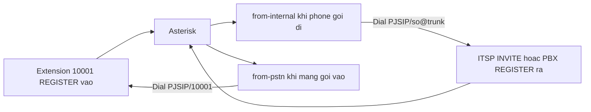
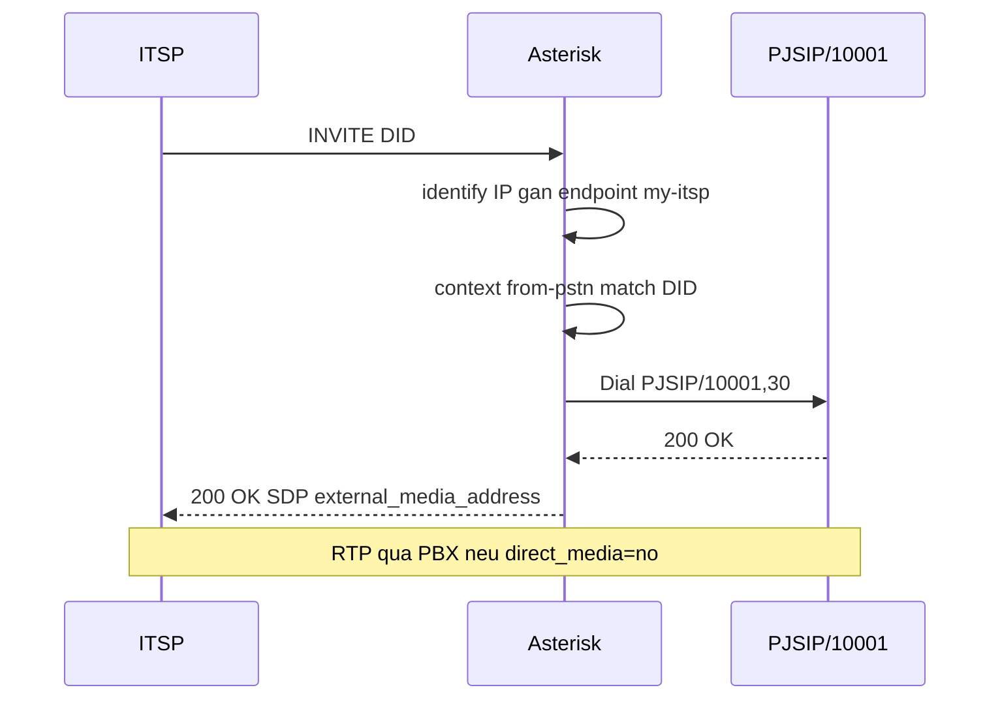

# Trunk SIP và PSTN trên Asterisk PJSIP

Trunk là đường PBX ↔ ITSP, không phải extension. Cùng `chan_pjsip` và `res_pjsip`, khác chiều REGISTER, chiều auth, và context. Lab hiện chỉ có extension nội bộ. Bài này là mẫu triển khai khi có ITSP. Object PJSIP: `asterisk-pjsip-wizard-transport-nat`. Dialplan: `asterisk-dialplan-ivr-queue-voicemail`.

## 1. Hai cửa của một PBX



| | Extension | Trunk |
|---|-----------|-------|
| Ai REGISTER | Phone → PBX | Thường PBX → ITSP |
| Wizard | `accepts_registrations=yes`, `sends_registrations=no` | `sends_registrations=yes`, `accepts_registrations=no` |
| Auth | `inbound_auth` | `outbound_auth` |
| Context của INVITE vào | `from-internal` | **`from-pstn`** |
| Module thêm | registrar | `res_pjsip_outbound_registration`, `identify` + `res_pjsip_endpoint_identifier_ip` |
| Qualify | Có thể tắt | `aor/qualify_frequency=60` |

## 2. Wizard trunk

```ini
[trunk-template](!)
type = wizard
transport = transport-udp
sends_registrations = yes
accepts_registrations = no
remote_hosts = sip.provider.example:5060
endpoint/context = from-pstn
endpoint/disallow = all
endpoint/allow = ulaw,alaw
outbound_auth/username = TRUNK_USER
outbound_auth/password = CHANGE_ME
aor/qualify_frequency = 60

;[my-itsp](trunk-template)
;remote_hosts = 203.0.113.10:5060
```

`endpoint/context=from-pstn` là điểm dễ sai: quên thì INVITE từ nhà mạng chạy dialplan nội bộ hoặc rơi vào context sample mở.

```bash
asterisk -rx "pjsip show registrations"
asterisk -rx "pjsip show endpoint my-itsp"
```

Dòng registration chiều outbound chứng tỏ PBX đã REGISTER tới ITSP. Unavailable ở đây nghĩa là credential, `remote_hosts`, firewall, hoặc sai `outbound_auth`.

Transport vẫn cần `external_media_address` và `external_signaling_address` đúng public IP, vì SDP gửi cho ITSP phải reachable. Codec khớp hợp đồng, thường `ulaw`/`alaw`. G.729 cần license, không bật mò.

## 3. Inbound DID

ITSP gửi INVITE. Request-URI hoặc To mang số được gọi. `${EXTEN}` là số đó. `${CALLERID(num)}` là người gọi ngoài, có thể sai hoặc ẩn nếu trunk không tin cậy.

```ini
[from-pstn]
exten => _X.,1,NoOp(Inbound ${CALLERID(num)} -> ${EXTEN})
 same => n,Dial(PJSIP/10001,30)
 same => n,Hangup()
```

Map DID cố định an toàn hơn pattern nuốt mọi số:

```ini
exten => 0281234567,1,Goto(from-internal,10001,1)
```

Đưa khách vào voicebot:

```ini
exten => 02812349999,1,Goto(from-internal,9999,1)
```

`from-pstn` không được chứa `_X.` hoặc `_0.` quay ngược ra trunk. Đó là toll fraud: ai gửi được INVITE sẽ gọi quốc tế tính cước công ty.

## 4. Outbound từ nội bộ

Trong `from-internal`, pattern số ngoài chỉ thêm khi đã có trunk và chính sách.

```ini
exten => _0XXXXXXXXX,1,Dial(PJSIP/${EXTEN}@my-itsp,60)
```

`@my-itsp` là **tên endpoint**, không phải IP. ITSP có thể bắt prefix. Cắt chữ số đầu:

```ini
exten => _9.,1,Goto(outbound,${EXTEN:1},1)
```

`${EXTEN:1}` bỏ ký tự đầu. Chuẩn hóa 0/84 bằng `Set` trước `Dial`.

Caller ID ra ngoài:

```ini
same => n,Set(CALLERID(num)=0281234567)
same => n,Dial(PJSIP/${EXTEN}@my-itsp,60)
```

ITSP có thể ghi đè. Header `P-Asserted-Identity` là bước sau, phụ thuộc hợp đồng.

## 5. Identify theo IP

Nhiều ITSP gửi INVITE không digest. PBX tin IP nguồn.

```ini
[my-itsp]
type=identify
endpoint=my-itsp
match=203.0.113.10
```

`res_pjsip_endpoint_identifier_ip` gắn INVITE từ IP đó vào endpoint trunk, rồi vào `from-pstn`. Kèm ACL trên transport. IP lạ không được thành trunk.

Không có identify và không có auth, INVITE lạ có thể rơi vào endpoint sai hoặc bị 401. Kiểm tra log `res_pjsip_session` xem endpoint nào được chọn trước khi sửa dialplan.

## 6. Luồng cuộc gọi DID



## 7. Điều kiện trước khi bật trunk trên lab

- Transport UDP và `external_*` = `45.76.147.0` đã đúng.
- Firewall SIP 5060 và RTP 10000–20000 mở cho IP ITSP, không mở 0.0.0.0 nếu tránh được.
- `from-pstn` không có pattern gọi ra.
- Password trunk trong vault, không git.
- `pjsip show registrations` thấy outbound Registered trước khi user quay số ngoài.
- Test một DID cụ thể trước pattern `_X.`.

Lab 2 vCPU không dành cho CPS cao. Vài cuộc đồng thời G.711 là trần thực tế khi cùng Pipecat.
