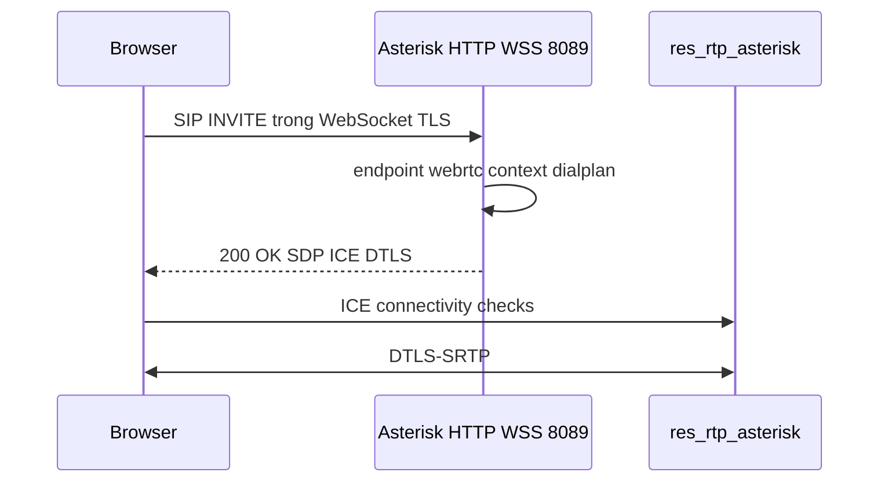

# WebRTC, TLS và SRTP trên Asterisk

Lab softphone đang dùng UDP 5060 và `media_encryption=no`. WebRTC là profile khác cho browser. Đừng trộn với voicebot `chan_websocket`. Transport NAT: `asterisk-pjsip-wizard-transport-nat`. Hợp đồng 9999: `asterisk-nang-cao-stasis-ha-voicebot`.

## 1. Vì sao UDP đủ cho Zoiper nhưng không đủ cho browser

| | Softphone UDP lab | Browser WebRTC |
|---|-------------------|----------------|
| Signaling | SIP UDP 5060 | SIP trong **WSS** |
| Media | RTP UDP | **DTLS-SRTP** |
| NAT | `rtp_symmetric`, `external_*` | **ICE** + STUN/TURN |
| Codec lab | ulaw, alaw | thêm `opus` |
| Firewall | 5060 + dải RTP | TCP 443/8089 + UDP cao cho ICE, có thể TURN |

Trình duyệt không cho JavaScript gửi RTP UDP thô. Media phải đi stack WebRTC: ICE candidate, DTLS handshake, SRTP.

## 2. Bản đồ thành phần

| Nhu cầu | Cấu hình Asterisk |
|---------|-------------------|
| SIP TLS (softphone enterprise, chưa phải browser) | `transport-tls`, cert PEM |
| SIP over WSS | `transport-wss`, `res_http_websocket`, `http.conf` |
| Mã hóa audio WebRTC | `endpoint/media_encryption=dtls` |
| Chọn đường media qua NAT | `ice_support=yes`, `rtp.conf` `icesupport=yes` |
| Relay khi đối xứng NAT thất bại | TURN phía client. Lab RTP `stun` đang off |

```bash
asterisk -rx "module show like websocket"
asterisk -rx "module show like http"
asterisk -rx "http show status"
asterisk -rx "rtp show settings"
```

Lab đã Running: `res_http_websocket`, `res_pjsip_transport_websocket`. Thiếu thì bật menuselect rồi `make install` và restart, không chỉ reload. Xem `asterisk-cai-dat-thu-muc-cli`.

`res_pjsip_transport_websocket` phục vụ SIP WSS. `chan_websocket` + `res_websocket_client` phục vụ media Pipecat. Cả hai cùng họ WebSocket và cùng có thể dùng HTTP core, nhưng không thay thế nhau.

## 3. Transport WSS

```ini
[transport-wss]
type=transport
protocol=wss
bind=0.0.0.0:8089
cert_file=/etc/asterisk/keys/asterisk.pem
priv_key_file=/etc/asterisk/keys/asterisk.key
```

Cert phải được browser tin (Let's Encrypt hoặc CA đã import). Self-signed bị chặn. Firewall mở **TCP** cổng WSS. 8089 là mặc định phổ biến, đổi được. `http.conf` bật HTTP server, bind và TLS dùng cùng cert để WebSocket upgrade.

Đổi cert thường cần `systemctl restart asterisk`, không đủ `pjsip reload`.

## 4. Endpoint WebRTC

Khác template UDP lab (`webrtc=no`, `media_encryption=no`, `transport-udp`).

```ini
endpoint/webrtc=yes
endpoint/media_encryption=dtls
endpoint/ice_support=yes
endpoint/use_avpf=yes
endpoint/rtcp_mux=yes
transport=transport-wss
```

Và `allow` thêm `opus` bên cạnh ulaw/alaw nếu browser offer opus.

| Field | Việc làm |
|-------|----------|
| `webrtc=yes` | Bật tập tùy chọn tương thích browser |
| `media_encryption=dtls` | DTLS để lấy key SRTP |
| `use_avpf=yes` | RTP/AVPF, RTCP feedback |
| `rtcp_mux=yes` | RTP và RTCP cùng một port. Browser gần như luôn yêu cầu |
| `ice_support=yes` | Asterisk tham gia ICE |

`rtp.conf` phải `icesupport=yes`. Lab snapshot đã ICE on. STUN trên Asterisk đang off. Client sau NAT đối xứng vẫn có thể cần TURN riêng. Không giả định `external_media_address` một mình giải quyết WebRTC.

Wizard: tạo template riêng, đừng sửa `extension-template` UDP của 10001/10002 thành webrtc, nếu không softphone UDP gãy.

## 5. Luồng signaling và media



Debug: `pjsip set logger on` thấy SIP, Chrome `chrome://webrtc-internals` thấy ICE và DTLS. Một chiều tiếng WebRTC thường là ICE failed hoặc thiếu `rtcp_mux` / `use_avpf`, không phải mở thiếu UDP 5060.

## 6. Không nhầm với voicebot 9999

| | PJSIP WebRTC | Voicebot lab |
|---|----------------|--------------|
| Ai nói SIP | Browser | Softphone UDP |
| Kênh media tới app | Vẫn là RTP/SRTP của endpoint | `Dial(WebSocket/pipecat/c(slin16))` |
| Config | `transport-wss`, `webrtc=yes` | `websocket_client.conf` section `[pipecat]` |
| Cổng lab | 8089/TCP nếu bật | Pipecat `127.0.0.1:10003`, không public |
| Codec tới app | opus/ulaw qua SRTP | slin16 trên WS |

User WebRTC vẫn là endpoint PJSIP. Có thể quay 9999 nếu context của endpoint đó là `from-internal` và dialplan có 9999. Leg bot vẫn là `chan_websocket`, không phải SRTP của browser.

## 7. TLS SIP không kèm WebRTC

Softphone “enterprise” có thể dùng `transport-tls` trên 5061, RTP thường hoặc SRTP (`media_encryption=sdes` tùy client). Đó không bật ICE và không cần `use_avpf`. Đừng copy nguyên khối `webrtc=yes` sang Zoiper UDP.

Lab chưa chuyển softphone sang TLS. Giữ UDP cho 10001/10002 cho đến khi có cert và profile riêng.
