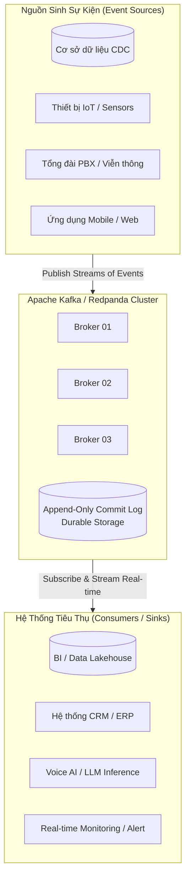
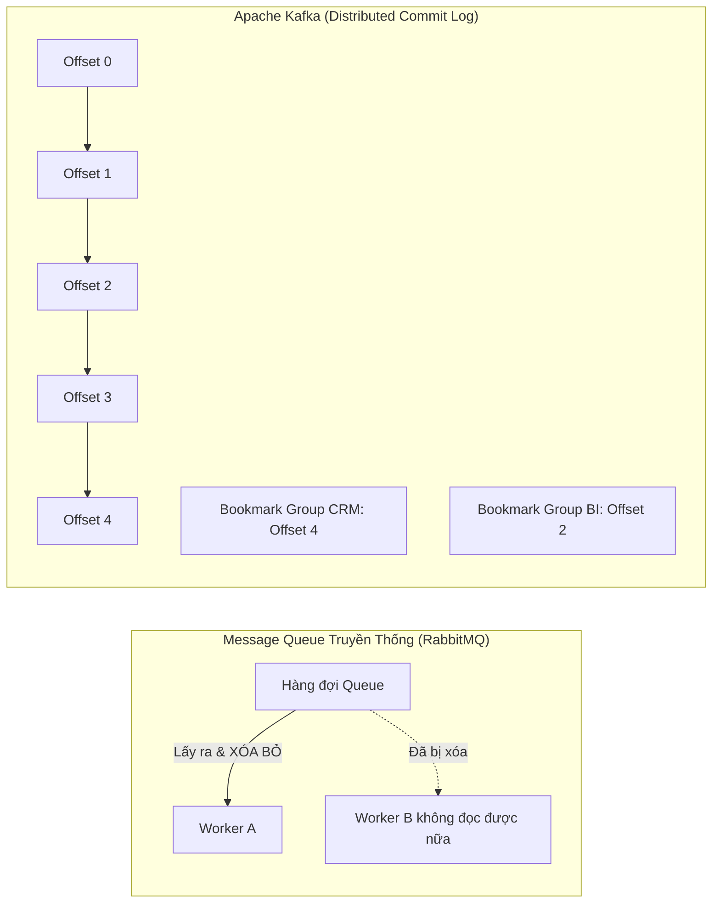
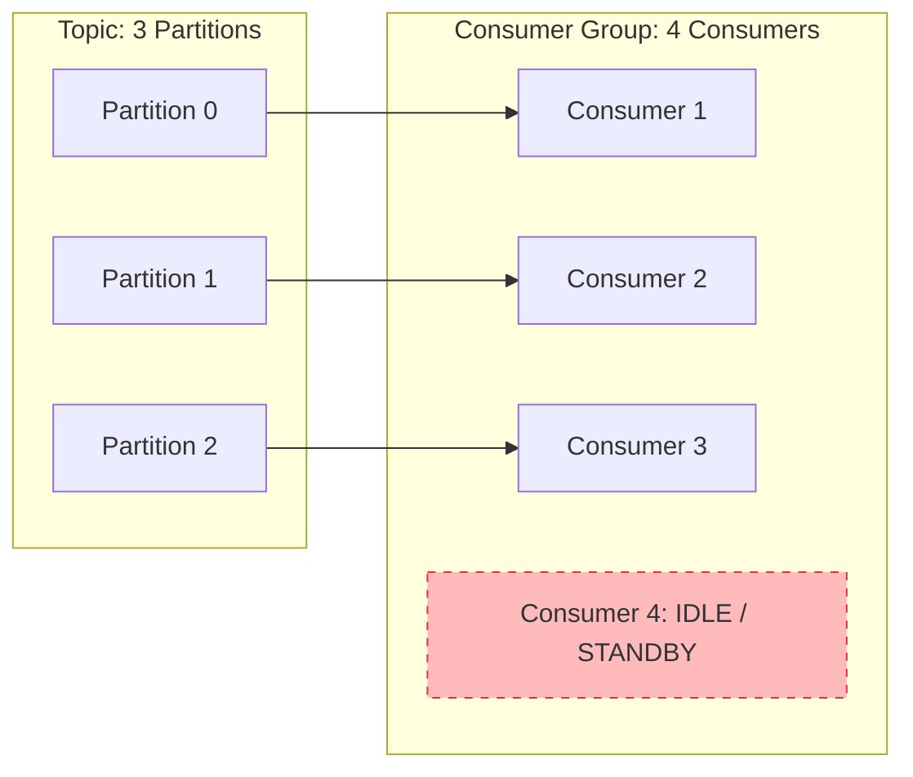
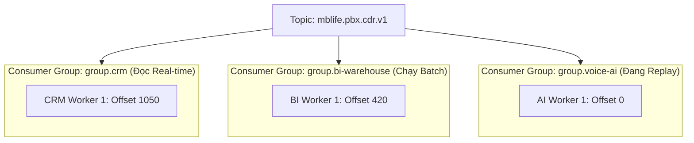
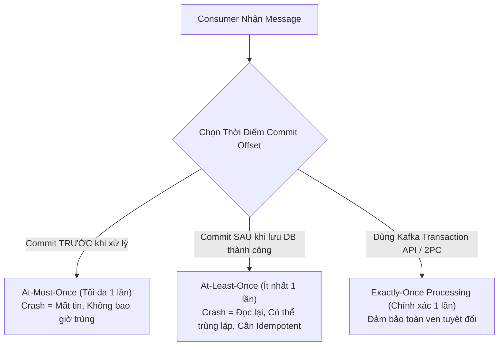
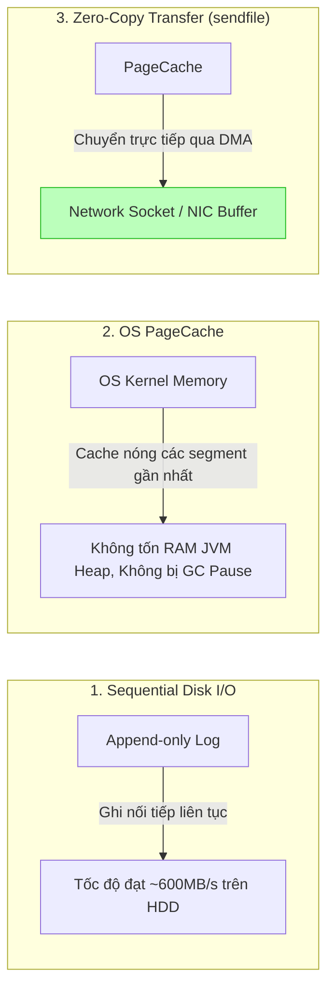
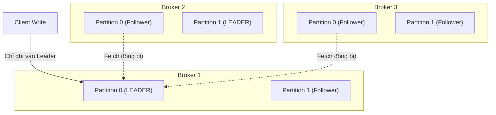
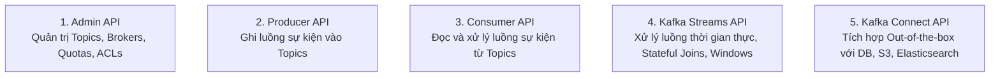
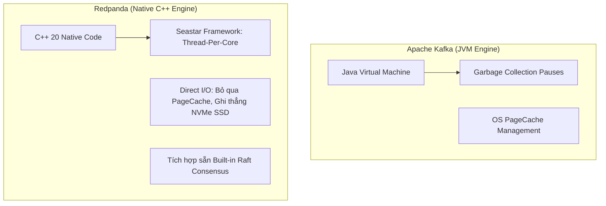

## 1. Bản chất của Event Streaming: "Hệ thần kinh trung ương kỹ thuật số"

Theo tài liệu chính thức của Apache Kafka (*Kafka 4.x Documentation*), trong thế giới doanh nghiệp hiện đại định hướng bằng phần mềm và tự động hóa, **Event Streaming** đóng vai trò tương đương với **hệ thần kinh trung ương (Central Nervous System)** của cơ thể con người.



### 1.1. Định nghĩa kỹ thuật
**Event Streaming** là phương thức:
1. **Thu thập thời gian thực (Capture in real-time)** các dòng sự kiện từ nguồn phát sinh (database transactions, telemetry sensors, thiết bị di động, cloud services, ứng dụng nghiệp vụ).
2. **Lưu trữ bền vững (Durable storage)** các luồng sự kiện này theo cơ chế phân tán, đảm bảo tính sẵn sàng cao và không bị mất mát dữ liệu.
3. **Xử lý và phản hồi (Manipulate & react)** theo thời gian thực (real-time stream processing) cũng như truy hồi lịch sử (retrospective processing).
4. **Định tuyến linh hoạt (Route event streams)** đến các hạ tầng đích khi có nhu cầu mà không làm thay đổi tầng nguồn.

### 1.2. Ba trụ cột năng lực cốt lõi của Apache Kafka
Apache Kafka kết hợp 3 khả năng then chốt trong một nền tảng duy nhất:
* **Publish & Subscribe**: Ghi (publish) và đọc (subscribe) các dòng sự kiện với thông lượng hàng triệu message mỗi giây mà không gây nghẽn cổ chai.
* **Durable Storage**: Lưu trữ an toàn, tin cậy trên đĩa cứng trong thời gian tùy chọn (từ vài giờ, vài tuần cho đến vĩnh viễn), không xóa message ngay sau khi đọc.
* **Process in Real-time**: Khả năng phân tích, tổng hợp, biến đổi luồng dữ liệu liên tục ngay khi chúng phát sinh thông qua Kafka Streams API.

---

## 2. Mô hình Mental Model: Sổ cái kế toán vs Hàng đợi truyền thống

Để hiểu cặn kẽ Kafka ngay từ ngày đầu tiên, hãy xóa bỏ tư duy về các Message Queue truyền thống (như RabbitMQ, ActiveMQ) và chuyển sang tư duy **Sổ cái kế toán ghi nối tiếp (Append-Only Ledger)**:



| Đặc Điểm | Message Queue Truyền Thống (RabbitMQ / ActiveMQ) | Apache Kafka / Redpanda |
| :--- | :--- | :--- |
| **Bản chất lưu trữ** | Bộ nhớ tạm (Transient buffer) — Message bị **xóa ngay** sau khi Consumer xác nhận (ACK). | Cuốn sổ cái chỉ ghi thêm (**Append-only Commit Log**) — Message được lưu bền vững trên đĩa theo thời gian (`retention.ms`). |
| **Cơ chế đọc** | Broker chủ động đẩy message xuống Consumer (**Push model**). | Consumer chủ động kéo message theo tốc độ xử lý của mình (**Pull model**). |
| **Vị trí đọc (Offset)** | Do Broker theo dõi trong RAM; khó scale khi có hàng triệu queue. | Do Consumer tự quản lý (**Bookmarks**), lưu tại topic nội bộ `__consumer_offsets`. |
| **Đa người đọc** | Muốn nhiều service đọc cùng dữ liệu phải tạo Fanout Exchange và duplicate dữ liệu ra nhiều queue. | Nhiều Consumer Group độc lập cùng đọc chung 1 log duy nhất với tốc độ và vị trí riêng. |
| **Khả năng Replay** | **Không thể** — Đã lấy ra là mất vĩnh viễn. | **Cực kỳ dễ dàng** — Chỉ cần tua lại Offset (seek) để đọc lại dữ liệu 7 ngày trước. |

---

## 3. Cấu trúc một Sự Kiện (Event Anatomy)

Trong Kafka, một sự kiện (Event / Record) ghi lại một dữ kiện thực tế đã xảy ra trong thế giới thực hoặc hệ thống kinh doanh ("Something happened"):

```
+-----------------------------------------------------------------+
|                       KAFKA RECORD / EVENT                      |
+-----------------------------------------------------------------+
| Headers   | trace_id=xyz-123, env=production, app=mblife-pbx   |
+-----------+-----------------------------------------------------+
| Timestamp | 1759734000120 (Epoch milliseconds - CreateTime)    |
+-----------+-----------------------------------------------------+
| Key       | "1759734000.1" (Định danh logic: linkedid cuộc gọi) |
+-----------+-----------------------------------------------------+
| Value     | { "caller": "0912345678", "callee": "19001234", ... }|
+-----------------------------------------------------------------+
```

1. **Key (Khóa)**: Chuỗi byte tùy chọn dùng để xác định **Partition đích** thông qua thuật toán băm (Hashing). Tất cả message có cùng Key luôn rơi vào đúng một Partition duy nhất.
2. **Value (Giá trị)**: Payload nội dung nghiệp vụ (JSON, Avro, Protobuf, nhị phân).
3. **Timestamp (Dấu thời gian)**: Thời điểm sự kiện được tạo (`CreateTime`) hoặc thời điểm Broker tiếp nhận (`LogAppendTime`).
4. **Headers (Siêu dữ liệu)**: Cặp key-value tùy chọn chứa thông tin metadata như `trace_id` (OpenTelemetry), nguồn gốc tenant, chữ ký xác thực.

---

## 4. Topics và 3 Nguyên Lý Vàng Về Partition

### 4.1. Topic là gì?
Topic là đơn vị tổ chức logic của các dòng sự kiện (tương đương với một bảng trong Database hoặc một thư mục trên File System).
* **Quy ước đặt tên Topic chuẩn doanh nghiệp**:
  $$\text{<domain>}.\text{<subdomain>}.\text{<entity>}.\text{<version>}$$
  * Ví dụ viễn thông PBX: `mblife.pbx.cdr.v1` (bản ghi cước cuộc gọi), `mblife.pbx.call-insight.v1` (kết quả phân tích giọng nói).
* **Vì sao phải tách Topic thay vì gộp chung?**
  * **Khác biệt về SLA & Tần suất**: CDR sinh ra ngay tức thì (vài trăm bytes), trong khi Voice Insight cần xử lý AI mất 2-3 phút (hàng trăm KB).
  * **Chính sách Retention khác nhau**: CDR cần lưu trữ 90 ngày phục vụ đối soát cước phí, Insight chỉ cần lưu 7 ngày để đẩy vào Data Lake.

### 4.2. Partition: Đơn vị co giãn vật lý (Unit of Scalability)
Một Topic được chia thành nhiều lát cắt vật lý gọi là **Partition** nằm rải rác trên các Broker khác nhau:

```mermaid
graph TD
    subgraph Topic["Topic: mblife.pbx.cdr.v1 (3 Partitions)"]
        subgraph P0["Partition 0 (Broker 1)"]
            P0_0[Offset 0] --> P0_1[Offset 1] --> P0_2[Offset 2]
        end
        subgraph P1["Partition 1 (Broker 2)"]
            P1_0[Offset 0] --> P1_1[Offset 1] --> P1_2[Offset 2]
        end
        subgraph P2["Partition 2 (Broker 3)"]
            P2_0[Offset 0] --> P2_1[Offset 1] --> P2_2[Offset 2]
        end
    end

    Producer[Producer] -->|hash(key) % 3| Topic
```

### 3 NGUYÊN LÝ VÀNG BẮT BUỘC PHẢI THUỘC LÒNG:

#### 1. Thứ tự chỉ được đảm bảo TUYỆT ĐỐI trong CÙNG MỘT PARTITION
* Kafka **không bao giờ đảm bảo thứ tự toàn cục (Global Ordering)** trên toàn bộ Topic.
* Nếu cuộc gọi có 3 sự kiện: `DIALING` $\rightarrow$ `ANSWERED` $\rightarrow$ `HANGUP`, bạn **bắt buộc** phải đảm bảo cả 3 sự kiện này rơi vào cùng một partition. Nếu rơi vào 2 partition khác nhau, Consumer đọc song song có thể nhận `HANGUP` trước khi nhận `ANSWERED`.

#### 2. Key quyết định Partition
* Thuật toán mặc định: $\text{partition} = \text{murmur2}(\text{key}) \pmod{\text{total\_partitions}}$.
* Cùng một Key $\rightarrow$ Luôn vào cùng một Partition $\rightarrow$ Luôn giữ đúng thứ tự thời gian.
* **Không có Key (`key = null`)**: Kafka gửi ngẫu nhiên theo cơ chế Round-robin (hoặc Sticky Partitioning để tối ưu batching). Dữ liệu sẽ bị rải đều nhưng mất hoàn toàn thứ tự nghiệp vụ giữa các bản tin liên quan.

#### 3. Giới hạn song song của Consumer: $N_{consumer} \le N_{partitions}$
* Tại một thời điểm, **một partition chỉ được giao cho duy nhất một Consumer trong cùng một Consumer Group**.
* Nếu Topic có 3 Partitions:
  * 1 Consumer: Đọc cả 3 partitions (chậm).
  * 3 Consumers: Mỗi con đọc 1 partition (tối ưu tối đa thông lượng).
  * 4 Consumers: **Consumer thứ 4 sẽ ngồi chơi xơi nước (idle)**, chỉ hoạt động khi 1 trong 3 con kia bị chết (Failover).



---

## 5. Offset và Cơ chế Consumer Group Độc Lập

### 5.1. Offset là gì?
Offset là số nguyên tăng dần liên tục $(0, 1, 2, 3...)$ gán cho mỗi message khi được ghi vào partition. Offset không bao giờ bị tái sử dụng. Nó đóng vai trò như **số trang sách (Bookmark)** để Consumer ghi nhớ mình đã đọc tới đâu.

### 5.2. Sự độc lập giữa các Consumer Group
Nhiều phòng ban hoặc dịch vụ khác nhau có thể đọc cùng một Topic mà không ảnh hưởng tới nhau:



* Nhóm `group.crm`: Đọc realtime ở vị trí mới nhất (Offset 1050) để hiển thị lên màn hình điện thoại viên.
* Nhóm `group.bi-warehouse`: Đọc chậm rãi (Offset 420) gom batch 15 phút một lần lưu vào BigQuery.
* Nhóm `group.voice-ai`: Vừa fix xong model, reset offset về 0 để đọc lại toàn bộ dữ liệu 3 ngày qua mà **không hề làm chậm hay gián đoạn nhóm CRM**.

### 5.3. Các cơ chế đảm bảo truyền phát (Delivery Semantics)



1. **At-Most-Once (Tối đa một lần)**:
   * Commit offset ngay khi vừa nhận bản tin từ Broker, sau đó mới xử lý.
   * Nếu tiến trình crash trong lúc xử lý: Bản tin bị mất vĩnh viễn, không bao giờ đọc lại. Phù hợp cho metrics giám sát hoặc log không quan trọng.
2. **At-Least-Once (Ít nhất một lần - Khuyến nghị cho Production)**:
   * Xử lý và lưu dữ liệu vào cơ sở dữ liệu thành công rồi mới commit offset.
   * Nếu tiến trình crash trước khi commit: Khi khởi động lại, consumer sẽ đọc lại bản tin đó $\rightarrow$ Có thể bị trùng dữ liệu.
   * **Giải pháp bắt buộc**: Thiết kế Consumer Idempotent (kiểm tra `uniqueid` hoặc `linkedid` trong Database trước khi INSERT).
3. **Exactly-Once (Chính xác một lần - EOS)**:
   * Kết hợp Idempotent Producer (`enable.idempotence=true`) và Transactional API (`sendOffsetsToTransaction`). Đảm bảo dữ liệu chỉ được ghi nhận đúng một lần duy nhất xuyên suốt chuỗi pipeline.

---

## 6. Cơ Chế Lưu Trữ Vật Lý: Tại Sao Kafka Cực Kỳ Nhanh?

Nhiều kỹ sư lầm tưởng rằng đọc/ghi từ đĩa cứng (HDD/SSD) sẽ luôn chậm hơn RAM. Kafka đạt được thông lượng hàng triệu message/giây nhờ 3 kỹ thuật cốt lõi:



### 6.1. Sequential Disk I/O (Ghi đĩa tuần tự)
* Ghi ngẫu nhiên (Random I/O) trên đĩa tốn chi phí di chuyển đầu đọc vật lý (~vài trăm IOPS).
* Kafka chỉ sử dụng thao tác **Append-Only (ghi nối tiếp vào cuối file)**. Tốc độ ghi tuần tự trên đĩa cứng có thể đạt hàng trăm MB/giây, nhanh ngang ngửa với thao tác trên bộ nhớ RAM.

### 6.2. Log Segments & Index
Mỗi partition được chia nhỏ thành các file phân đoạn (**Segments**, mặc định 1GB):
* `00000000000000000000.log`: Chứa nội dung byte thực tế của các message.
* `00000000000000000000.index`: Bảng chỉ mục thưa (Sparse index) ánh xạ giữa `Offset` $\rightarrow$ `Vị trí byte vật lý trong file .log`.
* `00000000000000000000.timeindex`: Ánh xạ giữa `Timestamp` $\rightarrow$ `Offset` phục vụ tìm kiếm theo thời gian.

### 6.3. Zero-Copy qua Linux System Call `sendfile()`
Trong các hệ thống thông thường, dữ liệu truyền từ đĩa ra mạng phải qua 4 lần copy và 4 lần chuyển đổi ngữ cảnh (Context switches):
$$\text{Disk} \xrightarrow{\text{copy 1}} \text{OS PageCache} \xrightarrow{\text{copy 2}} \text{JVM User Memory} \xrightarrow{\text{copy 3}} \text{Socket Buffer} \xrightarrow{\text{copy 4}} \text{NIC}$$

Kafka sử dụng lời gọi hệ thống `sendfile()` của Linux:
$$\text{OS PageCache} \xrightarrow{\text{DMA Direct Copy}} \text{NIC (Network Interface Card)}$$
Dữ liệu đi thẳng từ bộ đệm của Kernel ra card mạng mà không bao giờ bị copy vào bộ nhớ của ứng dụng Java, tiết kiệm 100% tài nguyên CPU và loại bỏ hoàn toàn hiện tượng Garbage Collection dừng hệ thống.

---

## 7. Phân Tán, Chịu Lỗi & Cơ Chế Đồng Thuận (KRaft vs ZooKeeper)

### 7.1. Replication Factor (Hệ số nhân bản)
Để chống mất dữ liệu khi máy chủ bị cháy hoặc sập nguồn, mỗi Partition được sao chép sang nhiều Broker:
* **Partition Leader**: Đảm nhận tất cả tác vụ ghi (write) và đọc (read) của client.
* **Follower Replicas**: Đóng vai trò là bản sao thụ động, liên tục gửi yêu cầu fetch để đồng bộ dữ liệu từ Leader.
* **In-Sync Replicas (ISR)**: Tập hợp các bản sao đang bắt kịp tiến độ với Leader. Nếu một Follower bị mất kết nối quá thời gian `replica.lag.time.max.ms`, nó sẽ bị loại khỏi danh sách ISR.



### 7.2. Cấu hình độ an toàn `acks` của Producer:
* `acks=0`: Producer gửi xong không cần chờ Broker phản hồi (Cực nhanh, rủi ro mất dữ liệu cao).
* `acks=1`: Producer chờ đúng một mình Partition Leader ghi vào đĩa thành công (Mặc định).
* `acks=all` (hoặc `-1`): Producer chờ toàn bộ các Broker trong danh sách **ISR** xác nhận ghi đĩa thành công kết hợp `min.insync.replicas=2`. Đây là tiêu chuẩn vàng cho các hệ thống thanh toán, ngân hàng và cước viễn thông để cam kết **Zero Data Loss**.

### 7.3. Bước chuyển mình sang KRaft (Kafka Raft Consensus)
Trước phiên bản 3.x, Kafka phụ thuộc vào cụm Apache ZooKeeper bên ngoài để bầu cử Controller và lưu metadata, dẫn đến độ trễ đồng bộ cao và giới hạn số lượng partition ở mức hàng chục ngàn.
Từ phiên bản **Kafka 4.x**, ZooKeeper bị loại bỏ hoàn toàn:
* Cụm Kafka tự vận hành thuật toán đồng thuận **KRaft (Event-driven Raft)**.
* Metadata của toàn bộ cụm được lưu trữ trực tiếp dưới dạng một internal topic (`@metadata`).
* Tốc độ bầu cử lại Leader nhanh hơn gấp 10 lần, khôi phục cụm tức thì và hỗ trợ mở rộng lên đến **hàng triệu Partitions**.

---

## 8. Năm API Chính Thức Của Apache Kafka (5 Core APIs)

Hệ sinh thái Apache Kafka cung cấp 5 bộ API lập trình tiêu chuẩn:



1. **Admin API**: Dùng trong tooling quản trị (tạo/xóa topic, thay đổi cấu hình runtime, kiểm tra ACLs, reassign partition).
2. **Producer API**: Thư viện client phía ứng dụng để đẩy dữ liệu vào topic kèm cơ chế batching, nén (lz4, zstd, snappy) và retry.
3. **Consumer API**: Thư viện client phía ứng dụng để lắng nghe topic, tự động quản lý kết nối và rebalance khi scale out/in.
4. **Kafka Streams API**: Thư viện Java gọn nhẹ nhúng trực tiếp vào microservices, hỗ trợ biến đổi stream-to-stream, xử lý windowing theo thời gian sự kiện (Event-time), state store cục bộ RocksDB và stream-table duality (KStream/KTable).
5. **Kafka Connect API**: Framework chuẩn hóa giúp kết nối Kafka với hệ thống bên ngoài mà không cần viết code:
   * **Source Connectors**: Tự động bắt sự kiện từ PostgreSQL (Debezium CDC), MySQL, Oracle đẩy vào Kafka.
   * **Sink Connectors**: Tự động tiêu thụ dữ liệu từ Kafka đổ vào Elasticsearch, ClickHouse, Amazon S3, Snowflake.

---

## 9. Năm Tình Huống Thực Chiến: Vì Sao Kafka Thay Thế Webhook HTTP?

*(Phân tích thực tế từ tài liệu `docs/kafka-101.html` áp dụng trong hệ thống tổng đài PBX)*

### Tình huống 1: Backend sập 2 tiếng lúc 2 giờ sáng
* **HTTP Webhook**: PBX gửi HTTP POST nhận lỗi `Connection Refused` hoặc `504 Timeout`. Muốn không mất dữ liệu, đội PBX phải tự code thêm cơ chế hàng đợi đệm và retry phức tạp trong tổng đài.
* **Apache Kafka**: PBX đẩy vào Kafka chỉ mất ~3ms rồi giải phóng tài nguyên. Message nằm nguyên vẹn an toàn trên partition. 4 giờ sáng backend khởi động lại, Consumer tự động đọc nối tiếp từ offset cũ và xử lý 100% dữ liệu mà không thất thoát một bản ghi nào.

### Tình huống 2: Triển khai phiên bản mới (Deployment Rolling Update 10 phút)
* **HTTP Webhook**: Các kết nối đang dang dở bị đứt gãy giữa chừng (Connection reset by peer). Hoặc phải dựng hạ tầng Blue-Green tốn kém, hoặc phải chấp nhận gián đoạn.
* **Apache Kafka**: Tắt toàn bộ Consumer backend để deploy. Dữ liệu cuộc gọi vẫn đều đặn đổ vào Kafka. Sau 10 phút backend bật lên, consumer tăng tốc tiêu thụ (catch up lag) về 0 chỉ trong vài chục giây.

### Tình huống 3: Giờ cao điểm 200 cuộc/phút nhưng Database chỉ ghi kịp 50 cuộc/phút
* **HTTP Webhook**: Webhook dồn ứ, backend cạn kiệt Connection Pool của Database, gây sập đổ dây chuyền (Cascading Failure).
* **Apache Kafka**: Kafka hoạt động như một **bể chứa đệm khổng lồ (Backpressure Absorber)**. Producer vẫn gửi 200 cuộc/phút, Consumer vẫn thong thả đọc 50 cuộc/phút theo đúng năng lực của Database. Không hệ thống nào bị quá tải.

### Tình huống 4: Phát hiện lỗi parse sai dữ liệu suốt 3 ngày qua
* **HTTP Webhook**: Dữ liệu đã gửi đi là hết. Muốn sửa phải nhờ đội vận hành PBX xuất file Excel thô rồi viết script vá dữ liệu thủ công.
* **Apache Kafka**: Sửa lỗi bug trong code, sau đó dùng lệnh quản trị tua lại bookmark:
  ```bash
  kafka-consumer-groups.sh --bootstrap-server localhost:9092 \
    --group group.crm --topic mblife.pbx.cdr.v1 \
    --reset-offsets --to-offset 0 --execute
  ```
  Hệ thống tự động chạy lại toàn bộ dữ liệu 3 ngày với logic chuẩn xác trong vài phút.

### Tình huống 5: Khách hàng muốn tích hợp thêm hệ thống BI / Data Warehouse
* **HTTP Webhook**: Kỹ sư PBX phải sửa code tổng đài để bắn thêm một Webhook endpoint thứ hai. Latency cuộc gọi bị nhân đôi; nếu hệ thống BI bị chậm sẽ kéo sập cả luồng CRM chính.
* **Apache Kafka**: Đội PBX **không cần chạm vào một dòng code nào**. Đội BI chỉ việc tạo một Consumer Group mới (`group.bi`) và bắt đầu subscribe vào topic có sẵn. Hoàn toàn cách ly và độc lập.

---

## 10. Ba Quy Tắc Vàng Khi Tiến Hóa Schema (Schema Evolution)

Kafka xem nội dung payload của message là một chuỗi bytes thô. Do đó, Producer và Consumer phải thống nhất một cấu trúc dữ liệu chung (Schema). Để tránh làm sập các Consumer đang chạy khi cập nhật hệ thống, bắt buộc phải tuân thủ 3 quy tắc:

| Loại Thay Đổi | Được Làm Trên `.v1` Không? | Nguyên Tắc Kỹ Thuật |
| :--- | :---: | :--- |
| **Thêm trường mới** | **ĐƯỢC** | Trường mới phải là trường tùy chọn (optional) hoặc có giá trị mặc định (`default`). Consumer phiên bản cũ đọc bản tin mới sẽ tự động bỏ qua trường này mà không bị lỗi JSON parse. |
| **Đổi ý nghĩa trường cũ** | **CẤM TUYỆT ĐỐI** | Ví dụ: trường `billsec` đang tính bằng giây, không được tự ý đổi sang mili-giây. Consumer cũ lấy số mili-giây nhân với đơn giá sẽ tính sai cước phí hàng ngàn lần. Trường hợp này phải tạo topic mới `.v2`. |
| **Xóa trường cũ** | **CẤM TUYỆT ĐỐI** | Nếu không dùng trường cũ nữa, hãy tiếp tục gửi kèm giá trị rỗng (`null` hoặc `""`) và đánh dấu `deprecated`. Cấm xóa hẳn khỏi schema vì các Consumer cũ vẫn đang phụ thuộc vào trường đó. |

---

## 11. Redpanda vs Apache Kafka: Điểm Khác Biệt Then Chốt

[Redpanda](https://redpanda.com) là hệ thống streaming thế hệ mới tương thích **100% Kafka Wire Protocol** (mọi thư viện `confluent-kafka`, Kafka CLI, Kafka Connect đều hoạt động nguyên vẹn mà không cần sửa code):



* **Không có JVM & Không có GC Pauses**: Viết bằng C++20 tối ưu, loại bỏ hoàn toàn hiện tượng jitter độ trễ do Garbage Collection của Java.
* **Kiến trúc Thread-per-core (Seastar Framework)**: Mỗi CPU Core xử lý một thread độc lập, không lock tranh chấp bộ nhớ, tối ưu tối đa năng lực phần cứng hiện đại.
* **Độ trễ P99 cực thấp**: Thấp hơn Kafka từ 3 đến 6 lần trong các bài kiểm thử tải cao.
* **Bộ công cụ dòng lệnh cực nhanh (`rpk`)**: Thay thế hàng loạt file script `.sh` phức tạp của Kafka bằng một file binary duy nhất.

---

## 12. Code Mẫu Thực Chiến (Python confluent-kafka)

### 12.1. Producer — Gửi sự kiện an toàn kèm Partition Key
```python
# name: pbx_producer.py
# description: Kafka producer gửi dữ liệu CDR kèm linkedid làm partition key

import json
from confluent_kafka import Producer

def delivery_report(err, msg):
    """Callback thông báo trạng thái ghi bản tin lên Broker."""
    if err is not None:
        print(f"❌ Ghi thất bại: {err}")
    else:
        print(f"✅ Ghi thành công vào [{msg.topic()}] Partition: {msg.partition()} Offset: {msg.offset()}")

conf = {
    'bootstrap.servers': 'localhost:9092',
    'client.id': 'mblife-pbx-producer',
    'acks': 'all',  # Đảm bảo toàn bộ ISR đã nhận tin
    'enable.idempotence': True,  # Chống trùng lặp dữ liệu phía Producer
    'retries': 5
}

producer = Producer(conf)

cdr_payload = {
    "linkedid": "1759734000.1",
    "uniqueid": "1759734000.1",
    "direction": "outbound",
    "caller": "0912345678",
    "callee": "19001234",
    "disposition": "ANSWERED",
    "duration": 45,
    "billsec": 38,
    "start_time": "2026-10-10 10:00:00"
}

# QUAN TRỌNG: Gán key là linkedid để mọi sự kiện của cuộc gọi này luôn rơi vào cùng 1 partition
producer.produce(
    topic='mblife.pbx.cdr.v1',
    key=cdr_payload['linkedid'].encode('utf-8'),
    value=json.dumps(cdr_payload).encode('utf-8'),
    callback=delivery_report
)

# Chờ hoàn tất gửi toàn bộ batch trong hàng đợi
producer.flush()
```

### 12.2. Consumer — Đọc dữ liệu, Xử lý Idempotent và Graceful Shutdown
```python
# name: pbx_consumer.py
# description: Consumer đọc CDR với cam kết At-Least-Once và Graceful Shutdown

import json
import signal
import sys
from confluent_kafka import Consumer, KafkaError

running = True

def handle_shutdown(sig, frame):
    global running
    print("\nĐang nhận tín hiệu dừng, đóng Consumer an toàn...")
    running = False

signal.signal(signal.SIGINT, handle_shutdown)
signal.signal(signal.SIGTERM, handle_shutdown)

conf = {
    'bootstrap.servers': 'localhost:9092',
    'group.id': 'mblife.crm.cdr-sync',
    'auto.offset.reset': 'earliest',
    'enable.auto.commit': False,  # Tắt auto-commit để kiểm soát thủ công
    'max.poll.interval.ms': 300000
}

consumer = Consumer(conf)
consumer.subscribe(['mblife.pbx.cdr.v1'])

print("🚀 Consumer đang chạy. Bấm Ctrl+C để thoát.")

try:
    while running:
        msg = consumer.poll(timeout=1.0)
        if msg is None:
            continue
        if msg.error():
            if msg.error().code() == KafkaError._PARTITION_EOF:
                continue
            else:
                print(f"Lỗi Consumer: {msg.error()}")
                break

        # 1. Giải mã dữ liệu
        data = json.loads(msg.value().decode('utf-8'))
        call_id = msg.key().decode('utf-8')

        # 2. Xử lý nghiệp vụ (Idempotent Insert vào CRM DB)
        print(f"Xử lý cuộc gọi: {call_id} | Thời lượng: {data.get('duration')}s")

        # 3. Commit offset SAU KHI ghi cơ sở dữ liệu thành công (At-Least-Once)
        consumer.commit(message=msg, asynchronous=False)

finally:
    # Đóng kết nối và bàn giao lại partition cho group
    consumer.close()
    print("Consumer đã đóng an toàn.")
```

---

## 13. Cheat Sheet Các Lệnh CLI Quản Trị Cần Thiết

| Mục Đích | Lệnh Chuẩn Apache Kafka CLI | Lệnh Nhanh Redpanda CLI (`rpk`) |
| :--- | :--- | :--- |
| **Tạo Topic mới** | `kafka-topics.sh --create --bootstrap-server localhost:9092 --topic mblife.pbx.cdr.v1 --partitions 3 --replication-factor 3` | `rpk topic create mblife.pbx.cdr.v1 -p 3 -r 3` |
| **Xem danh sách Topics** | `kafka-topics.sh --list --bootstrap-server localhost:9092` | `rpk topic list` |
| **Xem chi tiết Topic & Partitions** | `kafka-topics.sh --describe --bootstrap-server localhost:9092 --topic mblife.pbx.cdr.v1` | `rpk topic describe mblife.pbx.cdr.v1` |
| **Kiểm tra Consumer Lag** | `kafka-consumer-groups.sh --describe --bootstrap-server localhost:9092 --group mblife.crm.cdr-sync` | `rpk group describe mblife.crm.cdr-sync` |
| **Đọc thử tin nhắn từ đầu** | `kafka-console-consumer.sh --bootstrap-server localhost:9092 --topic mblife.pbx.cdr.v1 --from-beginning --property print.key=true` | `rpk topic consume mblife.pbx.cdr.v1 -f '%k: %v\n' --offset start` |
| **Tua lại Offset (Replay)** | `kafka-consumer-groups.sh --bootstrap-server localhost:9092 --group mblife.crm.cdr-sync --topic mblife.pbx.cdr.v1 --reset-offsets --to-earliest --execute` | `rpk group seek mblife.crm.cdr-sync --to start --topics mblife.pbx.cdr.v1` |

---

## 14. Tổng Kết

Hiểu rõ lý thuyết cốt lõi của Apache Kafka và Redpanda giúp chúng ta nhận ra rằng:
1. **Kafka không phải là Message Queue thông thường**: Nó là một **Distributed Append-Only Commit Log** kiêm hệ thống lưu trữ bền vững.
2. **Thứ tự nghiệp vụ nằm ở Partition Key**: Luôn chọn khóa phân vùng cẩn thận (`linkedid`, `order_id`) để không làm xáo trộn chuỗi sự kiện.
3. **Consumer độc lập hoàn toàn**: Một nguồn sự kiện duy nhất có thể nuôi sống đồng thời toàn bộ các hệ sinh thái từ CRM, Data Lake cho tới Realtime AI mà không gây nghẽn hệ thống nguồn.
