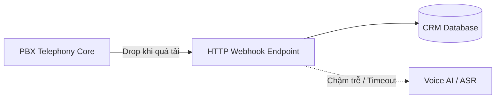
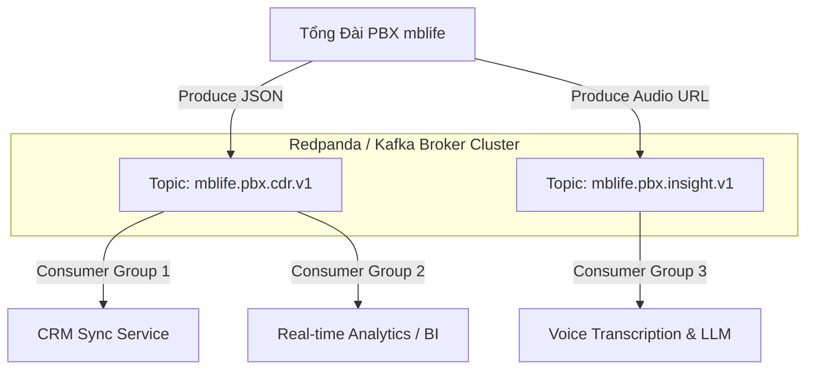
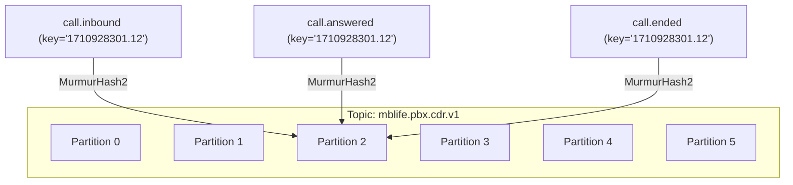
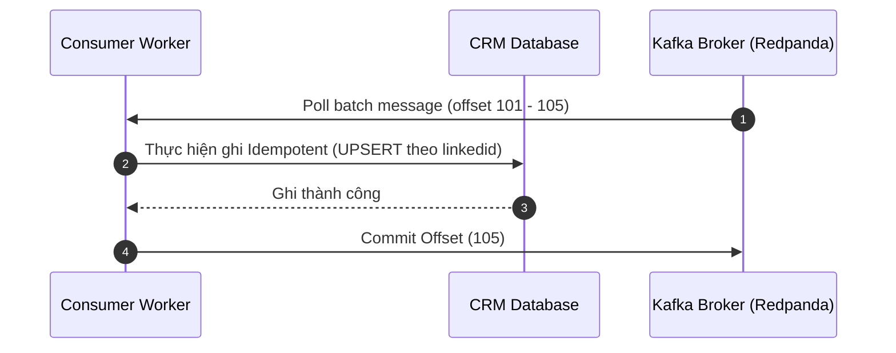

## 1. Bài toán: Giới hạn của Webhook truyền thống trong tổng đài PBX

Trong hệ thống tổng đài doanh nghiệp (PBX mblife), mỗi cuộc gọi phát sinh nhiều sự kiện vòng đời:
1. **CDR (Call Detail Record)**: Sinh ra ngay khi cúp máy (thời lượng, đầu số gọi, đầu số nhận, cước phí, trạng thái `ANSWERED` / `BUSY` / `NO ANSWER`). Kích thước nhỏ (~vài trăm bytes).
2. **Call Insights (ASR + LLM Summary)**: Xử lý file ghi âm thành văn bản (Speech-to-Text) và chạy mô hình ngôn ngữ tóm tắt nội dung cuộc gọi. Kích thước lớn (~vài trăm KB), độ trễ hoàn thành sau cuộc gọi vài phút.



### Các rủi ro chí mạng khi dùng Webhook HTTP truyền thống:
- **Tắc nghẽn giờ cao điểm**: Khi lưu lượng cuộc gọi tăng vọt lên 200 cuộc/phút nhưng backend CRM khách hàng chỉ xử lý kịp 50 cuộc/phút, webhook HTTP sẽ timeout (504 Gateway Timeout), dẫn đến mất mát bản tin cuộc gọi vĩnh viễn.
- **Phụ thuộc thời gian hoạt động (Coupling)**: Nếu backend khách hàng bảo trì hoặc gặp sự cố sập mạng 2 tiếng, toàn bộ webhook gửi đến đều bị từ chối kết nối.
- **Không có cơ chế Replay**: Khi phát hiện lỗi parser hoặc logic nghiệp vụ sai trong code, hệ thống webhook không thể tua lại để phát lại dữ liệu đã qua.

---

## 2. Giải pháp: Kiến trúc Distributed Event Streaming

Để giải quyết triệt để sự phụ thuộc, hệ thống chuyển sang mô hình **Distributed Log (Cuốn sổ ghi thêm)** sử dụng **Redpanda** (tương thích 100% giao thức Apache Kafka).



### Tại sao chọn Redpanda thay cho Apache Kafka gốc?
- **Zero JVM, Zero Garbage Collection pause**: Viết bằng C++ trên nền tảng Seastar (Thread-per-core), độ trễ p99 cực thấp và ổn định.
- **Không cần Apache ZooKeeper / KRaft phức tạp**: Tích hợp sẵn giao thức đồng thuận Raft bên trong nhị phân duy nhất.
- **Tiết kiệm tài nguyên hạ tầng**: Phù hợp triển khai biên (Edge) hoặc VM tài nguyên giới hạn (1 node UAT RAM ~2GB) mà vẫn đạt thông lượng hàng chục nghìn message/giây.

---

## 3. Thiết kế Topic & Phân tách dữ liệu

Hệ thống thiết kế tách biệt 2 topic riêng biệt thay vì gộp chung:

| Thuộc tính | `mblife.pbx.cdr.v1` | `mblife.pbx.insight.v1` |
| :--- | :--- | :--- |
| **Thời điểm sinh** | Ngay lập tức khi cúp máy | 2 - 5 phút sau cuộc gọi |
| **Kích thước** | ~500 bytes (metadata cuộc gọi) | ~200 - 500 KB (transcript + LLM summary) |
| **Thời gian lưu (Retention)** | 30 - 90 ngày | 7 - 14 ngày |
| **Mục đích** | Đồng bộ CRM, tính cước, giám sát | Đào tạo AI, kiểm tra chất lượng cuộc gọi |

> **Nguyên tắc phân tách**: Nếu gộp chung vào 1 topic, các service chỉ cần cập nhật trạng thái cuộc gọi vào CRM cũng buộc phải tải về toàn bộ transcript nặng hàng trăm KB rồi vứt bỏ, gây lãng phí băng thông mạng nghiêm trọng.

---

## 4. Chiến lược Chọn Key & Phân bổ Partition

Một topic được chia thành nhiều partition con (ví dụ: 6 partitions) để cho phép nhiều consumer đọc song song. Tuy nhiên, việc chọn Message Key quyết định tính đúng đắn của toàn bộ hệ thống.



### 3 Nguyên tắc phân bổ bắt buộc:

1. **Thứ tự chỉ được đảm bảo trong cùng một Partition**:
   Kafka **không** đảm bảo thứ tự thời gian giữa các partition khác nhau. Cuộc gọi kết thúc lúc 10:00 ở Partition 1 có thể được đọc *sau* cuộc gọi kết thúc lúc 10:05 ở Partition 3.
2. **Bắt buộc dùng `linkedid` (Call ID) làm Message Key**:
   Tất cả sự kiện của cùng 1 cuộc gọi (`call.inbound`, `call.answered`, `call.ended`) phải có cùng một key là `linkedid`. Thuật toán băm MurmurHash2 sẽ đưa toàn bộ sự kiện này vào **cùng một partition duy nhất**, đảm bảo thứ tự thời gian tuyệt đối.
3. **Tuyệt đối tránh Hot Partition (Data Skew)**:
   Không được dùng `enterprise_id` hay `tenant_id` làm key. Nếu 1 doanh nghiệp lớn chiếm 80% sản lượng cuộc gọi, toàn bộ 80% lưu lượng sẽ dồn vào đúng 1 partition, khiến consumer phụ trách partition đó chạm ngưỡng 100% CPU trong khi 5 consumer còn lại ngồi nhàn rỗi.

---

## 5. Offset Semantics & Ba điều kiện bắt buộc ở Consumer

Offset đóng vai trò như chiếc "kẹp đánh dấu trang sách" của từng Consumer Group trên từng Partition.



### Ba điều kiện bắt buộc khi triển khai Consumer:
1. **Ghi Database Idempotent theo `linkedid`**:
   Vì Kafka tuân thủ cơ chế *At-least-once delivery* (ít nhất một lần), khi consumer crash trước khi commit offset, message có thể được gửi lại. Database phải sử dụng câu lệnh `UPSERT` / `ON CONFLICT DO UPDATE` dựa trên khóa chính `linkedid`.
2. **Commit Offset SAU KHI ghi Database thành công**:
   Tắt tự động commit (`enable.auto.commit = False`). Chỉ commit offset lên Broker sau khi giao dịch cơ sở dữ liệu đã commit thành công.
3. **Không giả định thứ tự giữa các cuộc gọi khác nhau**:
   Hệ thống chỉ tuần tự trong phạm vi từng cuộc gọi đơn lẻ.

---

## 6. Mẫu Code Triển Khai (Python)

### Producer (PBX Event Publisher):
```python
import json
from kafka import KafkaProducer

producer = KafkaProducer(
    bootstrap_servers=['10.0.0.10:9092'],
    key_serializer=lambda k: k.encode('utf-8'),
    value_serializer=lambda v: json.dumps(v, ensure_ascii=False).encode('utf-8'),
    acks='all',  # Đảm bảo broker đã ghi vào đĩa
    retries=3
)

cdr_event = {
    "linkedid": "1710928301.12",
    "call_date": "2026-10-10T10:30:00+07:00",
    "caller": "0982294937",
    "callee": "19001234",
    "duration": 145,
    "disposition": "ANSWERED"
}

# Gửi với key là linkedid để đảm bảo thứ tự
producer.send(
    topic='mblife.pbx.cdr.v1',
    key=cdr_event['linkedid'],
    value=cdr_event
)
producer.flush()
```

### Consumer (CRM Sync Worker):
```python
import json
from kafka import KafkaConsumer

consumer = KafkaConsumer(
    'mblife.pbx.cdr.v1',
    bootstrap_servers=['10.0.0.10:9092'],
    group_id='crm-sync-service-v1',
    auto_offset_reset='earliest',
    enable_auto_commit=False,  # Quản lý commit thủ công
    key_deserializer=lambda k: k.decode('utf-8') if k else None,
    value_deserializer=lambda v: json.loads(v.decode('utf-8'))
)

for msg in consumer:
    cdr = msg.value
    try:
        # 1. Ghi Idempotent vào DB
        upsert_to_crm_database(cdr['linkedid'], cdr)
        
        # 2. Commit offset sau khi DB lưu thành công
        consumer.commit()
    except Exception as e:
        logger.error(f"Lỗi xử lý record {msg.offset}: {e}")
        # Không commit offset để retry
        break
```

---

## 7. Bảng Cheat Sheet thao tác nhanh `rpk` (Redpanda CLI)

| Tác vụ | Câu lệnh CLI |
| :--- | :--- |
| **Kiểm tra sức khỏe cluster** | `rpk cluster info` |
| **Tạo topic 6 partitions** | `rpk topic create mblife.pbx.cdr.v1 -p 6 -r 1` |
| **Xem danh sách topic** | `rpk topic list` |
| **Xem chi tiết partition & offset** | `rpk topic describe mblife.pbx.cdr.v1` |
| **Giám sát Consumer Lag** | `rpk group describe crm-sync-service-v1` |
| **Tua lại offset (Replay từ đầu)** | `rpk group seek crm-sync-service-v1 --to-oldest --topics mblife.pbx.cdr.v1` |
| **Lắng nghe trực tiếp message** | `rpk topic consume mblife.pbx.cdr.v1 -f '%k: %v\n'` |
