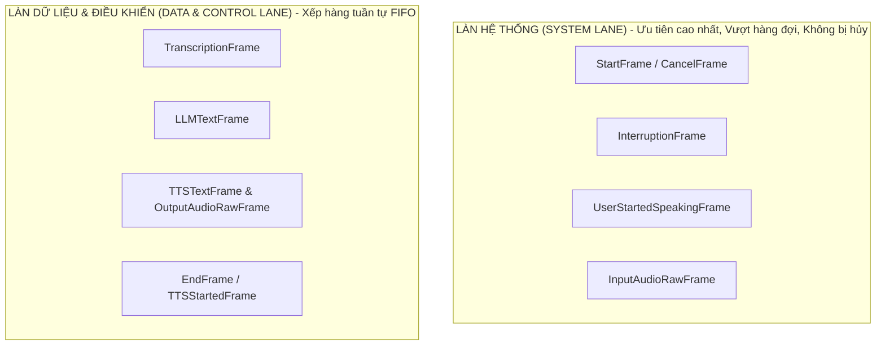
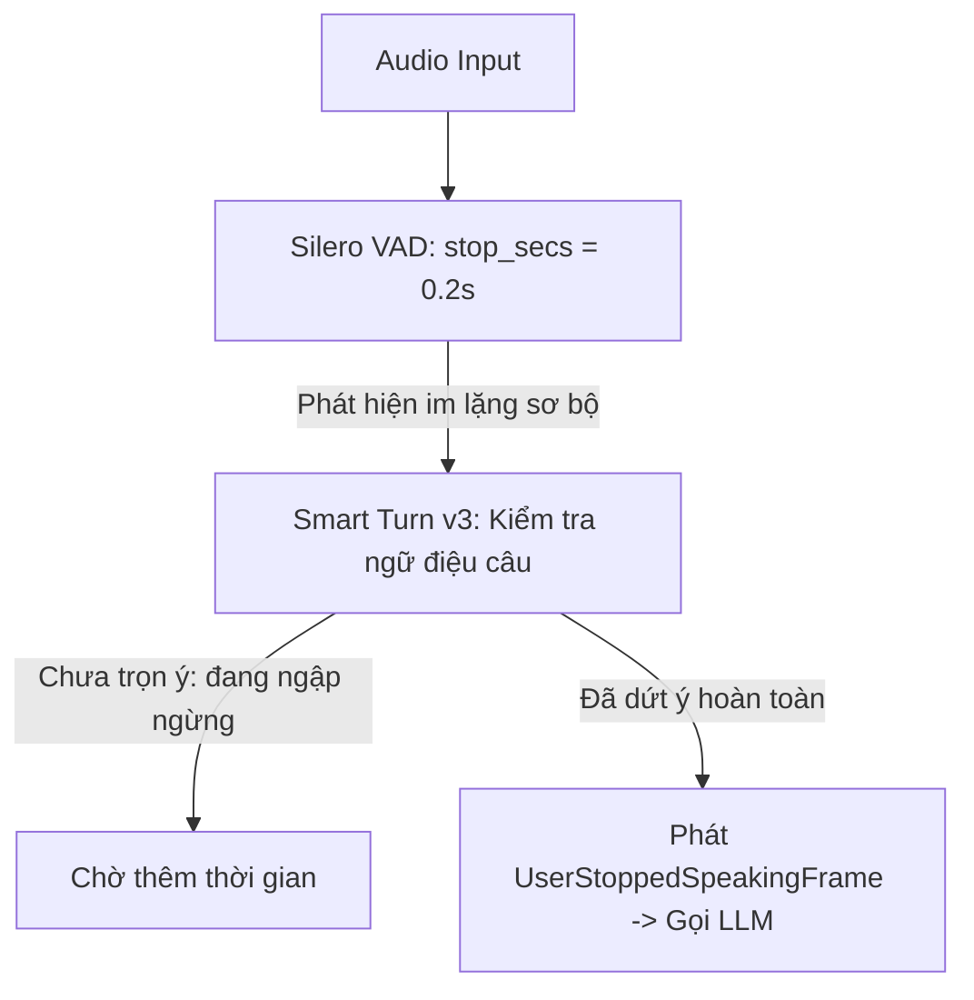

## 1. Giới thiệu tổng quan & Vòng lặp hội thoại thời gian thực

**Pipecat** là một framework mã nguồn mở (BSD-2) được phát triển bởi Daily, chuyên dùng để dàn dựng (orchestrate) các ứng dụng **Voice AI và Multimodal AI thời gian thực**. Khác với các hệ thống chatbot văn bản truyền thống (request-response qua REST API), Voice AI đòi hỏi mô hình luồng dữ liệu liên tục (streaming data flow) với độ trễ phản hồi cực thấp (sub-second latency, mục tiêu từ **500ms đến 800ms** cho một chu kỳ round-trip).

```mermaid
graph LR
    User([Người dùng]) -->|1. Raw Audio WebRTC/PSTN| TransportIn[Transport Input]
    TransportIn -->|2. InputAudioRawFrame| STT[STT Service Streaming]
    STT -->|3. TranscriptionFrame| AggUser[User Aggregator & VAD/SmartTurn]
    AggUser -->|4. LLMContext Frame| LLM[LLM Service Streaming]
    LLM -->|5. LLMTextFrame Chunks| TTS[TTS Service Streaming]
    TTS -->|6. TTSAudioRawFrame + TTSTextFrame| TransportOut[Transport Output]
    TransportOut -->|7. Audio Playback| User
    TransportOut -->|8. Spoken Text Confirmation| AggAssistant[Assistant Aggregator]
```



Một chu kỳ hội thoại của Pipecat bao gồm các thành phần trọng yếu:
1. **Lớp truyền thông (Transport)**: Tiếp nhận âm thanh từ micro người dùng qua WebRTC hoặc WebSocket viễn thông (Twilio, PSTN).
2. **Nhận dạng tiếng nói (STT)**: Chuyển đổi audio trực tiếp thành văn bản (`TranscriptionFrame`) theo dạng streaming.
3. **Phát hiện lượt nói (VAD & Smart Turn)**: Nhận biết thời điểm người dùng bắt đầu và hoàn tất lượt nói để kích hoạt suy luận.
4. **Mô hình ngôn ngữ lớn (LLM)**: Tiếp nhận `LLMContext`, sinh token phản hồi theo luồng stream (`LLMTextFrame`).
5. **Tổng hợp giọng nói (TTS)**: Nhận các cụm văn bản và tổng hợp thành luồng audio bytes nhị phân (`TTSAudioRawFrame`).
6. **Lớp xuất âm thanh (Transport Output)**: Phát trực tiếp âm thanh về loa người dùng.
7. **Đồng bộ ngữ cảnh thực tế (Assistant Aggregator)**: Đặt ngay sau Transport Output để ghi nhận chính xác những gì bot đã thực sự phát ra vào lịch sử trò chuyện.

---

## 2. Kiến trúc cốt lõi: Frame, Processor, Pipeline & Worker

### 2.1 Hệ thống Frame và 3 làn ưu tiên dữ liệu

Trong Pipecat, mọi thông điệp, âm thanh, văn bản và tín hiệu điều khiển đều được đóng gói dưới dạng các **Frame** (Python Dataclass). Để giải quyết bài toán ngắt lời tức thì (barge-in) mà không bị nghẽn hàng đợi âm thanh đang phát, Pipecat phân tách Frame thành **3 làn xử lý độc lập**:



| Họ Frame | Đặc tính xếp hàng & Ưu tiên | Hành vi khi có ngắt lời (Interruption) | Ví dụ tiêu biểu |
| :--- | :--- | :--- | :--- |
| **SystemFrame** | Chạy trên làn ưu tiên cao nhất, nhảy cóc qua hàng đợi FIFO, truyền tức thì | **Không bao giờ bị hủy**, luôn được xử lý ngay | `StartFrame`, `CancelFrame`, `InterruptionFrame`, `UserStartedSpeakingFrame`, `InputAudioRawFrame` |
| **DataFrame** | Xếp hàng FIFO tuần tự theo thứ tự đến | **Bị hủy ngay lập tức** khỏi queue khi nhận tín hiệu ngắt | `TranscriptionFrame`, `LLMTextFrame`, `TTSTextFrame`, `OutputAudioRawFrame` |
| **ControlFrame** | Xếp hàng chung làn với DataFrame theo thứ tự logic | Mặc định bị hủy, trừ khi gắn cờ `interruptible=False` | `EndFrame`, `TTSStartedFrame`, `FunctionCallResultFrame` |

### 2.2 Quy tắc sống còn khi viết Custom FrameProcessor

Mọi node xử lý trong pipeline đều kế thừa từ `FrameProcessor`. Dưới đây là mẫu chuẩn hóa:

```python
from pipecat.frames.frames import Frame, TranscriptionFrame
from pipecat.processors.frame_processor import FrameDirection, FrameProcessor

class CustomSentimentProcessor(FrameProcessor):
    async def process_frame(self, frame: Frame, direction: FrameDirection):
        # QUY TẮC 1: Luôn gọi super().process_frame trước tiên để xử lý lifecycle frame (StartFrame, InterruptionFrame)
        await super().process_frame(frame, direction)

        # QUY TẮC 2: Kiểm tra type an toàn bằng isinstance()
        if isinstance(frame, TranscriptionFrame):
            print(f"[Transcript] User vừa nói: {frame.text}")

        # QUY TẮC 3: Bắt buộc đẩy frame tiếp tục qua push_frame trừ khi cố ý nuốt frame
        await self.push_frame(frame, direction)
```

> **Cảnh báo lỗi phổ biến:** Quên gọi `await self.push_frame(frame, direction)` là nguyên nhân hàng đầu khiến pipeline bị nghẽn và bot rơi vào trạng thái "im lặng hoàn toàn" (Silent Bot).

---

## 3. Lớp truyền thông (Transports): WebRTC vs WebSocket

Pipecat cung cấp kiến trúc Transport đa hình, cho phép chuyển đổi từ môi trường phát triển cục bộ sang production quy mô lớn mà không thay đổi logic nghiệp vụ:

| Tiêu chí | WebRTC (DailyTransport / SmallWebRTCTransport) | WebSocket (FastAPIWebsocketTransport) |
| :--- | :--- | :--- |
| **Giao thức mạng** | UDP (RTP/SRTP), peer-to-peer hoặc SFU | TCP (WebSocket connection) |
| **Độ trễ truyền dẫn** | Cực thấp (50 - 150ms), không bị head-of-line blocking | Phụ thuộc đường truyền, dễ trễ nếu mất gói tin |
| **Xử lý âm thanh tích hợp** | Tự động khử tiếng vọng (AEC), lọc nhiễu (ANS), tự cân bằng âm lượng (AGC) | Phải tự xử lý ở tầng client hoặc thông qua filter |
| **Trường hợp sử dụng** | Ứng dụng Web Client, Mobile App (iOS/Android), P2P Video/Voice | Điện thoại PSTN (Twilio, Telnyx, Plivo), tích hợp Server-to-Server |

### Cấu hình Transport Runner đa môi trường

```python
from pipecat.runner.types import RunnerArguments
from pipecat.runner.utils import create_transport
from pipecat.transports.base_transport import TransportParams

# Factory cấu hình linh hoạt cho từng môi trường
transport_params = {
    "webrtc": lambda: TransportParams(audio_in_enabled=True, audio_out_enabled=True),
    "daily": lambda: TransportParams(audio_in_enabled=True, audio_out_enabled=True),
    "twilio": lambda: TransportParams(audio_in_enabled=True, audio_out_enabled=True),
}

async def bot(runner_args: RunnerArguments):
    transport = await create_transport(runner_args, transport_params)
    await run_bot(transport, runner_args)
```

---

## 4. VAD, Turn-Taking & Cơ chế ngắt lời (Barge-In)

### 4.1 Khác biệt giữa VAD thô và Smart Turn Detection

- **VAD thuần túy (như Silero VAD)**: Chỉ đo năng lượng âm thanh để phân biệt có tiếng nói hay khoảng lặng. Nhược điểm lớn là khi người dùng ngập ngừng ("ờ... ừm..."), VAD sẽ hiểu nhầm là đã dứt câu và kích hoạt bot nói chèn.
- **Smart Turn v3 (`LocalSmartTurnAnalyzerV3`)**: Mô hình học máy chạy ONNX cục bộ, phân tích ngữ điệu âm thanh và cấu trúc ngữ nghĩa để biết câu đã trọn ý chưa. Hỗ trợ chính thức **23 ngôn ngữ, bao gồm tiếng Việt**.



### 4.2 Cơ chế hủy luồng khi xảy ra Interruption (Barge-in)

Khi người dùng nói chen ngang lúc bot đang phát biểu, User Aggregator sẽ broadcast `InterruptionFrame` trên làn System:
1. **LLM**: Huỷ ngay tác vụ suy luận hiện tại; các Tool call đang chạy có cờ `cancel_on_interruption=True` bị hủy và phát `FunctionCallCancelFrame`.
2. **TTS Service**: Xóa sạch bộ đệm âm thanh đang chờ tổng hợp.
3. **Transport Output**: Xả lập tức (flush) toàn bộ buffer âm thanh chưa phát ra loa.
4. **Bảo vệ tính toàn vẹn Context**: Do `assistant_aggregator` đặt sau `transport.output()`, chỉ những từ mà người dùng **đã thực sự nghe thấy** mới được lưu vào `LLMContext`. Lời nói bị cắt giữa chừng sẽ được đánh dấu `interrupted=True`.

---

## 5. Quản lý ngữ cảnh (LLMContext) & Direct Function Calling

### 5.1 Cấu trúc Universal LLMContext

Từ phiên bản Pipecat 1.x, lớp `LLMContext` trở thành container dùng chung cho mọi nhà cung cấp LLM (OpenAI, Anthropic, Gemini, Groq, Ollama), tự động thích ứng qua các adapter:

```python
from pipecat.processors.aggregators.llm_context import LLMContext
from pipecat.processors.aggregators.llm_response_universal import (
    LLMContextAggregatorPair,
    LLMUserAggregatorParams,
    LLMAssistantAggregatorParams,
)
from pipecat.audio.vad.silero import SileroVADAnalyzer

context = LLMContext()
user_aggregator, assistant_aggregator = LLMContextAggregatorPair(
    context,
    user_params=LLMUserAggregatorParams(
        vad_analyzer=SileroVADAnalyzer(),
        user_idle_timeout=8.0,
    ),
    assistant_params=LLMAssistantAggregatorParams(
        enable_auto_context_summarization=True,
    ),
)
```

> **Lưu ý di chuyển API (Migration Note):** Việc đặt system prompt bằng tin nhắn `role: "system"` trong context đã bị **deprecated từ 1.9.0** và sẽ bị gỡ bỏ ở 2.0.0. Thay vào đó, hãy luôn truyền qua `system_instruction` trong `Settings` của LLM Service.

### 5.2 Định nghĩa Direct Function Calling chuẩn

```python
from pipecat.services.llm_service import FunctionCallParams
from pipecat.adapters.schemas.direct_function import tool_options
from pipecat.frames.frames import TTSSpeakFrame

@tool_options(cancel_on_interruption=True, timeout_secs=8)
async def tra_cuu_don_hang(params: FunctionCallParams, order_id: str):
    """Tra cứu trạng thái vận chuyển của đơn hàng.

    Args:
        order_id: Mã đơn hàng khách cung cấp, ví dụ: 'DH12345'.
    """
    # Phát âm thanh đệm (Filler phrase) để người dùng không cảm thấy im lặng lâu
    await params.llm.push_frame(TTSSpeakFrame("Dạ em kiểm tra hệ thống ngay ạ."))
    
    try:
        data = await db_query_order(order_id)
        await params.result_callback({"success": True, "status": data.status})
    except Exception as e:
        # Luôn trả kết quả về callback để LLM không bị treo lượt
        await params.result_callback({"success": False, "error": str(e)})

# Đăng ký tool trực tiếp vào LLMContext
context = LLMContext(tools=[tra_cuu_don_hang])
```

---

## 6. Kiểm chuẩn chất lượng & Quan sát (Observability & Metrics)

Để đạt ngưỡng **500 - 800 ms** cho độ trễ tổng thể, việc phân tích chi tiết từng chặng là tối quan trọng:

```python
from pipecat.observers.user_bot_latency_observer import UserBotLatencyObserver
from pipecat.pipeline.worker import PipelineWorker, PipelineParams

latency_observer = UserBotLatencyObserver()

@latency_observer.event_handler("on_latency_breakdown")
async def handle_latency_breakdown(observer, breakdown):
    for metric_line in breakdown.turn_contribution_lines():
        print(f"[Latency Audit] {metric_line}")

# Đầu ra mẫu trên production:
#   0.200s  endpointing wait   [config: VAD stop_secs & Smart Turn]
#   0.145s  transcription      [DeepgramSTTService Nova-2]
#   0.210s  LLM inference      [OpenAILLMService gpt-4o-mini]
#   0.115s  speech synthesis   [CartesiaTTSService Sonic]
#   0.670s  TOTAL ROUND-TRIP
```

---

## 7. Mã nguồn Voicebot Production hoàn chỉnh (Mẫu Thực Chiến)

Dưới đây là mã nguồn `bot.py` chuẩn sản xuất, tương thích Pipecat 1.x (1.12+), tích hợp tra cứu đơn hàng, đo đạc độ trễ và hỗ trợ đa transport:

```python
import os
from loguru import logger

from pipecat.adapters.schemas.direct_function import tool_options
from pipecat.audio.vad.silero import SileroVADAnalyzer
from pipecat.frames.frames import LLMRunFrame, TTSSpeakFrame
from pipecat.observers.user_bot_latency_observer import UserBotLatencyObserver
from pipecat.pipeline.pipeline import Pipeline
from pipecat.pipeline.worker import PipelineParams, PipelineWorker, ProcessorUnusablePolicy
from pipecat.processors.aggregators.llm_context import LLMContext
from pipecat.processors.aggregators.llm_response_universal import (
    LLMAssistantAggregatorParams,
    LLMContextAggregatorPair,
    LLMUserAggregatorParams,
)
from pipecat.runner.types import RunnerArguments
from pipecat.runner.utils import create_transport
from pipecat.services.cartesia.tts import CartesiaTTSService
from pipecat.services.deepgram.stt import DeepgramSTTService
from pipecat.services.llm_service import FunctionCallParams
from pipecat.services.openai.llm import OpenAILLMService
from pipecat.transports.base_transport import BaseTransport, TransportParams
from pipecat.workers.runner import WorkerRunner

SYSTEM_PROMPT = """Bạn là trợ lý ảo chăm sóc khách hàng qua điện thoại.
Hãy trả lời ngắn gọn (1 đến 2 câu), thân thiện, tự nhiên.
Không dùng markdown, danh sách gạch đầu dòng hay biểu tượng cảm xúc vì câu trả lời sẽ được đọc thành tiếng.
Khi khách hỏi về đơn hàng, hãy hỏi mã đơn và sử dụng công cụ tra cứu.
Nếu chưa rõ thông tin, hãy hỏi lại một cách lịch sự."""

FAKE_DATABASE = {
    "DH101": "đang được vận chuyển, dự kiến giao vào chiều nay",
    "DH102": "đã giao hàng thành công vào hôm qua",
}

@tool_options(cancel_on_interruption=True, timeout_secs=8)
async def lookup_order(params: FunctionCallParams, order_id: str):
    """Tra cứu trạng thái đơn hàng.

    Args:
        order_id: Mã đơn hàng khách đọc, ví dụ: 'DH101'.
    """
    await params.llm.push_frame(TTSSpeakFrame("Dạ em kiểm tra ngay ạ."))
    key = order_id.strip().upper()
    status = FAKE_DATABASE.get(key)
    if status:
        await params.result_callback({"found": True, "status": status})
    else:
        await params.result_callback({"found": False, "message": "Không tìm thấy mã đơn hàng trên hệ thống"})

transport_params = {
    "webrtc": lambda: TransportParams(audio_in_enabled=True, audio_out_enabled=True),
    "daily": lambda: TransportParams(audio_in_enabled=True, audio_out_enabled=True),
}

async def run_bot(transport: BaseTransport, runner_args: RunnerArguments):
    runner = WorkerRunner(handle_sigint=runner_args.handle_sigint)

    stt = DeepgramSTTService(
        api_key=os.environ["DEEPGRAM_API_KEY"],
        settings=DeepgramSTTService.Settings(language="vi"),
    )
    llm = OpenAILLMService(
        api_key=os.environ["OPENAI_API_KEY"],
        settings=OpenAILLMService.Settings(model="gpt-4o", system_instruction=SYSTEM_PROMPT),
    )
    tts = CartesiaTTSService(
        api_key=os.environ["CARTESIA_API_KEY"],
        settings=CartesiaTTSService.Settings(voice="vietnamese-voice-id"),
    )

    context = LLMContext(tools=[lookup_order])
    user_aggregator, assistant_aggregator = LLMContextAggregatorPair(
        context,
        user_params=LLMUserAggregatorParams(vad_analyzer=SileroVADAnalyzer()),
        assistant_params=LLMAssistantAggregatorParams(enable_auto_context_summarization=True),
    )

    pipeline = Pipeline([
        transport.input(),
        stt,
        user_aggregator,
        llm,
        tts,
        transport.output(),
        assistant_aggregator,
    ])

    latency = UserBotLatencyObserver()

    @latency.event_handler("on_latency_breakdown")
    async def on_latency_breakdown(observer, breakdown):
        for line in breakdown.turn_contribution_lines():
            logger.info(f"[Latency Metric] {line}")

    worker = PipelineWorker(
        pipeline,
        name="order-support-bot",
        params=PipelineParams(enable_metrics=True, enable_usage_metrics=True),
        observers=[latency],
        processor_unusable_policy=ProcessorUnusablePolicy.END,
    )

    @transport.event_handler("on_client_connected")
    async def on_client_connected(transport, client):
        context.add_message({"role": "developer", "content": "Chào khách hàng thân thiện và hỏi xem có thể hỗ trợ gì."})
        await worker.queue_frames([LLMRunFrame()])

    @transport.event_handler("on_client_disconnected")
    async def on_client_disconnected(transport, client):
        await runner.cancel()

    await runner.add_workers(worker)
    await runner.run()

async def bot(runner_args: RunnerArguments):
    transport = await create_transport(runner_args, transport_params)
    await run_bot(transport, runner_args)

if __name__ == "__main__":
    from pipecat.runner.run import main
    main()
```

---

## 8. Bảng đối chiếu chuyển đổi API di chuyển từ 0.0.x lên 1.x (1.12+)

| Cú pháp cũ (0.0.x) | Cú pháp chuẩn hiện tại (Pipecat 1.x / 1.12+) | Ghi chú & Lý do kiến trúc |
| :--- | :--- | :--- |
| `OpenAILLMContext` / `AnthropicLLMContext` | `LLMContext` | Đã hợp nhất thành Universal Context dùng adapter tự động |
| `llm.create_context_aggregator(ctx)` | `LLMContextAggregatorPair(ctx)` | Tách biệt rõ 2 đầu `user` và `assistant` trong pipeline |
| `PipelineParams(allow_interruptions=True)` | Cấu hình trên `LLMUserAggregatorParams` | **Bị xoá.** Giữ lại tham số cũ sẽ bị Pydantic bỏ qua im lặng |
| `UserIdleProcessor` | `user_idle_timeout` trong `LLMUserAggregatorParams` | Tích hợp thẳng vào bộ gom lượt của người dùng |
| `STTMuteFilter` | `user_mute_strategies` trong `LLMUserAggregatorParams` | Kiểm soát việc bỏ qua tiếng nói khi bot đang phát biểu |
| `TransportParams.vad_analyzer` | `LLMUserAggregatorParams.vad_analyzer` | Tách rời VAD khỏi tầng mạng transport |
| `StartInterruptionFrame` | `InterruptionFrame` | Chuẩn hóa danh xưng tín hiệu ngắt SystemFrame |
| `TranscriptProcessor` | Sự kiện `on_user_turn_stopped` / `on_assistant_turn_stopped` | Lấy transcript chính xác kèm trạng thái `interrupted` |
| `PipelineTask`, `PipelineRunner` | `PipelineWorker`, `WorkerRunner` | Nâng cấp thành kiến trúc đa worker/agent giao tiếp qua Bus |
| `camera_*` trong transport | `video_*` | Chuẩn hóa hỗ trợ avatar video và streaming camera |
