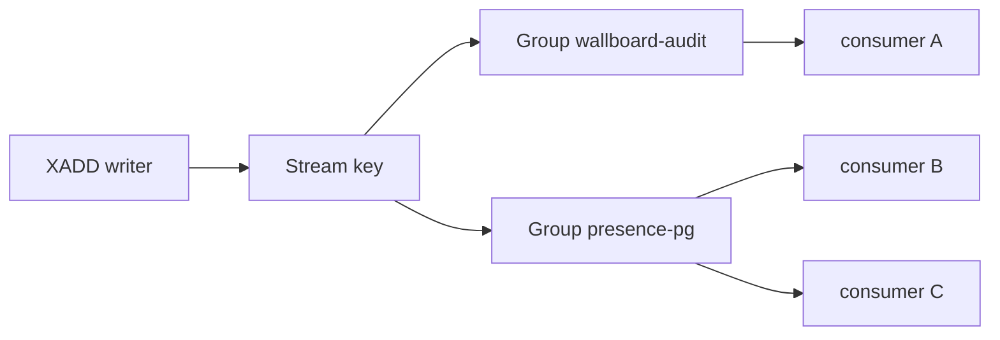
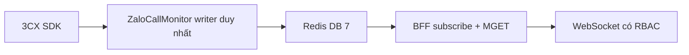

## 1. Chọn Stream, Pub/Sub hay snapshot

Redis có ba cách đưa dữ liệu realtime. Chúng không thay thế nhau.

| Cách | Redis giữ gì | Ai nhận | Khi consumer chết |
|---|---|---|---|
| Pub/Sub | Không lưu message | Mọi subscriber đang online | Message đã bắn là mất |
| STRING snapshot + SET index | Bản ghi hiện tại | Ai `GET` / `MGET` | Hỏi lại snapshot. Delta trong lúc rớt mạng thì mất |
| Stream | Log nối đuôi đến khi trim | Mỗi consumer group một bản sao; trong group thì chia việc | Nằm trong PEL cho đến khi `XACK` |

Chọn Stream khi hệ sau **phải xử lý từng sự kiện**, được phép xử lý lại, và cần tua trong cửa sổ retention. Chọn snapshot khi UI chỉ cần **trạng thái hiện tại** và entity có thể im hàng chục phút. ZaloCallMonitor wallboard thuộc nhóm sau. Chi tiết mẫu ở mục 9. Nguồn thiết kế: [Redis realtime — Snapshot + Pub/Sub (ZaloCallMonitor)](https://app.notion.com/p/Redis-realtime-Snapshot-Pub-Sub-ZaloCallMonitor-3fe6a4610b53819b9314f1088cafc5f9).

Stream không phải Kafka. Một stream là **một key trên một shard**. Không có partition, không có rebalance, không có ISR. Muốn song song mà vẫn đúng thứ tự theo cuộc gọi thì tự tách nhiều stream theo id, giống partition key của Kafka.

## 2. Stream là log nối đuôi trong một key

Một key kiểu stream chứa các entry theo thứ tự tăng. Entry không bị xóa khi có người đọc. Nhiều group đọc cùng một log, mỗi group có con trỏ riêng. Trong một group, mỗi entry được giao cho **một** consumer.



Group `presence-pg` và `wallboard-audit` đều thấy mọi entry. Consumer B và C trong cùng group thì chia entry: mỗi entry vào một trong hai.

Khác LIST `LPUSH` / `BRPOP`: `BRPOP` lấy mất phần tử, chỉ một họ worker. Khác Pub/Sub: message Pub/Sub không thành key, không replicate, không `XACK`.

Cấu trúc một entry:

- **ID** do Redis gán khi `XADD` dùng `*`: `<milliseconds>-<seq>`, ví dụ `1729400000000-0`. ID chỉ tăng. Client có thể tự đặt ID nhưng ID nhỏ hơn hoặc bằng ID cuối sẽ bị từ chối.
- **Các cặp field-value**, giống một hash nhỏ. Stream không index field. Lọc theo `event_type` là việc của consumer.
- Payload nên có `v` để đổi schema. Một field `json` chứa nguyên envelope là đủ khi consumer luôn parse cả bản tin.

## 3. Lệnh ghi và ID đặc biệt

```text
XADD zalopay:audit:events MAXLEN ~ 100000 * v 2 event_type call.updated json { ... }
XGROUP CREATE zalopay:audit:events presence-pg $ MKSTREAM
XREADGROUP GROUP presence-pg worker-1 COUNT 100 BLOCK 5000 STREAMS zalopay:audit:events >
XACK zalopay:audit:events presence-pg 1729400000000-0
```

| ID | Ý nghĩa |
|---|---|
| `*` | Redis cấp ID lúc `XADD` |
| `$` lúc `XGROUP CREATE` | Group bắt đầu từ đuôi. Entry cũ không được giao |
| `0` lúc `XGROUP CREATE` | Group đọc từ đầu log còn lại |
| `>` lúc `XREADGROUP` | Chỉ entry chưa giao cho **bất kỳ** consumer nào trong group |
| `0` lúc `XREADGROUP` | PEL của chính consumer này, để xử lý dở |

`MKSTREAM` tạo key nếu chưa có. `NOMKSTREAM` trên `XADD` làm lệnh thất bại nếu key đã bị xóa, tránh tạo lại stream rỗng sau một lần `DEL` nhầm.

`BLOCK 5000` giữ connection đến khi có entry hoặc hết 5 giây. `BLOCK 0` chờ mãi. Vòng `XRANGE` không `BLOCK` đốt CPU. `COUNT` 100 đến 500 là vùng thực dụng. `COUNT` quá lớn giữ entry trong PEL của một consumer quá lâu nếu process chết giữa batch.

## 4. Consumer group, PEL và ACK

`XREADGROUP` với `>` làm hai việc: giao entry cho consumer và đưa entry vào **pending entries list (PEL)** của group. Entry ở lại PEL cho đến khi `XACK`. `XACK` gỡ khỏi PEL, **không** xóa entry khỏi log. Log chỉ mất khi `XTRIM`, `MAXLEN`, `MINID` hoặc `XDEL`.

Mỗi lần giao hoặc `XCLAIM` / `XAUTOCLAIM`, delivery count tăng. `XPENDING` cho biết ID, consumer đang giữ, thời gian idle, số lần giao.

Process chết sau khi nhận và trước khi `XACK`: entry vẫn pending. Consumer khác gọi `XAUTOCLAIM` (Redis 6.2+) với `min-idle-time` lớn hơn thời gian xử lý bình thường, nhận entry đó, xử lý, rồi `XACK`.

```text
XAUTOCLAIM zalopay:audit:events presence-pg worker-2 60000 0-0 COUNT 50
```

`60000` là idle tối thiểu 60 giây. `0-0` là con trỏ duyệt PEL. Lệnh trả con trỏ tiếp theo; lặp đến khi hết.

Redis 7 thêm `lag` trên `XINFO GROUPS`: số entry đã vào stream mà group chưa giao. `pending` là số đang nằm trong PEL. Lag tăng nghĩa là consumer không đọc kịp. Pending tăng nghĩa là đã giao nhưng chưa ack.

## 5. Ngữ nghĩa giao

| Cách làm | Hệ quả |
|---|---|
| Pub/Sub | At-most-once. Offline là mất |
| `XREAD` thường, tự lưu ID sau khi xử lý xong | At-least-once. Crash trước khi lưu ID thì đọc lại |
| `XREAD`, lưu ID trước khi xử lý | At-most-once |
| Group, `XACK` sau khi side effect đã commit | At-least-once |
| Group, `XACK` trước khi xử lý, hoặc `NOACK` | At-most-once |
| Group + handler idempotent theo stream ID hoặc id nghiệp vụ | Thực tế gần exactly-once ở đích |

Redis Stream **không** có exactly-once. Cùng một entry có thể bị claim hai lần nếu ack đến chậm hơn `min-idle-time`. Đích phải chịu trùng: `INSERT ... ON CONFLICT`, hoặc bảng đã thấy stream ID.

Poison message: delivery count vượt ngưỡng thì `XADD` sang stream dead-letter, kèm ID gốc và lý do, rồi `XACK` bản gốc. Không ack thì PEL phình và cùng một lỗi bị claim mãi.

## 6. Thứ tự khi process sống lại

Đọc `>` trước khi vét PEL sẽ bỏ đói entry đang pending trong lúc entry mới vẫn chảy. Thứ tự cho một worker:

1. `XGROUP CREATE` với `$` hoặc `0`. Bỏ qua lỗi `BUSYGROUP` nếu group đã có.
2. `XAUTOCLAIM` các entry idle quá hạn của consumer đã chết.
3. `XREADGROUP` với ID `0` để vét PEL của chính mình.
4. `XREADGROUP BLOCK` với `>`.
5. Xử lý xong và commit đích thì `XACK`. Có thể ack theo lô sau khi cả lô đã commit.

`XREADGROUP` chặn **connection** đang chạy lệnh, không chỉ chặn một coroutine. Trên StackExchange.Redis, connection của `ConnectionMultiplexer` dùng chung. Một `BLOCK` trên multiplexer làm các lệnh khác trên connection đó đứng. Consumer loop dùng multiplexer riêng, writer dùng multiplexer riêng.

## 7. Trim, bộ nhớ, và chỗ mất data

Stream nằm trong RAM, replicate và AOF như key khác. Pub/Sub thì không. Trim là chính sách giữ, không phải chi tiết phụ.

```text
XADD key MAXLEN ~ 100000 * field value
XADD key MINID ~ 1729000000000-0 * field value
```

`~` trim gần đúng theo macro node, nhanh hơn `=`. Stream có thể dài hơn ngưỡng một đoạn. `MINID` giữ theo thời gian. `MAXLEN` giữ theo số entry.

Cửa sổ trim phải dài hơn thời gian đích chết dài nhất mà vẫn cần replay. Consumer chậm hơn trim thì entry biến mất lúc còn pending: đó là mất data. Theo dõi `lag` và độ sâu PEL. Cảnh báo trước khi lag chạm maxlen.

Ước lượng thô: 20 event/giây, 2 KB/entry, một giờ khoảng 144 MB. Giữ 24 giờ trên Redis dùng chung là hàng gigabyte. Redis UAT của CallMonitor để `maxmemory 0` và `noeviction`. Stream không trim làm bộ nhớ tăng đến khi `XADD` và cả `LPUSH` của Celery trên DB 6 cùng fail. Bật `maxmemory` kèm eviction trên instance đó cũng sai: eviction có thể xóa key cuộc gọi hoặc làm job Celery lỗi. Stream trên instance này bắt buộc có `MAXLEN` hoặc `MINID` tính từ cửa sổ outage, không giữ vô hạn.

AOF `everysec` vẫn có thể mất khoảng một giây lệnh cuối khi đĩa hoặc máy chết. Replica mặc định là bất đồng bộ, failover có thể rớt đuôi log. Muốn chặt hơn thì producer còn nguồn để ghi lại, hoặc `WAIT` replica, và consumer idempotent. Bền của pipeline là nguồn sự thật cộng log có ack, không phải một mình AOF.

`XDEL` xóa entry khỏi log nhưng ID có thể còn trong PEL đến khi `XACK`.

## 8. Best practice

**Thứ tự theo entity.** Nhiều consumer trong một group xử lý song song thì hai entry của cùng `sdk_call_id` có thể vào hai worker và xong không đúng thứ tự. Khi thứ tự theo cuộc gọi là bất biến, chọn một trong hai: một consumer cho group đó, hoặc một stream cho mỗi khóa (`zalopay:call:stream:{sdk_call_id}` hay shard hữu hạn `...:{hash % N}`). Mọi event của một cuộc phải rơi vào cùng một stream. Group trên các stream khác nhau không giữ thứ tự chéo stream.

**Một group cho một đích.** Flusher PostgreSQL, audit, và indexer là ba group. Chúng không lấy mất entry của nhau. Worker scale trong một group chỉ khi việc chia entry không phá thứ tự.

**Ack sau commit.** Ghi PostgreSQL xong rồi mới `XACK`. Ack trước thì crash giữa chừng làm mất việc. Claim lại là đúng thiết kế, nên handler phải idempotent theo stream ID hoặc `history_id` cộng loại event.

**Ngưỡng dead-letter.** `min-idle-time` lớn hơn p99 của thời gian xử lý, nếu không consumer khỏe bị cướp entry. Sau N lần giao, chuyển dead-letter rồi ack. Ghi delivery count và ID gốc vào dead-letter.

**Schema ổn định.** Field `v`, tên field không đổi. Đổi shape thì tăng `v`. Consumer bỏ entry `v` lạ vào dead-letter thay vì parse đoán.

**Đừng nhét blob lớn.** Stream nhớ mọi entry đến lúc trim. File ghi âm để object storage, stream chỉ giữ id.

**Cluster.** Nhiều key phải cùng slot thì dùng hash tag, ví dụ `{zalopay}:audit`. Một stream nóng vẫn nằm một shard. 20 event/giây của tổng đài không cần shard. Hàng trăm nghìn event/giây thì shard có chủ đích, chấp nhận hết thứ tự toàn cục.

**Quan sát.** `XINFO GROUPS` lấy `pending` và `lag`. `XINFO CONSUMERS` lấy idle. Alert khi lag tăng liên tục hoặc một consumer idle trong lúc pending của nó không giảm.

**Việc không làm.** Không dùng Stream làm sổ cái nhiều năm. Không `KEYS` để tìm stream. Không để consumer `BLOCK` trên connection ghi. Không tạo group bằng `$` rồi kỳ vọng đọc lại lịch sử. Không trim ngắn hơn thời gian sửa đích.

## 9. ZaloCallMonitor: snapshot cho wallboard, Stream cho flusher

Wallboard cần state đang sống. Khoảng 200 agent, 80 cuộc, đỉnh khoảng 20 event/giây. Cuộc `talking` có thể không phát event hàng chục phút. Tua Stream không trả lại state nếu entry đã bị trim hoặc cuộc im không sinh entry mới. Vì vậy v1 **không** dùng Stream cho dashboard.



Ba tầng: 3CX là sự thật, Redis DB 7 là projection tái tạo được, PostgreSQL là CDR và presence history. AOF không cứu message Pub/Sub.

| Key hoặc channel | Kiểu | TTL |
|---|---|---|
| `zalopay:call:active:{sdk_call_id}` | STRING envelope `call.updated` | 4 giờ, heartbeat `EXPIRE` |
| `zalopay:call:index` | SET id | không |
| `zalopay:agent:{ext}` và `zalopay:agent:index` | STRING + SET | snapshot 4 giờ |
| `zalopay:queue:{number}` và `zalopay:queue:index` | STRING + SET | 4 giờ, không dùng TTL 60 giây |
| `zalopay:meta:heartbeat` | STRING | 30 giây, refresh 15 giây |
| `zalopay:call:events`, `zalopay:agent:events`, `zalopay:queue:events`, `zalopay:sys:events` | Pub/Sub | không lưu |

`zalopay:queue:events` là ống truyền. Queue tổng đài nằm ở `zalopay:queue:{number}`.

Mỗi mutation serialize một JSON rồi `MULTI` trên `IDatabase`: `SET` hoặc `DEL`, `SADD` hoặc `SREM`, rồi `IDatabase.Publish` cùng byte đó. `ISubscriber.Publish` đi connection khác, không vào `MULTI`, nên UI có thể thấy event mới trong lúc `GET` còn bản cũ. `call.removed` là `DEL` + `SREM` + publish, không `SET`. `sys.resync` chỉ publish. `seq` tăng trong process, restart về 1. Fingerprint bỏ `ts`, `seq`, `updated_at` và sort legs, queue, ext trước khi so.

DB 7 là CallMonitor. DB 2 là sync. DB 6 là Celery. Process từ chối start nếu bật Redis mà db là 2 hoặc 6. Browser không nối Redis.

BFF đọc đúng thứ tự, vì Pub/Sub không có backlog:

1. `SUBSCRIBE` bốn channel và buffer.
2. `GET` heartbeat, `SMEMBERS` ba index, `MGET` từng lô khoảng 200 key. Bỏ key nil.
3. Thay dict RAM bằng snapshot.
4. Apply message buffer có `seq` lớn hơn mốc snapshot.
5. `sys.resync` hoặc `seq` nhỏ hơn lần trước: làm lại từ bước 1.
6. Hết heartbeat hoặc `ts` cũ hơn 60 giây: `stale=true`. Waiting bằng 0 chỉ khi snapshot thật sự là 0.

Daemon production là `monitor --calls=all`: dump cuộc, agent, queue, reconcile index, rồi `sys.resync`. Reconcile không publish từng orphan. Agent Disabled hiện chưa `DEL` ngay; key còn đến lần reconcile hoặc hết TTL.

Mở Stream ở project này khi một worker phải ghi `agent_presence_sessions` hoặc audit SDK và PostgreSQL có thể chết vài phút. Việc đó là group mới, không thay snapshot của wallboard.

```text
MULTI
SET snapshot EX 14400
SADD index
XADD zalopay:presence:events MAXLEN ~ N * json <envelope>
PUBLISH channel <cùng envelope>
EXEC
```

`N` tính từ cửa sổ PostgreSQL chết và kích thước entry, trên đúng instance dùng chung Celery. Group `presence-pg` tạo ở `0` lần đầu để lấy backlog, sau đó worker vét PEL rồi đọc `>`. Ack sau `INSERT` idempotent. BFF wallboard vẫn bootstrap bằng `MGET`, không đọc stream để vẽ bảng.

## 10. Checklist

1. Đích cần từng event hay chỉ cần state? Event thì Stream. State thì snapshot, Pub/Sub chỉ là đánh thức.
2. Thứ tự theo khóa nào? Một stream một khóa, hoặc một consumer nếu không shard.
3. Một group một đích. Ack sau commit. Handler idempotent.
4. Sống lại: claim, vét PEL, rồi mới `>`.
5. Trim dài hơn outage. Đo `lag` và `pending`. Dead-letter khi delivery count vượt ngưỡng.
6. Connection `BLOCK` tách khỏi connection ghi.
7. Trên Redis dùng chung: có trần số entry, không bật eviction, không đụng DB job khác.
8. Wallboard ZaloCallMonitor giữ snapshot DB 7. Stream chỉ thêm cho flusher hoặc audit.
