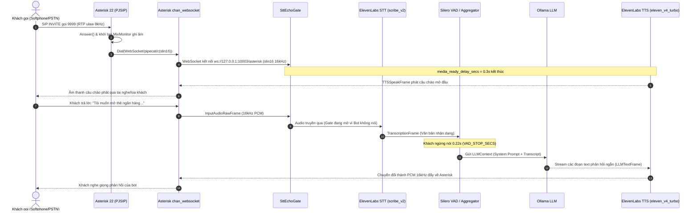

## 1. Tổng quan & Bản chất kết nối Telephony AI

Trong các hệ sinh thái Voice AI, việc đưa trợ lý giọng nói tiếp cận kênh thoại truyền thống (**PSTN / SIP Trunking / PBX**) đòi hỏi sự kết hợp chặt chẽ giữa giao thức viễn thông thời gian thực và pipeline xử lý trí tuệ nhân tạo streaming. Không giống như WebRTC trong trình duyệt vốn đã có sẵn lớp xử lý AEC (Acoustic Echo Cancellation) và codec Opus băng rộng, kênh thoại truyền thống hoạt động chủ yếu trên nền codec **G.711 (u-law / a-law, 8 kHz)** với nhiều đặc thù về trễ truyền dẫn và tiếng vọng vật lý.

Hệ thống trong hướng dẫn này được xây dựng trên sự phối hợp của 4 thành phần trụ cột:
- **Asterisk 22 PBX**: Đóng vai trò tổng đài viễn thông tiếp nhận cuộc gọi SIP từ Softphone/Trunk, thực hiện transcoding âm thanh hai chiều và mở kênh media WebSocket outbound.
- **Pipecat 1.x**: Framework điều phối pipeline xử lý âm thanh thời gian thực theo hướng sự kiện (event-driven audio streaming pipeline).
- **ElevenLabs API**: Cung cấp mô hình nhận dạng giọng nói tiếng Việt độ chính xác cao (**STT `scribe_v2`**) và tổng hợp giọng đọc tự nhiên siêu tốc (**TTS `eleven_v4_turbo`**).
- **Ollama**: Cung cấp mô hình ngôn ngữ lớn (LLM `gemma4:cloud` hoặc mô hình chạy cục bộ `qwen2.5:7b` qua endpoint OpenAI-compatible `/v1`), đảm bảo tư duy ngữ cảnh và phản hồi nhanh chóng.



---

## 2. Thiết lập tầng Viễn thông: Asterisk 22

Mô hình tích hợp được chọn là **Outbound WebSocket** (`Dial(WebSocket/...)`): Khi có cuộc gọi đến số extension `9999`, Asterisk đóng vai trò **WebSocket Client** chủ động mở kết nối TCP tới Pipecat (lắng nghe ở cổng nội bộ `10003`).

### 2.1 Kiểm tra module Asterisk 22
Đảm bảo hệ thống Asterisk 22 đã được biên dịch và kích hoạt đầy đủ các module WebSocket:
```bash
asterisk -rx "module show like websocket"
```
Kết quả cần có trạng thái **Running**:
- `chan_websocket.so`: Driver kênh âm thanh WebSocket.
- `res_websocket_client.so`: Client WebSocket để quay số ra bên ngoài.
- `res_http_websocket.so`: Thư viện lõi WebSocket.

### 2.2 Cấu hình WebSocket Client (`/etc/asterisk/websocket_client.conf`)
Khai báo endpoint kết nối tới Pipecat:
```ini
[pipecat]
type = websocket_client
uri = ws://127.0.0.1:10003/asterisk
protocols = media
connection_type = per_call_config
connection_timeout = 5000
reconnect_interval = 1000
reconnect_attempts = 3
tls_enabled = no
```
> **Điểm cốt lõi**: `connection_type = per_call_config` đảm bảo mỗi cuộc gọi là một kết nối socket độc lập, khớp với vòng đời của từng phiên AI Worker trong Pipecat. Khi cuộc gọi kết thúc, kết nối tự đóng và giải phóng tài nguyên.

### 2.3 Cấu hình Dialplan (`/etc/asterisk/extensions.conf`)
Thêm extension `9999` vào context tiếp nhận cuộc gọi nội bộ (`from-internal`):
```ini
[from-internal]
exten => 9999,1,NoOp(=== Pipecat Voicebot 9999 === Caller: ${CALLERID(num)})
 same => n,Set(BOT_CALLER=${CALLERID(num)})
 same => n,Set(VOICEBOT_REC_DIR=/var/spool/asterisk/monitor/voicebot)
 same => n,System(mkdir -p ${VOICEBOT_REC_DIR} && chown asterisk:asterisk ${VOICEBOT_REC_DIR})
 same => n,Answer()
 same => n,Set(MIXMON_FILE=${VOICEBOT_REC_DIR}/voicebot-${STRFTIME(${EPOCH},,%Y%m%d-%H%M%S)}-${BOT_CALLER}-${CHANNEL(linkedid)})
 same => n,MixMonitor(${MIXMON_FILE}.wav,b,/opt/pipecat-voicebot/scripts/mixmonitor_post.sh ^{MIXMONITOR_FILENAME})
 same => n,Dial(WebSocket/pipecat/c(slin16)v(caller=${URIENCODE(${BOT_CALLER})},linkedid=${URIENCODE(${CHANNEL(linkedid)})}))
 same => n,NoOp(Voicebot ended with DIALSTATUS=${DIALSTATUS})
 same => n,Hangup()
```

Giải thích các tham số quan trọng:
1. `Answer()`: Bắt buộc nhấc máy trước khi kích hoạt `Dial()` để dừng chuông ringback phía caller.
2. `c(slin16)`: Tham số channel driver chỉ định codec **Signed Linear PCM 16-bit 16kHz**. Asterisk tự động xử lý việc chuyển đổi định dạng từ codec u-law/a-law 8kHz của điện thoại sang 16kHz chuẩn cho Pipecat.
3. `MixMonitor(..., b, ...)`: Tùy chọn cờ `b` (**bridge**) đảm bảo ghi âm cả 2 chiều (tiếng khách + tiếng bot) nhưng **chỉ bắt đầu ghi khi hai kênh đã nối luồng thành công**.
4. `v(...)`: Truyền metadata `caller` và `linkedid` qua query parameters của WebSocket, hỗ trợ việc correlate log của Pipecat với hệ thống CDR/billing sau cuộc gọi.

---

## 3. Cấu hình Tham số Tối ưu Hệ thống (`.env`)

Tập tin `.env` chuẩn hóa giúp cân bằng hoàn hảo giữa độ trễ, khả năng bắt giọng và kiểm soát hiện tượng phản hồi âm thanh:

```bash
# ==========================================
# 1. DỊCH VỤ ELEVENLABS (STT & TTS)
# ==========================================
ELEVENLABS_API_KEY="sk_elevenlabs_secret_key"
ELEVENLABS_VOICE_ID="21m00Tcm4TlvDq8ikWAM"
ELEVENLABS_STT_MODEL="scribe_v2"
ELEVENLABS_TTS_MODEL="eleven_v4_turbo"

# LƯU Ý SỐNG CÒN: Tuyệt đối KHÔNG cấu hình ELEVENLABS_TTS_OPTIMIZE_LATENCY 
# khi dùng eleven_v4_turbo (sẽ gây lỗi HTTP 400 Bad Request làm bot câm nín).
# ELEVENLABS_TTS_OPTIMIZE_LATENCY=

# Benchmark độ trễ P99 cho STT scribe_v2 khớp với VAD_STOP_SECS=0.22s
ELEVENLABS_STT_TTFS_P99_LATENCY=0.85

# ==========================================
# 2. DỊCH VỤ LLM (OLLAMA CLOUD HOẶC LOCAL)
# ==========================================
OLLAMA_API_KEY="ollama_cloud_or_local_key"
OLLAMA_BASE_URL="https://ollama.com/v1"   # Hoặc "http://127.0.0.1:11434/v1" nếu chạy local
OLLAMA_MODEL="gemma4:cloud"              # Hoặc "qwen2.5:7b-instruct-q4_K_M"
OLLAMA_TEMPERATURE=0.4
OLLAMA_MAX_COMPLETION_TOKENS=280         # Giới hạn 2-3 câu ngắn để giảm thời gian phát âm

# ==========================================
# 3. MẠNG & THÔNG SỐ AUDIO
# ==========================================
PIPECAT_HOST="127.0.0.1"
PIPECAT_PORT=10003
PIPECAT_SAMPLE_RATE=16000                # Khớp 100% với c(slin16) của Asterisk
MEDIA_READY_DELAY_SECS=0.3               # Chờ 300ms để Asterisk ổn định RTP bridge trước khi phát câu chào

# ==========================================
# 4. KHỬ VANG LOA NGOÀI & CHEN LỜI (BARGE-IN)
# ==========================================
STT_ECHO_GATE_TAIL_SECS=0.18             # Khóa mic thêm 180ms sau khi bot dừng nói (hút dư âm)
PIPECAT_ENABLE_INTERRUPTIONS=true        # Cho phép người dùng nói chen ngang
STT_ECHO_GATE_BARGE_IN=true              # Kích hoạt Silero VAD trong gate để mở mic khi ngắt lời

# ==========================================
# 5. CẤU HÌNH SILERO VAD
# ==========================================
VAD_CONFIDENCE=0.7                       # Ngưỡng tin cậy nhận diện tiếng người
VAD_START_SECS=0.2                       # Xác nhận bắt đầu nói sau 200ms âm thanh
VAD_STOP_SECS=0.22                       # Chốt dứt lượt sau 220ms im lặng (tiết kiệm ~330ms)
VAD_MIN_VOLUME=0.5                       # Lọc tạp âm nền nhỏ từ môi trường điện thoại

LOG_LEVEL="INFO"
```

---

## 4. Thiết kế Chi tiết Mã Nguồn Pipecat Voicebot

### 4.1 `config.py` — Quản lý cấu hình kiểu dữ liệu chặt chẽ
Đảm bảo tất cả các tham số từ biến môi trường đều được chuyển đổi kiểu dữ liệu an toàn và báo lỗi sớm ngay khi khởi động:

```python
"""
name: config.py
description: Strongly-typed application configuration loader with environment validations.
"""

import os
import sys
from dataclasses import dataclass


def _float_env(name: str, default: float) -> float:
    raw = (os.getenv(name) or "").strip()
    return float(raw) if raw else default


def _int_env(name: str, default: int) -> int:
    raw = (os.getenv(name) or "").strip()
    return int(raw) if raw else default


def _bool_env(name: str, default: bool) -> bool:
    raw = (os.getenv(name) or "").strip().lower()
    return raw in ("1", "true", "yes", "on") if raw else default


def _optional_int_env(name: str) -> int | None:
    raw = (os.getenv(name) or "").strip()
    if not raw or raw.lower() in ("off", "none", "-", "0"):
        return None
    return int(raw)


@dataclass(frozen=True)
class Settings:
    elevenlabs_api_key: str
    elevenlabs_voice_id: str
    elevenlabs_stt_model: str
    elevenlabs_tts_model: str
    elevenlabs_tts_optimize_latency: int | None
    ollama_api_key: str
    ollama_base_url: str
    ollama_model: str
    ollama_temperature: float
    ollama_max_completion_tokens: int
    host: str
    port: int
    sample_rate: int
    vad_confidence: float
    vad_start_secs: float
    vad_stop_secs: float
    vad_min_volume: float
    stt_ttfs_p99_latency: float
    media_ready_delay_secs: float
    stt_echo_gate_tail_secs: float
    enable_interruptions: bool
    stt_echo_gate_barge_in: bool


def load_settings() -> Settings:
    """Validate and load configurations from system environment variables."""
    missing = [
        key
        for key in ("ELEVENLABS_API_KEY", "ELEVENLABS_VOICE_ID", "OLLAMA_API_KEY")
        if not (os.getenv(key) or "").strip()
    ]
    if missing:
        print(f"Missing mandatory environment variables: {', '.join(missing)}", file=sys.stderr)
        sys.exit(1)

    return Settings(
        elevenlabs_api_key=os.environ["ELEVENLABS_API_KEY"].strip(),
        elevenlabs_voice_id=os.environ["ELEVENLABS_VOICE_ID"].strip(),
        elevenlabs_stt_model=os.getenv("ELEVENLABS_STT_MODEL", "scribe_v2").strip(),
        elevenlabs_tts_model=os.getenv("ELEVENLABS_TTS_MODEL", "eleven_v4_turbo").strip(),
        elevenlabs_tts_optimize_latency=_optional_int_env("ELEVENLABS_TTS_OPTIMIZE_LATENCY"),
        ollama_api_key=os.environ["OLLAMA_API_KEY"].strip(),
        ollama_base_url=os.getenv("OLLAMA_BASE_URL", "https://ollama.com/v1").strip().rstrip("/"),
        ollama_model=os.getenv("OLLAMA_MODEL", "gemma4:cloud").strip(),
        ollama_temperature=_float_env("OLLAMA_TEMPERATURE", 0.4),
        ollama_max_completion_tokens=_int_env("OLLAMA_MAX_COMPLETION_TOKENS", 280),
        host=os.getenv("PIPECAT_HOST", "127.0.0.1").strip(),
        port=int(os.getenv("PIPECAT_PORT", "10003")),
        sample_rate=int(os.getenv("PIPECAT_SAMPLE_RATE", "16000")),
        vad_confidence=_float_env("VAD_CONFIDENCE", 0.7),
        vad_start_secs=_float_env("VAD_START_SECS", 0.2),
        vad_stop_secs=_float_env("VAD_STOP_SECS", 0.22),
        vad_min_volume=_float_env("VAD_MIN_VOLUME", 0.5),
        stt_ttfs_p99_latency=_float_env("ELEVENLABS_STT_TTFS_P99_LATENCY", 0.85),
        media_ready_delay_secs=_float_env("MEDIA_READY_DELAY_SECS", 0.3),
        stt_echo_gate_tail_secs=_float_env("STT_ECHO_GATE_TAIL_SECS", 0.18),
        enable_interruptions=_bool_env("PIPECAT_ENABLE_INTERRUPTIONS", True),
        stt_echo_gate_barge_in=_bool_env("STT_ECHO_GATE_BARGE_IN", True),
    )
```

---

### 4.2 `stt_echo_gate.py` — Khử Vang Loa Ngoài & Quản lý Barge-in
Trong môi trường điện thoại, khi khách hàng bật loa ngoài, âm thanh bot phát ra từ loa điện thoại sẽ bị micro thu ngược lại và đẩy về STT. Nếu không có bộ lọc, bot sẽ nhận diện chính câu nói của mình và tự trò chuyện một mình.

Bộ xử lý `SttEchoGateProcessor` giải quyết triệt để vấn đề này bằng cách:
1. Chặn toàn bộ frame âm thanh đi vào STT trong lúc bot đang phát thoại (`BotStartedSpeakingFrame`).
2. Tích hợp một bộ **Silero VAD độc lập** chạy song song để phát hiện xem khách hàng có đang nói đè lên tiếng bot (barge-in) hay không. Nếu phát hiện giọng nói của khách, cổng sẽ lập tức mở ra và phát `InterruptionFrame` để ngắt TTS.
3. Duy trì một khoảng thời gian đuôi (`tail_secs = 0.18s`) sau khi bot dứt câu để chặn nốt các âm vọng trễ của phòng nghe.

```python
"""
name: stt_echo_gate.py
description: FrameProcessor that gates user audio to STT during bot speech playback while supporting smooth barge-in.
"""

import time
from loguru import logger
from pipecat.audio.vad.silero import SileroVADAnalyzer
from pipecat.audio.vad.vad_analyzer import VADAnalyzer, VADParams, VADState
from pipecat.frames.frames import (
    BotStartedSpeakingFrame,
    BotStoppedSpeakingFrame,
    Frame,
    InputAudioRawFrame,
    InterruptionFrame,
    StartFrame,
    UserAudioRawFrame,
)
from pipecat.processors.frame_processor import FrameDirection, FrameProcessor


class SttEchoGateProcessor(FrameProcessor):
    """
    Prevents acoustic feedback loops by blocking incoming audio frames from reaching STT
    while bot TTS playback is active, while allowing voice-detected interruptions to ungate instantly.
    """

    def __init__(
        self,
        *,
        tail_secs: float = 0.18,
        barge_in: bool = True,
        barge_vad: VADAnalyzer | None = None,
    ) -> None:
        super().__init__()
        self._tail_secs = tail_secs
        self._barge_in = barge_in
        self._barge_vad = barge_vad
        self._bot_speaking = False
        self._gate_open_at = 0.0
        self._barge_open = False

    def _gate_closed(self) -> bool:
        if self._barge_open:
            return False
        if self._bot_speaking:
            return True
        return time.monotonic() < self._gate_open_at

    async def _maybe_detect_barge_in(self, audio: bytes) -> None:
        """Analyze audio frames with dedicated VAD instance to detect caller barge-in during bot speech."""
        if not self._barge_in or not self._bot_speaking or not self._barge_vad:
            return
        state = await self._barge_vad.analyze_audio(audio)
        if state in (VADState.STARTING, VADState.SPEAKING):
            if not self._barge_open:
                logger.info("Echo gate: barge-in detected — unblocking mic input to STT")
            self._barge_open = True

    async def process_frame(self, frame: Frame, direction: FrameDirection):
        await super().process_frame(frame, direction)

        if isinstance(frame, StartFrame) and self._barge_vad:
            rate = frame.audio_in_sample_rate or 16000
            self._barge_vad.set_sample_rate(rate)

        if isinstance(frame, InterruptionFrame):
            self._barge_open = True
            logger.info("Barge-in: interruption frame received — unblocking echo gate")

        if isinstance(frame, BotStartedSpeakingFrame):
            self._bot_speaking = True
            self._barge_open = False
            logger.debug("Echo gate: bot started speaking — blocking STT audio input")
        elif isinstance(frame, BotStoppedSpeakingFrame):
            self._bot_speaking = False
            self._barge_open = False
            self._gate_open_at = time.monotonic() + self._tail_secs
            logger.info(f"Echo gate: bot stopped — releasing gate after {self._tail_secs}s tail")

        if isinstance(frame, (InputAudioRawFrame, UserAudioRawFrame)):
            await self._maybe_detect_barge_in(frame.audio)
            if self._gate_closed():
                return  # Drop raw audio frame to prevent acoustic loop back into STT

        await self.push_frame(frame, direction)


def make_barge_vad(params: VADParams, sample_rate: int) -> SileroVADAnalyzer:
    """Instantiate a dedicated Silero VAD analyzer specifically for barge-in detection."""
    vad = SileroVADAnalyzer(params=params, sample_rate=sample_rate)
    vad.set_sample_rate(sample_rate)
    return vad
```

---

### 4.3 `prompts.py` — Prompt chuẩn hóa kênh thoại
Mô hình thoại đòi hỏi prompt có những quy tắc rất khác so với chatbot văn bản:
- Không trả lời quá 2–3 câu ngắn trong một lượt.
- Viết số bằng chữ thay vì chữ số để TTS đọc tự nhiên ("hai mươi tư trên bảy" thay vì "24/7").
- Phát lời chào cố định ngay từ mã nguồn (`TTSSpeakFrame`), hoàn toàn bỏ qua bước LLM để giảm thời gian chờ khi khách vừa nhấc máy.

```python
"""
name: prompts.py
description: Spoken dialog instructions and deterministic opening greetings for telephony AI.
"""

BANK_VOICE_SYSTEM_INSTRUCTION = """
# Personality
Bạn là nhân viên chăm sóc khách hàng trên kênh thoại. Bạn lịch sự, kiên nhẫn, tận tâm và đáng tin cậy.

# Tone & Style
- Nói tiếng Việt chuẩn, xưng "em" với khách hàng "anh/chị".
- Mỗi lượt thoại chỉ trả lời tối đa 2 đến 3 câu ngắn gọn, súc tích.
- Không sử dụng ký tự markdown, danh sách gạch đầu dòng, dấu sao hay biểu tượng cảm xúc (emoji).
- Viết số bằng chữ để mô hình tổng hợp âm thanh đọc chính xác (ví dụ: "hai mươi tư trên bảy", "mười tám tuổi").

# Guardrails
- Tuyệt đối không bao giờ hỏi hay ghi nhận mã PIN, mật khẩu ứng dụng, mã OTP hay 3 số CVV của khách hàng.
- Khi khách hỏi ngoài phạm vi nghiệp vụ, lịch sự thông báo giới hạn và hướng dẫn khách đến chi nhánh gần nhất.
"""

OPENING_GREETING_TEXT = (
    "Chào anh chị, em là nhân viên chăm sóc khách hàng hỗ trợ tự động. "
    "Em có thể hỗ trợ gì cho anh chị hôm nay ạ?"
)
```

---

### 4.4 `bot.py` — Pipeline điều phối tổng hợp
Đây là trái tim của hệ thống voicebot, nơi kết nối toàn bộ các mắt xích:

```python
"""
name: bot.py
description: Master voicebot pipeline integrating Asterisk WS with ElevenLabs STT, Ollama LLM, and ElevenLabs TTS.
"""

import asyncio
import os
import sys
import aiohttp
from loguru import logger

from pipecat.audio.vad.silero import SileroVADAnalyzer
from pipecat.audio.vad.vad_analyzer import VADParams
from pipecat.frames.frames import TTSSpeakFrame
from pipecat.pipeline.pipeline import Pipeline
from pipecat.pipeline.worker import PipelineParams, PipelineWorker, ProcessorUnusablePolicy
from pipecat.processors.aggregators.llm_context import LLMContext
from pipecat.processors.aggregators.llm_response_universal import (
    LLMContextAggregatorPair,
    LLMUserAggregatorParams,
)
from pipecat.services.elevenlabs.stt import ElevenLabsSTTService
from pipecat.services.elevenlabs.tts import ElevenLabsHttpTTSService
from pipecat.services.openai.llm import OpenAILLMService
from pipecat.transcriptions.language import Language
from pipecat.turns.user_start.transcription_user_turn_start_strategy import (
    TranscriptionUserTurnStartStrategy,
)
from pipecat.turns.user_start.vad_user_turn_start_strategy import VADUserTurnStartStrategy
from pipecat.turns.user_turn_strategies import UserTurnStrategies
from pipecat.workers.runner import WorkerRunner
from pipecat_asterisk import AsteriskWebsocketTransport

from config import Settings
from pipeline_log import PipelineLogProcessor
from prompts import BANK_VOICE_SYSTEM_INSTRUCTION, OPENING_GREETING_TEXT
from stt_echo_gate import SttEchoGateProcessor, make_barge_vad


def _configure_logging() -> None:
    logger.remove()
    logger.add(sys.stderr, level=os.getenv("LOG_LEVEL", "INFO"))


def _elevenlabs_http_tts_settings(settings: Settings) -> ElevenLabsHttpTTSService.Settings:
    """
    Construct ElevenLabs TTS settings.
    CRITICAL: eleven_v4_turbo does not support optimize_streaming_latency (causes HTTP 400).
    """
    model = settings.elevenlabs_tts_model.lower()
    kwargs: dict = {
        "voice": settings.elevenlabs_voice_id,
        "model": settings.elevenlabs_tts_model,
    }
    if "v4" not in model:
        kwargs["language"] = Language.VI
        if settings.elevenlabs_tts_optimize_latency is not None:
            kwargs["optimize_streaming_latency"] = settings.elevenlabs_tts_optimize_latency
    return ElevenLabsHttpTTSService.Settings(**kwargs)


async def run_asterisk_call(websocket_client, settings: Settings) -> None:
    """
    Execute full voicebot pipeline for a single inbound Asterisk call session.

    Parameters:
        websocket_client: The connected FastAPI WebSocket instance.
        settings (Settings): Runtime immutable configuration settings.
    """
    _configure_logging()
    ws_transport = AsteriskWebsocketTransport(websocket=websocket_client)

    async with aiohttp.ClientSession() as session:
        # 1. Nhận dạng giọng nói ElevenLabs STT
        stt = ElevenLabsSTTService(
            api_key=settings.elevenlabs_api_key,
            aiohttp_session=session,
            ttfs_p99_latency=settings.stt_ttfs_p99_latency,
            settings=ElevenLabsSTTService.Settings(
                model=settings.elevenlabs_stt_model,
                language=Language.VI,
            ),
        )

        # 2. Tổng hợp giọng nói ElevenLabs TTS (16 kHz PCM matching slin16)
        tts = ElevenLabsHttpTTSService(
            api_key=settings.elevenlabs_api_key,
            aiohttp_session=session,
            sample_rate=settings.sample_rate,
            settings=_elevenlabs_http_tts_settings(settings),
        )

        # 3. Trí tuệ suy luận Ollama qua OpenAI-compatible endpoint
        llm = OpenAILLMService(
            api_key=settings.ollama_api_key,
            base_url=settings.ollama_base_url,
            settings=OpenAILLMService.Settings(
                model=settings.ollama_model,
                system_instruction=BANK_VOICE_SYSTEM_INSTRUCTION,
                temperature=settings.ollama_temperature,
                max_completion_tokens=settings.ollama_max_completion_tokens,
            ),
        )

        # 4. Quản lý ngữ cảnh & Chiến lược xác định lượt nói (Turn-Taking)
        context = LLMContext()
        vad = SileroVADAnalyzer(
            params=VADParams(
                confidence=settings.vad_confidence,
                start_secs=settings.vad_start_secs,
                stop_secs=settings.vad_stop_secs,
                min_volume=settings.vad_min_volume,
            )
        )

        # LƯU Ý: Không dùng AlwaysUserMuteStrategy vì buffer Asterisk sẽ làm kẹt muted ở lượt 2
        user_aggregator, assistant_aggregator = LLMContextAggregatorPair(
            context,
            user_params=LLMUserAggregatorParams(
                vad_analyzer=vad,
                user_turn_strategies=UserTurnStrategies(
                    start=[
                        VADUserTurnStartStrategy(
                            enable_interruptions=settings.enable_interruptions
                        ),
                        TranscriptionUserTurnStartStrategy(
                            enable_interruptions=settings.enable_interruptions
                        ),
                    ],
                ),
            ),
        )

        # 5. Echo Gate & VAD chen lời độc lập
        barge_vad = (
            make_barge_vad(
                VADParams(
                    confidence=settings.vad_confidence,
                    start_secs=settings.vad_start_secs,
                    stop_secs=settings.vad_stop_secs,
                    min_volume=settings.vad_min_volume,
                ),
                settings.sample_rate,
            )
            if settings.stt_echo_gate_barge_in
            else None
        )
        echo_gate = SttEchoGateProcessor(
            tail_secs=settings.stt_echo_gate_tail_secs,
            barge_in=settings.stt_echo_gate_barge_in and settings.enable_interruptions,
            barge_vad=barge_vad,
        )

        stt_log = PipelineLogProcessor(log_stt=True)
        llm_log = PipelineLogProcessor(log_llm=True)

        # 6. Ghép nối Pipeline hoàn chỉnh
        pipeline = Pipeline(
            [
                ws_transport.input(),
                echo_gate,
                stt,
                stt_log,
                user_aggregator,
                llm,
                llm_log,
                tts,
                ws_transport.output(),
                assistant_aggregator,
            ]
        )

        worker = PipelineWorker(
            pipeline,
            params=PipelineParams(
                audio_in_sample_rate=settings.sample_rate,
                audio_out_sample_rate=settings.sample_rate,
                enable_metrics=True,
                enable_usage_metrics=True,
            ),
            processor_unusable_policy=ProcessorUnusablePolicy.END,
        )

        # 7. Sự kiện mở máy: Phát câu chào mở đầu sau khi Asterisk bridge ổn định
        @ws_transport.event_handler("on_client_connected")
        async def on_client_connected(transport, client):
            logger.info("Asterisk WebSocket connected — scheduling greeting")

            async def play_greeting() -> None:
                await asyncio.sleep(settings.media_ready_delay_secs)
                context.add_message({"role": "assistant", "content": OPENING_GREETING_TEXT})
                await worker.queue_frames([TTSSpeakFrame(OPENING_GREETING_TEXT)])

            asyncio.create_task(play_greeting())

        @ws_transport.event_handler("on_client_disconnected")
        async def on_client_disconnected(transport, client):
            logger.info("Asterisk WebSocket disconnected — tearing down worker")
            await worker.cancel()

        runner = WorkerRunner(handle_sigint=False)
        await runner.add_workers(worker)
        await runner.run()
```

---

### 4.5 `main.py` — Khởi động máy chủ FastAPI
```python
"""
name: main.py
description: FastAPI application hosting the Asterisk WebSocket audio bridge.
"""

import sys
import uvicorn
from dotenv import load_dotenv
from fastapi import FastAPI, WebSocket
from loguru import logger

from bot import run_asterisk_call
from config import load_settings

load_dotenv(override=True)
app = FastAPI(title="Pipecat Telephony Voicebot", version="1.0.0")


@app.get("/health")
async def health():
    return {"status": "ok", "service": "pipecat-voicebot"}


@app.websocket("/asterisk")
async def asterisk_ws(websocket: WebSocket):
    await websocket.accept()
    settings = load_settings()
    try:
        await run_asterisk_call(websocket, settings)
    except Exception as exc:
        logger.exception(f"Voicebot session error: {exc}")
        await websocket.close()


def main() -> None:
    settings = load_settings()
    logger.info(f"Starting Pipecat Telephony Voicebot on {settings.host}:{settings.port}")
    uvicorn.run("main:app", host=settings.host, port=settings.port, factory=False)


if __name__ == "__main__":
    try:
        main()
    except KeyboardInterrupt:
        sys.exit(0)
```

---

## 5. Bảng So Sánh Hiệu Năng & Tối Ưu Độ Trễ

| Tiêu chí | Cấu hình Mặc định (Out-of-box) | Cấu hình Tối ưu Thực chiến | Tác động cải thiện độ trễ |
| :--- | :--- | :--- | :--- |
| **VAD Stop Duration** | `0.55s` | **`0.22s`** (`VAD_STOP_SECS`) | **Tiết kiệm ~330ms**; chốt dứt câu tức thì mà không cắt ngang từ tiếng Việt |
| **STT Buffering Latency** | `0.40s` (hoặc uncalibrated) | **`0.85s`** (`ELEVENLABS_STT_TTFS_P99_LATENCY`) | Khớp chuẩn với `VAD_STOP_SECS ~ 0.22s`, ngăn chặn hiện tượng timeout giả |
| **TTS Chunking Engine** | WebSocket streaming chuẩn cũ | **HTTP Chunked Streaming (`eleven_v4_turbo`)** | Âm sắc tự nhiên vượt trội, giảm thời gian sinh audio gói đầu tiên |
| **LLM Output Budget** | Không giới hạn (default 2048) | **`280 tokens`** (`OLLAMA_MAX_COMPLETION_TOKENS`) | Bắt buộc LLM sinh câu ngắn (2-3 câu), giảm hơn **1.2 giây** thời gian phát TTS |
| **Acoustic Feedback Gate** | `AlwaysUserMuteStrategy` | **`SttEchoGateProcessor` (Tail: 0.18s)** | Xóa bỏ 100% tiếng vọng loa ngoài, không bị kẹt câm ở lượt thoại thứ hai |
| **Greeting Latency** | Chờ LLM sinh câu mở đầu (>1.5s) | **`0.30s`** (`TTSSpeakFrame` trực tiếp) | Người dùng nghe tiếng bot chào ngay khi vừa nhấc máy |

---

## 6. Tổng Hợp 7 Sự Cố Thực Chiến & Cách Khắc Phục

### 1. TTS câm nín do lỗi API 400 Bad Request (`eleven_v4_turbo`)
- **Triệu chứng**: STT nhận diện tốt, LLM sinh câu trả lời trong log nhưng phía người dùng không có bất kỳ âm thanh nào phát ra.
- **Nguyên nhân gốc**: Model thế hệ mới `eleven_v4_turbo` của ElevenLabs không còn hỗ trợ tham số `optimize_streaming_latency`. Nếu gửi tham số này (ví dụ: `3`), máy chủ ElevenLabs trả về lỗi **HTTP 400 Bad Request**.
- **Giải pháp**: Trong logic khởi tạo Settings của TTS, nếu tên model có chứa `v4`, bắt buộc phải bỏ qua `optimize_streaming_latency`.

### 2. Cuộc gọi chỉ thực hiện được 1 câu, đến câu thứ hai bot im lặng vĩnh viễn
- **Triệu chứng**: Lượt nói đầu tiên chào hỏi và trả lời rất tốt. Khi người dùng nói câu thứ hai, log không nhận được bất kỳ `TranscriptionFrame` nào nữa.
- **Nguyên nhân gốc**: Sử dụng `AlwaysUserMuteStrategy` của Pipecat. Khi kết nối qua Asterisk, do driver âm thanh của tổng đài có buffer đệm, sự kiện `BotStoppedSpeakingFrame` bị gửi trễ hơn thực tế, dẫn đến việc chiến lược này giữ trạng thái câm (muted) vĩnh viễn cho micro.
- **Giải pháp**: Xóa bỏ hoàn toàn `AlwaysUserMuteStrategy`. Thay vào đó, kiểm soát âm thanh bằng `SttEchoGateProcessor` đặt ngay trước STT.

### 3. Hiện tượng lặp câu / Acoustic Echo Loop trên loa ngoài điện thoại
- **Triệu chứng**: Khi người dùng bật loa ngoài (speakerphone), bot vừa dứt câu chào thì STT nhận diện lại chính câu chào đó và LLM trả lời: *"Em thấy đường truyền có tiếng vọng..."*.
- **Nguyên nhân gốc**: Loa ngoài phát âm thanh vào micro điện thoại truyền ngược lại pipeline.
- **Giải pháp**: `SttEchoGateProcessor` drop toàn bộ PCM chunk trong lúc bot đang phát TTS, đồng thời duy trì khoảng đệm 180ms (`tail_secs`) sau khi bot dứt câu.

### 4. Lời chào mở đầu bị nuốt 1-2 từ đầu tiên
- **Triệu chứng**: Thay vì nghe *"Chào anh chị..."*, người dùng chỉ nghe thấy *"...chị em là..."*.
- **Nguyên nhân gốc**: Gửi frame âm thanh ngay lập tức khi WebSocket vừa kết nối, trong khi RTP bridge giữa Asterisk và Softphone chưa kịp hoàn tất đàm phán SDP.
- **Giải pháp**: Cấu hình `MEDIA_READY_DELAY_SECS=0.3` để trì hoãn việc gửi `TTSSpeakFrame` khoảng 300ms sau sự kiện `on_client_connected`.

### 5. Vừa bấm gọi 9999 cuộc gọi đã bị ngắt ngay (Beep rồi cúp)
- **Triệu chứng**: Asterisk báo `DIALSTATUS=CONGESTION` và cúp máy ngay lập tức.
- **Nguyên nhân gốc**: Ứng dụng Pipecat chưa chạy hoặc lắng nghe sai cổng, khiến lệnh `Dial(WebSocket/...)` bị từ chối kết nối (Connection Refused).
- **Giải pháp**: Kiểm tra service bằng lệnh `systemctl status pipecat-voicebot` và xác minh cổng đang mở bằng `ss -lntp | grep 10003`.

### 6. Softphone (Linphone / MicroSIP) không REGISTER được tới tổng đài
- **Triệu chứng**: Báo lỗi `Registration Failed: Request Timeout`.
- **Nguyên nhân gốc**: Tường lửa trên máy chủ Linux (UFW) hoặc Security Group trên Cloud chưa mở cổng SIP và dải cổng RTP.
- **Giải pháp**: Mở đầy đủ các cổng trên máy chủ:
  ```bash
  ufw allow 5060/udp
  ufw allow 5060/tcp
  ufw allow 10000:20000/udp
  ```

### 7. Ghi âm cuộc gọi 2 chiều tự động
- **Giải pháp**: Không cần thực hiện ghi âm trong Python pipeline (gây tốn I/O và CPU). Sử dụng ứng dụng `MixMonitor` của Asterisk với cờ `b` trong dialplan để tự động lưu file WAV 16kHz hai chiều thoại tại `/var/spool/asterisk/monitor/voicebot/`.

---

## 7. Triển Khai Production Với Systemd

Tạo file dịch vụ `/etc/systemd/system/pipecat-voicebot.service`:
```ini
[Unit]
Description=Pipecat Telephony Voicebot Service
After=network.target

[Service]
Type=simple
User=root
WorkingDirectory=/opt/pipecat-voicebot
EnvironmentFile=/opt/pipecat-voicebot/.env
ExecStart=/opt/pipecat-voicebot/venv/bin/python main.py
Restart=always
RestartSec=3

[Install]
WantedBy=multi-user.target
```

Kích hoạt và theo dõi log thời gian thực:
```bash
systemctl daemon-reload
systemctl enable --now pipecat-voicebot
journalctl -u pipecat-voicebot -f
```

---

## 8. Kết luận & Hướng Phát Triển Tiếp Theo

Việc tích hợp **Asterisk 22 + Pipecat 1.x + ElevenLabs + Ollama** mang lại giải pháp Voicebot viễn thông có chất lượng đàm thoại vượt trội, độ trễ tương tác đạt mức cận thời gian thực (**dưới 900ms round-trip**), đồng thời giải quyết triệt để các bài toán cố hữu của kênh thoại như tiếng vọng loa ngoài và khả năng ngắt lời mượt mà.

Hướng phát triển tiếp theo cho hệ sinh thái:
1. **Tích hợp Pipecat Flows**: Quản lý kịch bản nghiệp vụ phức tạp dưới dạng đồ thị trạng thái FSM (State Graph).
2. **Streaming WebSocket TTS**: Chuyển đổi từ HTTP Chunking sang WebSocket hai chiều cho TTS để giảm thêm 150ms Time-to-First-Audio.
3. **Đồng bộ sự kiện cuộc gọi lên Apache Kafka**: Đẩy metadata cuộc gọi và bản tóm tắt hội thoại sang Kafka topic để phục vụ phân tích dữ liệu chuyên sâu và chấm điểm chất lượng cuộc gọi (QA).
