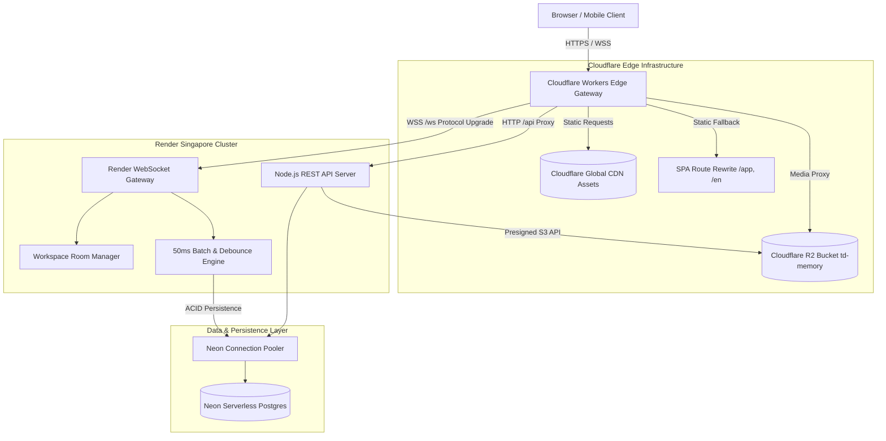

## Project Overview & Live Deployment

**Between Us** is an intimate digital sanctuary and infinite spatial memory canvas designed specifically for couples and close-knit groups. Moving beyond traditional algorithmic feeds and ephemeral chat logs, Between Us provides an interactive, tactile co-creation space where partners can pin memories, sync heartbeats in real-time, scratch collaborative love notes, and preserve relationship milestones forever.

The production platform is deployed live at [between.omnimer.io.vn](https://between.omnimer.io.vn/) under a custom domain managed by Cloudflare DNS, Workers, and Singapore-based application clusters.

```text
User Device (VN / Global)
          │
          ▼  [Sub-millisecond Edge Anycast CDN]
 Cloudflare Workers Edge Gateway (worker.ts)
  ├── 1. Static Asset Delivery (Next.js SPA via CF Assets, 0ms TTFB)
  ├── 2. Single-Page Application (SPA) Fallback (/app, /en)
  ├── 3. Google Site Verification Instant 200 OK Handler
  ├── 4. Real-time WebSocket Proxy (/ws) ───┐
  └── 5. REST API Reverse Proxy (/api/*)  ──┤
                                            │
                                            ▼  [Low-Latency Fiber]
                             Render Web Service (Singapore Region)
                               ├── Node.js / TypeScript App Core
                               ├── Socket.io / Native WS Rooms
                               └── Storage GC & Quota Engine
                                            │
                       ┌────────────────────┴────────────────────┐
                       ▼                                         ▼
            Neon PostgreSQL Serverless               Cloudflare R2 Storage (S3 API)
             - GIN Indexed JSONB Nodes                - Zero Egress Media Bucket
             - Hierarchical parent_id                 - 4K Photos & Voice Archives
```

---

## Production Deployment Topology

To balance global accessibility, sub-millisecond frontend delivery, and stateful real-time WebSockets on a cost-effective startup budget, Between Us uses a **hybrid multi-cloud edge architecture**:



### 1. Edge Gateway & Static Assets Server (`worker.ts`)

The entire client application is statically generated via Next.js (`output: 'export'`) and bundled directly into Cloudflare Workers Assets. Inbound requests to `between.omnimer.io.vn` hit Cloudflare's nearest edge node (e.g., Ho Chi Minh City or Hanoi for Vietnamese users):

- **Zero-Latency Static Delivery:** Static HTML, JS, CSS, and web fonts are served from Cloudflare's edge cache with sub-millisecond Time to First Byte (TTFB).
- **SPA Deep Routing Fallback:** For paths like `/app` (authenticated canvas workspace) and `/en` (international landing page), the Worker dynamically intercepts 404 responses from the asset store and rewrites the request to the matching SPA root without changing the browser address bar.
- **Header Normalization & Proxy Security:** When proxying REST or WebSocket calls, `worker.ts` injects `X-Forwarded-Host` and `X-Forwarded-Proto`, preserving the client's original TLS connection context while protecting backend origins.

```typescript
// Excerpt from worker.ts: Reverse Proxying & SPA Fallback
export default {
  async fetch(request: Request, env: Env): Promise<Response> {
    const url = new URL(request.url);
    const backendOrigin = (env.BACKEND_URL || DEFAULT_BACKEND_URL).replace(/\/+$/, '');

    // 1. WebSocket Protocol Upgrade
    if (url.pathname === '/ws' || request.headers.get('Upgrade') === 'websocket') {
      const targetWsUrl = new URL(backendOrigin);
      targetWsUrl.protocol = backendOrigin.startsWith('https') ? 'https:' : 'http:';
      targetWsUrl.pathname = url.pathname;
      targetWsUrl.search = url.search;
      return fetch(targetWsUrl.toString(), request);
    }

    // 2. REST API & Media Proxying
    if (url.pathname.startsWith('/api/') || url.pathname.startsWith('/uploads/')) {
      const targetApiUrl = `${backendOrigin}${url.pathname}${url.search}`;
      const proxyHeaders = new Headers(request.headers);
      proxyHeaders.set('X-Forwarded-Host', url.host);
      proxyHeaders.set('X-Forwarded-Proto', url.protocol.replace(':', ''));

      return fetch(new Request(targetApiUrl, {
        method: request.method,
        headers: proxyHeaders,
        body: ['GET', 'HEAD'].includes(request.method) ? undefined : request.body,
      }));
    }

    // 3. Static Assets & SPA Routing
    let assetResponse = await env.ASSETS.fetch(request);
    if (assetResponse.status === 404 && request.method === 'GET') {
      const fallbackPath = url.pathname.startsWith('/app') ? '/app' : '/';
      assetResponse = await env.ASSETS.fetch(new Request(new URL(fallbackPath, request.url), request));
    }
    return assetResponse;
  }
};
```

---

## Backend Infrastructure (Render Singapore)

The core application backend runs on Render as a dedicated Node.js service defined in `render.yaml`:

- **Geographic Proximity:** Configured in `region: singapore`, reducing network round-trip time (RTT) for users in Vietnam to ~25–35ms.
- **Zero-Downtime Blueprints:** Automated build and database migration pipeline (`npm install && npm run db:neon:init`) with health check verification (`/api/health`).
- **Stateful WebSocket Handling:** Keeps bidirectional WebSocket connections alive between partners, dispatching synchronized touch, live cursor tracking, and collaborative state updates.

```yaml
# render.yaml deployment blueprint
services:
  - type: web
    name: between-us-backend
    env: node
    plan: free
    region: singapore # Closest region to Vietnam
    rootDir: backend
    buildCommand: npm install && npm run db:neon:init
    startCommand: npm run start:server
    healthCheckPath: /api/health
    envVars:
      - key: NODE_ENV
        value: production
      - key: ANNIVERSARY_DATE
        value: "2026-05-30"
      - key: R2_BUCKET_NAME
        value: "td-memory"
      - key: R2_ENDPOINT
        value: "https://fd50c7a4f3c68704298fab3fd0aaf572.r2.cloudflarestorage.com"
```

---

## Serverless Database Architecture (Neon PostgreSQL)

Traditional relational databases require strict migrations every time a new interactive node type is introduced. Between Us solves this through **JSONB Inheritance & GIN Indexing**:

1. **Unified Polymorphic Node Schema:** All canvas elements (Polaroids, Heartbeat sensors, Scratchcards, Memory Jars, Maps, and Two Favorites) are stored in the core `nodes` table.
2. **Flexible Metadata (`meta_json`):** Node-specific state (scratch coverage percentages, target coordinates, color themes, and unlock conditions) is stored in a JSONB column indexed via PostgreSQL GIN (`idx_nodes_meta_json_gin`).
3. **Hierarchical Relationships (`parent_id`):** Allows recursive groupings (e.g., dropping multiple photo cards into a Memory Jar container).

```sql
-- Production database optimization for polymorphic interactive nodes
ALTER TABLE nodes ADD COLUMN IF NOT EXISTS parent_id UUID REFERENCES nodes(id) ON DELETE SET NULL;
ALTER TABLE nodes ADD COLUMN IF NOT EXISTS is_unlocked BOOLEAN DEFAULT TRUE;
ALTER TABLE nodes ADD COLUMN IF NOT EXISTS interaction_type VARCHAR(50);

-- GIN indexing for fast JSONB metadata querying
CREATE INDEX IF NOT EXISTS idx_nodes_parent_id ON nodes(parent_id);
CREATE INDEX IF NOT EXISTS idx_nodes_interaction_type ON nodes(interaction_type);
CREATE INDEX IF NOT EXISTS idx_nodes_meta_json_gin ON nodes USING gin(meta_json);
```

---

## Zero-Egress Media Storage (Cloudflare R2)

Consumer memory applications are photo- and audio-heavy. Traditional cloud storage providers (such as AWS S3) penalize growing platforms with steep **egress bandwidth fees** when users stream high-resolution memories.

- **Zero Egress Cost:** Cloudflare R2 provides complete S3 API compatibility with **$0 egress fees**, allowing users to upload and view uncompressed 4K photos and lossless voice messages without ballooning cloud bills.
- **Client Fallback Resilience:** The backend storage adapter (`backend/lib/r2.ts`) implements multi-bucket candidate resolution, automatically normalizing bucket names across deployment migrations (`td-memory` vs `hrm-agent`).

---

## Real-Time Event-Tiering Strategy

To maintain a fluid 60 FPS canvas experience while preventing WebSocket connection saturation and database bottlenecks, real-time events are divided into three distinct operational tiers:

| Event Tier | Frequency | Example Events | Technical Strategy |
| :--- | :---: | :--- | :--- |
| **High-Frequency** | 20–30 Hz | Scratching vectors (`scratch:draw_batch`), Live Map heartbeat reactions (`map:pin_react`) | **50ms Client Batching:** Client aggregates coordinate arrays; server broadcasts to room peers immediately without database I/O. |
| **Medium-Frequency** | 1–5 Hz | Touch progress ring (`node:touch:progress`), Jar shaking physics (`jar:shake`) | **150–200ms Debounce:** Broadcasts only on state threshold crossings; ephemeral memory state. |
| **Critical State** | On-Demand | Secret unlock (`node:touch:unlocked`), Date rating (`calendar:rate_event`), Scratchcard dissolved | **ACID Neon Commit:** Immediate transactional write to PostgreSQL followed by full payload room broadcast. |

---

## Server-Authoritative Timing & Sensory Physics

### 1. Anti-Clock-Tampering Heartbeat Sync

To prevent client-side timer manipulation (e.g., fast-forwarding local device clocks to force-unlock private secrets), the **Heartbeat Node** implements a strict server-authoritative timer:

1. When User A and User B touch the node simultaneously, the server verifies `touching_users.size >= required_quorum`.
2. The Node.js server launches a precise **2500ms authoritative timer**.
3. If any user lifts their finger before 2500ms elapses, the server cancels the countdown and broadcasts `node:touch:countdown_cancelled`.
4. Only upon natural timer completion does the server update `is_unlocked = true` in Neon DB and dispatch the secret payload.

### 2. Browser-Synthesized Audio & Haptics

Instead of loading heavy `.mp3` audio files over the network, Between Us synthesizes accelerating heartbeats directly in the client's browser using the **Web Audio API**:

- An `OscillatorNode` generates low-frequency sine pulses (45 Hz to 90 Hz).
- Pulse frequency (BPM) accelerates dynamically from 70 BPM to 130 BPM as the 2.5s threshold nears.
- Coupled with the Navigator Vibration API (`navigator.vibrate([30, 50, 30])`), partners experience synchronized auditory and tactile resonance regardless of distance.

---

## Technical Highlights & Key Takeaways

1. **Sub-millisecond Edge Delivery:** Leveraging Cloudflare Workers Assets eliminates web server bottlenecks for frontend delivery.
2. **Cost-Efficient Scalability:** The combination of Render free/starter compute, Neon serverless autoscaling, and Cloudflare R2 zero-egress storage allows the platform to support thousands of active couples at minimal operating cost.
3. **Polymorphic Database Design:** Using JSONB inheritance for interactive nodes enabled rapid feature iteration (from Heartbeat to Memory Jar) without complex schema migrations.
4. **Resilient Real-time Streaming:** Tiered event batching keeps WebSocket payload sizes under 2 KB, preventing packet loss over high-latency cellular networks.
