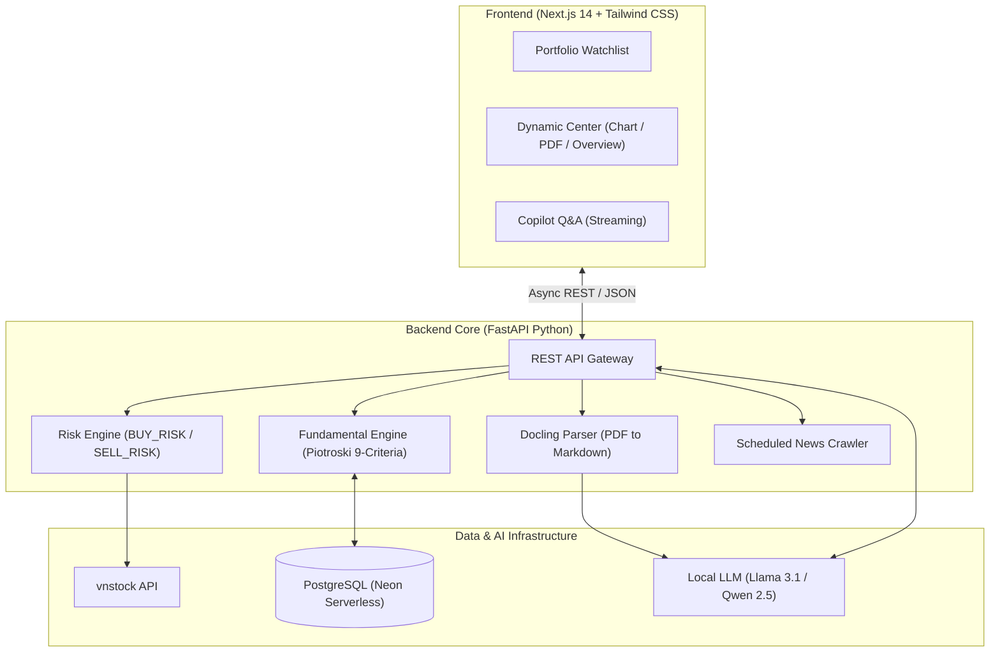

## Project Overview

**AI Finance Pro** is an enterprise-grade, automated financial analysis workspace designed to unify quantitative technical data, deep PDF financial statement extraction, and local AI reasoning into a single seamless dashboard.

For retail investors and financial analysts, evaluating market opportunities often involves hours of painful manual effort—sifting through fragmented news, manually parsing complex multi-page financial statements (BCTC), and making emotionally compromised trading decisions. AI Finance Pro solves this by cutting research time per ticker from **~45 minutes down to under 2 minutes**, providing a 100% objective, emotion-free risk scoring system.

## Core Features & MVP Walkthrough

### 1. Unified Multi-Dimensional Dashboard & PDF Viewer

A frictionless 3-panel workspace features a real-time watchlist on the left, an interactive central stage, and an AI copilot on the right. Users can instantly switch between a comprehensive algorithmic overview, technical charts, and embedded PDF reports without page reloads.

*   **Portfolio Watchlist:** Real-time tracking of personal holdings and key market movers.
*   **Instant Actionable Insights:** Algorithmic verdict coupled with MA20/MA50 and RSI status.
*   **Embedded High-Fidelity PDF Viewer:** Inspect original earnings releases side-by-side with AI summaries.

---

### 2. Conversational Financial Copilot & PDF Ingestion

Directly upload company earnings releases (`.pdf`). Our parsing pipeline preserves complex balance sheets, income statements, and cash flow structures into clean Markdown before feeding them into local AI.

*   **Document Parsing Engine:** Upload files up to 50MB; tables and footnotes stay intact via Docling.
*   **Context-Aware Q&A:** Ask complex questions backed by exact citations.
*   **Privacy-First AI:** Zero-hallucination local AI copilot powered by Ollama with strict no-financial-advice guardrails.

---

### 3. Professional Interactive Charting & Price Discovery

High-performance charting system equipped with moving averages, volatility bands, volume bars, and intraday boundaries.

*   **Technical Overlays:** One-click toggle for MA20, MA50, and Bollinger Bands.
*   **Multi-Horizon Analysis:** Rapid switching between 1M, 3M, 6M, 1Y, and 3Y timelines.

---

### 4. Quantitative Risk Engine & Decision Support

Eliminate subjective guesswork with mathematical risk modeling. Two independent risk indicators evaluate the hazards of buying or selling at any given moment.

*   **`BUY_RISK` (0-100):** Quantifies FOMO risk by scanning for bearish RSI divergence (`MOM_BEAR_DIV`) and abnormal volume surges.
*   **`SELL_RISK` (0-100):** Alerts when supply is exhausted to prevent panic selling at market bottoms.

---

### 5. Piotroski F-Score 9-Criteria Health Matrix

Complete fundamental health audit based on Joseph Piotroski's renowned 9-point criteria across three corporate finance pillars:
1. **Profitability** (ROA, CFO, etc.)
2. **Leverage & Liquidity** (Debt reduction, Current Ratio, etc.)
3. **Operating Efficiency** (Gross Margin, Asset Turnover, etc.)

---

## System Architecture

The platform architecture is built for performance and privacy, leveraging Next.js for the frontend, FastAPI for the backend core, and Ollama for local LLM inference.

## Security, Privacy & Guardrails

1.  **100% Local Inference:** Financial data and internal PDF documents remain private when running with local Ollama models.
2.  **Deterministic Financial Extractions:** Metrics are extracted directly from tables—no probabilistic rounding or hallucinated financial figures.
3.  **No-Advice Mandate:** Prompts are enforced with strict system guardrails. The AI delivers risk probabilities and factual analysis only, never speculative buy/sell commands.

[Explore the Source Code on GitHub](https://github.com/HuynhTri-dev/finance-analysis)
