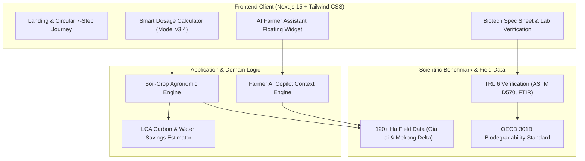

## Project Context and Vision

**ViNar (VinaGreen)** is a deep-tech circular agritech platform engineered to turn organic agricultural byproducts—specifically coffee husks from the Central Highlands and rice straw from the Mekong Delta—into high-performance biodegradable superabsorbents and plant protection materials:

```text
Coffee Husks & Rice Straw
           ↓
Bio-Refining & Cellulose Extraction
           ↓
Cross-Linked AgriGel™ (450× Water Retention) & BioBandage™ (Salt Barrier)
           ↓
Field Application & Smart Dosage Model (Tree Species + Soil Profile)
           ↓
Continuous Root Hydration & Salt Shielding (21 Days Unwatered)
           ↓
100% Decomposition into Nutrient-Rich Soil Humus (0% Microplastics)
```

Traditional agricultural operations in Vietnam face escalating climatic pressures: intense dry-season droughts in the Central Highlands and severe seasonal saltwater intrusion across the Mekong Delta. Simultaneously, millions of tons of crop residue are openly burned each year, worsening air quality and carbon emissions.

ViNar bridges biotechnology and software engineering to provide:
1. **High-yield bio-retention materials** replacing hazardous petroleum-based polyacrylamide polymers.
2. **Interactive digital tools and an AI Farmer Assistant** that equip farm operators with precision dosage calculations, agronomic guidance, and soil management insights.
3. **A verifiable path toward Vietnam's Net Zero 2050 commitment**, turning environmental liabilities into sustainable livelihoods for farming communities.

> **Core Philosophy:** "Waste is not discarded material; it is biological gold." Technology serves people and the environment by establishing closed-loop circular systems where nothing is lost and all nutrients return to the soil.

<div class="my-8 overflow-hidden rounded-2xl border border-slate-800 bg-slate-950/60 p-2">
  
</div>

---

## Problem Statement

Vietnamese agriculture stands at the intersection of climate vulnerability and unsustainable soil inputs:

1. **Prolonged Droughts in the Central Highlands:** Coffee, durian, and pepper plantations routinely endure dry spells extending 3 to 5 months. Pumping groundwater requires substantial diesel consumption, depleting aquifers and costing growers millions of VND per hectare each season.
2. **Salinity Intrusion in the Mekong Delta:** Seasonal tidal surges push saltwater concentrations above 3‰ into estuaries. High salinity burns delicate feeder roots (*rễ tơ*), stunting tree vitality and destroying entire harvest cycles.
3. **Open-Air Waste Combustion:** Approximately 40 million tons of rice straw and coffee husks are incinerated or dumped annually, emitting dense particulate matter and greenhouse gases.
4. **Toxic Chemical Hydrogels:** Conventional superabsorbent polymers (SAPs) rely on synthetic polyacrylamides. When they degrade, they leave toxic monomer residues and indestructible microplastics that permanently impair soil porosity and microbiology.

ViNar directly counters these four crises with a 100% natural, polysaccharide-based alternative validated to OECD 301B biodegradability standards.

---

## Core Innovations and Capabilities

### 1. AgriGel™ 450× Bio-Hydrogel & BioBandage™ Salt Shield

At the heart of ViNar are two proprietary biotech formulations synthesized from modified agricultural cellulose:

*   **AgriGel™ Crystals:** Absorb up to **450 times** their dry weight in water within 180 seconds. Formulated as compressed pellets, AgriGel establishes microscopic water reservoirs directly around the root zone, releasing moisture continuously over a 15–21 day drying cycle.
*   **BioBandage™ Root Wrap:** Designed specifically for coastal regions confronting saltwater intrusion. It actively chelates and blocks **88.4% of sodium (Na⁺) and chloride (Cl⁻) ions**, insulating fragile feeder roots for 90 to 120 days until salinity recedes.

<div class="my-8 grid grid-cols-1 md:grid-cols-2 gap-4">
  <div class="overflow-hidden rounded-2xl border border-slate-800 bg-slate-950/60 p-2">
    
    <p class="mt-2 text-xs text-center text-slate-400 font-mono">AgriGel™ 450× micro-reservoir absorption under root simulation</p>
  </div>
  <div class="overflow-hidden rounded-2xl border border-slate-800 bg-slate-950/60 p-2">
    
    <p class="mt-2 text-xs text-center text-slate-400 font-mono">Field trial comparison: untreated soil vs. AgriGel-treated soil after 21 days without irrigation</p>
  </div>
</div>

---

### 2. 7-Step Closed-Loop Circular Journey

ViNar implements an end-to-end biological cycle where agricultural byproducts are sourced, converted, deployed, and naturally integrated back into the earth:

<div class="my-8 overflow-hidden rounded-2xl border border-slate-800 bg-slate-950/60 p-4">
  
</div>

1. **Farmer Livelihood Enhancement:** Direct contracting with agricultural cooperatives to purchase discarded straw and husks, generating 2.8 – 4.2M VND/month in supplemental household income.
2. **Standardized Raw Material Logistics:** Sourcing and dry-processing coffee husks from Gia Lai/Đắk Lắk and rice straw from the Mekong Delta.
3. **Bio-Refining & Pelletization:** Proprietary mechanical-chemical cross-linking that transforms raw cellulose into non-toxic hydrogel granules without petroleum polymers.
4. **Targeted Drought & Salinity Defense:** Applying pellets to planting pits, maintaining 68–75% root soil moisture throughout peak hot seasons.
5. **Operational Cost Savings:** Reducing irrigation runs by up to 3 cycles per crop, saving ~2.8M VND/hectare in fuel and generator electricity costs.
6. **Humus Generation & Soil Conditioning:** Over 6 to 8 months, the material completely biodegrades into rich organic humus, boosting soil beneficial bacteria.
7. **Bountiful Harvest & Next-Cycle Renewal:** Higher crop yield and quality produce raw materials for subsequent production seasons, closing the ecological loop.

---

### 3. Smart Agricultural Dosage Calculator (Model v3.4)

Precision application is vital for agricultural inputs. ViNar features an integrated, real-time dosage modeling engine allowing agronomists and farmers to parameterize their plots:

*   **Target Crops:** Calibrated models for Durian (*Sầu riêng*), Robusta Coffee (*Cà phê vối*), Pomelo/Citrus (*Bưởi/Cam*), and Wet Rice/Short-cycle crops (*Lúa*).
*   **Acreage Scaling:** Dynamic slider supporting scale from 0.5 to 20 hectares.
*   **Soil Chemistry Profiling:**
    *   *Bazan Red Soil (Central Highlands):* High permeability, susceptible to rapid desiccation; optimized for vertical moisture retention.
    *   *Alluvial Sediment (Mekong Delta):* Dense texture, requiring enhanced fertilizer adsorption and nutrient buffering.
    *   *Coastal Saline Soils (>2.5‰):* Triggering BioBandage™ ionic salt-blocking ratios.
*   **Output Metrics:** Computes exact total kilogram requirements, per-tree dispersal rates (e.g., 45g – 55g per drip line), estimated percentage of irrigation water conserved (~42%), and projected fuel cost savings.

---

### 4. AI Farmer Assistant & Interactive Copilot

To democratize biotech guidance, the platform integrates an AI Farmer Copilot accessible across devices:

*   **Agronomic Guidance:** Instant responses concerning dosage timing, companion crop practices, and seasonal weather adaptations.
*   **Pest & Disease Advisory:** Guidelines for integrating bio-hydrogels alongside biological pest control and organic fertilizers.
*   **Zero Complex Jargon:** Translates complex biochemical and soil parameters into clear, step-by-step instructions that farmers can immediately execute in the field.

---

## System Architecture

The ViNar digital platform is engineered with modern full-stack technologies to deliver instant feedback, fluid animations, and high performance even under low-bandwidth rural network conditions:



### Technical Highlights

*   **Next.js 15 & Turbopack:** Server-rendered landing pages with optimized client hydration, achieving sub-second Largest Contentful Paint (LCP).
*   **Custom Design System:** Organic color palette inspired by nature (Forest Greens `#2E5C38`, Moss Green `#82AC42`, Warm Timber, Cream), enhanced with CSS 3D surface shadows and responsive micro-interactions.
*   **Deterministic Mathematical Modeling:** Dosage logic implemented with reactive client-side computations for instantaneous slider feedback without server roundtrips.
*   **Accessible Bilingual Architecture:** Vietnamese-first localization with English internationalization support.

<div class="my-8 grid grid-cols-1 md:grid-cols-2 gap-4">
  <div class="overflow-hidden rounded-2xl border border-slate-800 bg-slate-950/60 p-2">
    
    <p class="mt-2 text-xs text-center text-slate-400 font-mono">Biochemical characterization of polysaccharide matrices in high-tech lab</p>
  </div>
  <div class="overflow-hidden rounded-2xl border border-slate-800 bg-slate-950/60 p-2">
    
    <p class="mt-2 text-xs text-center text-slate-400 font-mono">100% microplastic-free, crystal-clear water-retention hydrogel</p>
  </div>
</div>

---

## Field Validation and Impact

ViNar has transitioned beyond the conceptual phase to active field testing under real-world agricultural conditions:

| Parameter | Laboratory / Field Result | Standard / Methodology |
| :--- | :--- | :--- |
| **Component Composition** | 100% Polysaccharide & Agriculture Cellulose | Fourier-Transform Infrared (FTIR) |
| **Max Water Absorption** | 400g – 450g H₂O per 1g dry material | ASTM D570 Standard |
| **Swelling Saturation Speed** | < 180 seconds upon moisture contact | Dynamic Adsorption Gravimetry |
| **Root Hydration Cycle** | 15 – 21 days per single water saturation | 30cm Depth Capacitance Soil Sensor |
| **Soil Active Lifespan** | 6 – 8 months (180 – 240 days) | Gia Lai Field Burial Verification |
| **Saline Ion Blockade** | 88.4% blockage under salinity > 3‰ | EC Electrical Conductivity & Ion Chromatography |
| **Toxicity & Residue** | 0% Polyacrylamide, 100% humus degradation | OECD 301B Biodegradability Standard |
| **Technology Readiness** | **TRL 6** (Field Pilot scale: 120+ hectares) | Independent Science & Innovation Council |

### Strategic Partnerships

The initiative is developed and supported in coordination with:
*   **GreenHeart Vietnam:** Eco-agriculture partnership in the Mekong Delta (Rice - Shrimp ecological model).
*   **Vietnam Academy of Science and Technology:** Analytical backing for Fourier-transform infrared spectroscopy (FTIR) and soil toxicity metrics.
*   **Central Highlands Agriculture Cooperatives:** Multi-hectare testing across durian and coffee orchards in Gia Lai and Đắk Lắk.
*   **Omnimer Team:** Core software engineering, product design, and AI agent architecture.

---

## Live Platform

Experience the interactive dosage tool, circular bio-economy walkthrough, and platform capabilities live:

*   **Live Web Application:** [vinagreen.omnimer.io.vn](https://vinagreen.omnimer.io.vn/)
*   **Omnimer Team Ecosystem:** [github.com/omnimerteam](https://github.com/omnimerteam)
